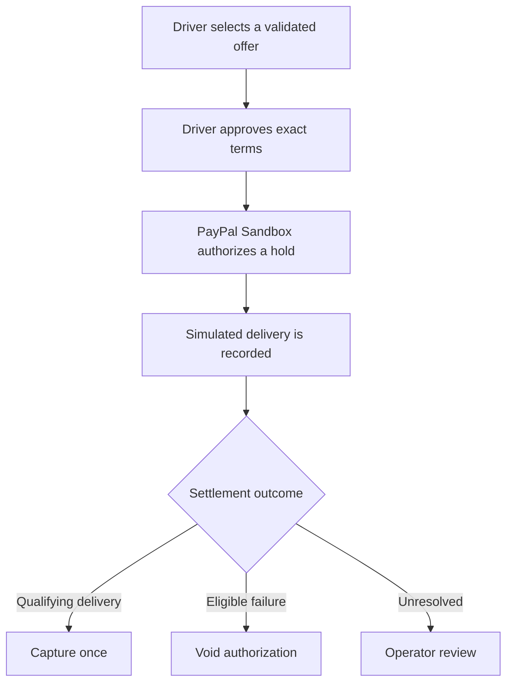
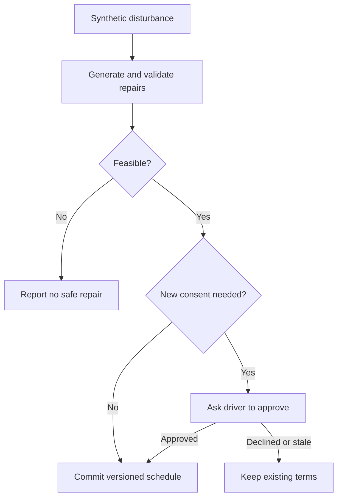
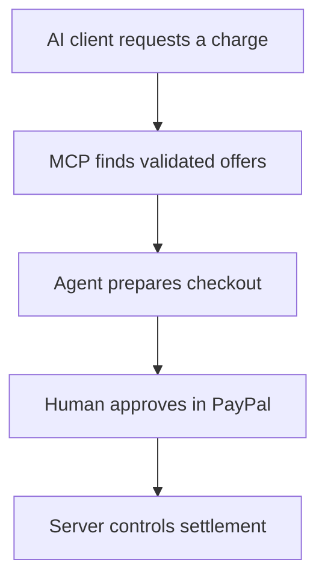

<div align="center">


# GridWindow FlexPay

### Your car charges when it makes sense. Your payment waits until delivery.

**Flexible EV charging · PayPal-backed settlement · AI-assisted recovery · Human-controlled decisions**


[](https://github.com/piyusha-sayal/gridwindow-flexpay/actions/workflows/ci.yml)
[](https://developer.paypal.com/)
[](https://www.typescriptlang.org/)
[](LICENSE)

**[Live app](https://gridwindow-flexpay.onrender.com/)** · **[Smart Charge](https://gridwindow-flexpay.onrender.com/drive)** · **[Developer portal](https://gridwindow-flexpay-developers.onrender.com/)** · **[Judge guide](docs/JUDGES.md)**

<sub>Publicly hosted on Render · PayPal Sandbox test funds · Synthetic charging and grid data</sub>

<br />


</div>

---

## The problem we are solving

EVs often sit parked overnight, but shared charging sites have a limited power budget. Charging every car immediately can create expensive peaks. Moving everyone to a cheap hour can overload the same site. And when a charger fails, a cheap schedule is not enough: the driver needs a trustworthy new plan and a fair payment outcome.

**What makes it different:** most charging tools focus on finding a time slot. GridWindow handles what happens after the driver says yes: consent, changing site conditions, auditable recovery, and settlement tied to delivered energy.

| For drivers | For site operators | For payments |
| :--- | :--- | :--- |
| Energy ready by the agreed deadline, with transparent modeled savings | A validated schedule that respects port occupancy and site capacity | Authorize the agreed amount first; capture after qualifying delivery or void after an eligible failure |

## Try the working product

<table>
<tr>
<td align="center" width="33%" valign="top">
<h3>Driver</h3>
<p>Ask for 30 kWh by 7 AM, compare offers, and review the exact terms.</p>
<a href="https://gridwindow-flexpay.onrender.com/drive"><strong>Open Smart Charge</strong></a>
</td>
<td align="center" width="33%" valign="top">
<h3>Operator</h3>
<p>Inspect reservations, AG Grid payment states, the Bryntum schedule, and recovery.</p>
<a href="https://gridwindow-flexpay.onrender.com/operator"><strong>Open console</strong></a><br />
<sub>Passphrase required</sub>
</td>
<td align="center" width="33%" valign="top">
<h3>Judge</h3>
<p>Follow the hosted walkthrough and inspect real Sandbox evidence.</p>
<a href="docs/JUDGES.md"><strong>Open judge guide</strong></a>
</td>
</tr>
</table>

**Quick judge route:** [Home](https://gridwindow-flexpay.onrender.com/) → [Smart Charge](https://gridwindow-flexpay.onrender.com/drive) → [Rewards](https://gridwindow-flexpay.onrender.com/rewards) → [Impact Lab](https://gridwindow-flexpay.onrender.com/impact-lab) → [API portal](https://gridwindow-flexpay-developers.onrender.com/). The operator console and Sandbox buyer checkout require the access instructions in Devpost.

<sub>The hosted app may need a short cold start on Render's free tier.</sub>

---

## See it working

### 1. Driver offer and delivery receipt

<table>
<tr>
<td align="center" width="50%" valign="top">
<strong>Compare validated charging offers</strong>
<p><a href="docs/evidence/final-release-2026-11-11/01-product/05-validated-charging-offers.png"></a></p>
<sub>Local synthetic charging, MOCK payment, deterministic fallback</sub>
</td>
<td align="center" width="50%" valign="top">
<strong>Smart Charge on mobile</strong>
<p><a href="docs/evidence/final-release-2026-11-11/08-responsive/02-mobile-smart-charge.png"></a></p>
<sub>Responsive driver request form on a phone</sub>
</td>
</tr>
</table>

### 2. Operator console

<div align="center">
<a href="docs/evidence/final-release-2026-11-11/03-operator-ag-grid/01-operator-dashboard.png"></a>

<sub>Live station overview, operational status, and AG Grid-backed reservations</sub>
</div>

### 3. Recovered charging schedule

<div align="center">
<a href="docs/evidence/final-release-2026-11-11/04-bryntum-recovery/07-updated-bryntum-schedule.png"></a>

<sub>Synthetic disturbance, validated recovery, driver approval, and a persisted schedule version</sub>
</div>

---

## How the charging and payment flow works



PayPal authorization is a **hold, not a charge or escrow**. The server verifies the approved amount, merchant and terms; records energy delivery separately; and uses provider-confirmed capture or void states. Idempotency, webhook signature verification and reconciliation guard against repeated or uncertain payment operations.

### Both financial outcomes have been exercised on the hosted site

<table>
<tr>
<td width="50%" align="center" valign="top">
<strong>Delivered energy, payment captured</strong>
<p><a href="docs/evidence/final-release-2026-11-11/02-paypal/06-flexreceipt.png"></a></p>
<sub>30.02 kWh simulated · $15.56 Sandbox capture</sub>
</td>
<td width="50%" align="center" valign="top">
<strong>Charging failure, nothing collected</strong>
<p><a href="docs/evidence/final-release-2026-11-11/02-paypal/08-zero-charge-receipt.png"></a></p>
<sub>Authorization voided · $0.00 collected</sub>
</td>
</tr>
</table>

The live release also records **recovery followed by PayPal Sandbox settlement**: one driver-approved recovery was captured after delivery, and one operator-attributed disruption with no feasible recovery resulted in a void. The [judge guide](docs/JUDGES.md) identifies the corresponding records in the operator console.

---

## Recovery that respects the original deal

When a port loses power, the site cap drops, or a departure deadline moves, GridWindow runs a recovery workflow against the **remaining energy**. It proposes only schedules that pass deterministic checks. A change outside the driver's approved terms waits for fresh consent.



The operator can see the original plan, proposed change, validation results, consent state, and committed plan in **Bryntum Scheduler**. The selected night stays in sync with the operator console, and a recovery's financial step is not marked complete before PayPal confirms the capture or void.

**The safeguards:** past energy is immutable, other drivers' reservations are protected, stale approvals are rejected, and AI cannot override the physical validator or payment rules.

---

## AI can assist, but the driver stays in control

**Gemini** interprets charging requests and explains server-priced offers. A deal agent can recommend an option that meets the driver's goals. **OpenRouter** is configured as a backup; when models are unavailable, the product uses a labeled deterministic fallback.

GridWindow also exposes **seven MCP tools** so compatible AI clients can discover charging options and prepare a checkout. The agent stops at the approval link. Only the human buyer can complete PayPal consent.



| AI can | AI cannot |
| :--- | :--- |
| Parse a natural-language request | Set its own price or merchant |
| Explain verified quotes and recommend feasible offers | Approve a purchase or move money |
| Select from server-approved recovery candidates | Invent a recovery plan or rewrite delivered energy |

---

## The integrations behind the experience

| Technology | What it does in GridWindow |
| :--- | :--- |
| **[PayPal](https://developer.paypal.com/)** | Sandbox Orders and Payments APIs, authorization, capture, void, signed webhooks and reconciliation |
| **[Gemini](https://ai.google.dev/)** + **[OpenRouter](https://openrouter.ai/)** | Request parsing, deal recommendations, explanations and constrained recovery assistance with fallback |
| **[Bryntum](https://bryntum.com/products/scheduler/)** | Per-port timeline, pending recovery proposals and persisted schedules |
| **[AG Grid](https://www.ag-grid.com/)** | Operator reservation table, filters, payment-state inspection and CSV export |
| **[Channel3](https://trychannel3.com/)** | Live EV accessory listings in [Rewards](https://gridwindow-flexpay.onrender.com/rewards) and agent gear search |
| **[APIMatic](https://www.apimatic.io/)** | [Public developer portal](https://gridwindow-flexpay-developers.onrender.com/), [OpenAPI contract](docs/openapi.yaml) and [TypeScript SDK](apimatic/sdk/typescript/) |
| **[Model Context Protocol](https://modelcontextprotocol.io/)** | Agent-accessible charging discovery and checkout preparation with a human approval boundary |
| **[Render](https://render.com/)** | Hosted [application](https://gridwindow-flexpay.onrender.com/) and [developer portal](https://gridwindow-flexpay-developers.onrender.com/) |

<table>
<tr>
<td align="center" width="50%" valign="top">
<strong>Channel3 in Rewards</strong>
<p><a href="docs/evidence/final-release-2026-11-11/06-channel3/02-channel3-product-cards.png"></a></p>
</td>
<td align="center" width="50%" valign="top">
<strong>APIMatic developer portal</strong>
<p><a href="docs/evidence/final-release-2026-11-11/07-apimatic/03-accept-offer-api-reference.png"></a></p>
</td>
</tr>
</table>

---

## The modeled impact

The benchmark compares four scheduling strategies across **500 seeded synthetic nights and 1,500 charging requests**. All strategies use the same modeled station, building loads and tariffs.

<div align="center">
<table>
<tr>
<td align="center" width="33%"><strong>48.7% lower</strong><br /><sub>Mean modeled energy cost per served session<br />$10.61 to $5.44</sub></td>
<td align="center" width="33%"><strong>20.4% lower</strong><br /><sub>Mean site peak<br />22.1 to 17.6 kW</sub></td>
<td align="center" width="33%"><strong>22.5% more</strong><br /><sub>Requests served vs static off-peak<br />1,024 to 1,254</sub></td>
</tr>
</table>
</div>

| Scheduling policy | Served / 1,500 | Mean modeled cost / served session | Mean site peak |
| :--- | ---: | ---: | ---: |
| Immediate | 1,246 | $10.61 | 22.1 kW |
| Static off-peak | 1,024 | $6.01 | 20.2 kW |
| Greedy cheapest tariff | 1,243 | $6.86 | 21.9 kW |
| **GridWindow optimized** | **1,254** | **$5.44** | **17.6 kW** |

The cost and peak improvements above compare GridWindow with **immediate charging**; the served-request improvement compares it with **static off-peak**. GridWindow served only eight more requests than immediate charging, and **125 pairwise comparisons** were unfavorable. Another **246 requests were physically infeasible** for the optimizer. These are model results, not measured utility savings or guaranteed real-world outcomes.

---

## Tested, deployed, and reproducible

The latest [v1.0.0 release](https://github.com/piyusha-sayal/gridwindow-flexpay/releases/tag/v1.0.0), published November 11, 2026, reports:

| Verification | Result |
| :--- | :--- |
| Unit and integration tests (Vitest) | **1,023 passed**, 12 skipped, 0 failed |
| Browser tests (Playwright) | **131 passed**, 6 skipped, 0 failed |
| TypeScript, ESLint, production build, release scan | **Passed** |
| Generated API SDK and CI | **Passed** |
| Live PayPal Sandbox | **Provider-confirmed capture and void**, including settlement after recorded recovery |
| Public access | **App and API portal available on Render** |

The screenshots show both live PayPal Sandbox activity and labeled local MOCK tests. A model-selected *final* recovery decision is not claimed: the deterministic fallback can finish a recovery safely if a provider fails.

### Run locally without external accounts

Requires [Node.js 22+](https://nodejs.org/) and Git. This starts an isolated demo with simulated charging, a MOCK payment provider and embedded PGlite.

<details open>
<summary><strong>macOS, Linux, or Git Bash</strong></summary>

```bash
git clone https://github.com/piyusha-sayal/gridwindow-flexpay.git
cd gridwindow-flexpay
npm ci
npm run build

PAYMENT_MODE=mock PAYPAL_ENV=sandbox DEMO_TOOLS=true \
APP_BASE_URL=http://localhost:3000 \
SESSION_SECRET=local-demo-session-secret-change-me-0123456789 \
OPERATOR_PASSPHRASE=local-demo-operator \
npm start
```

</details>

<details>
<summary><strong>Windows PowerShell</strong></summary>

```powershell
git clone https://github.com/piyusha-sayal/gridwindow-flexpay.git
cd gridwindow-flexpay
npm ci
npm run build

$env:PAYMENT_MODE="mock"
$env:PAYPAL_ENV="sandbox"
$env:DEMO_TOOLS="true"
$env:APP_BASE_URL="http://localhost:3000"
$env:SESSION_SECRET="local-demo-session-secret-change-me-0123456789"
$env:OPERATOR_PASSPHRASE="local-demo-operator"
npm start
```

</details>

Open `http://localhost:3000`. The sample secret and passphrase are **local-only placeholders**. Use private, strong values outside this isolated setup.

For further test steps, seeded evidence nights, operator access requirements and PayPal Sandbox instructions, use the **[judge guide](docs/JUDGES.md)**.

---

## Built by

<div align="center">
<table>
<tr>
<td align="center" width="50%"><a href="https://github.com/piyusha-sayal"></a><br /><strong>Piyusha Sayal</strong><br /><sub>Co-creator</sub><br /><a href="https://github.com/piyusha-sayal">GitHub</a></td>
<td align="center" width="50%"><a href="https://github.com/satyamamarpandey"></a><br /><strong>Satyam Pandey</strong><br /><sub>Co-creator</sub><br /><a href="https://github.com/satyamamarpandey">GitHub</a> · <a href="https://pandeysatyam.com/#satyam-pandey">Website</a></td>
</tr>
</table>
</div>

**License:** [MIT](LICENSE). Copyright © 2026 Piyusha Sayal and Satyam Pandey.

<div align="center">

### Flexible charging. Verified delivery. Accountable payment.

[Live app](https://gridwindow-flexpay.onrender.com/) · [Judge guide](docs/JUDGES.md) · [Back to top](#gridwindow-flexpay)

</div>
