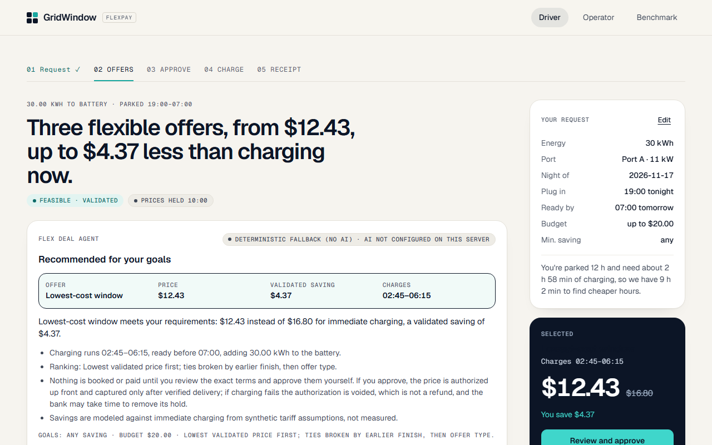
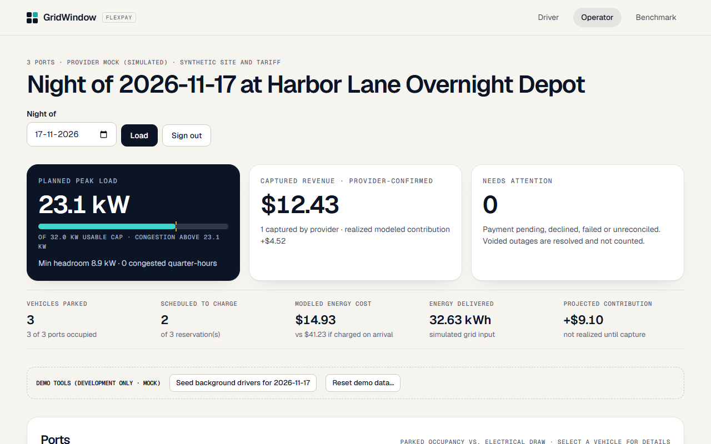
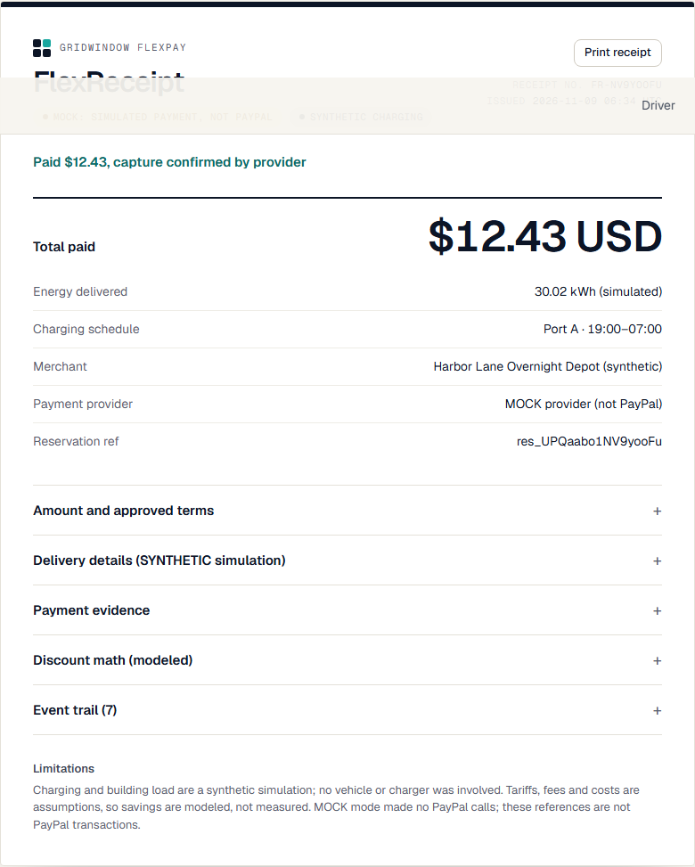
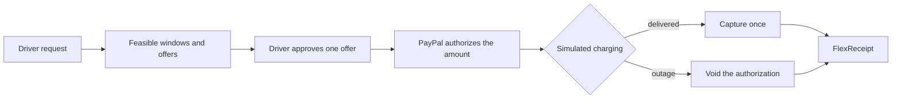

<div align="center">

# GridWindow FlexPay

**Smarter EV charging windows, AI-assisted offer selection, and PayPal payment authorization that is captured only after energy is delivered.**

[](LICENSE)
[](https://nextjs.org/)
[](https://www.typescriptlang.org/)
[](https://nodejs.org/)


</div>

GridWindow FlexPay is a working web application for overnight EV charging at a shared site. A driver says how much energy they need, when they leave and what they will spend. A deterministic engine finds charging windows that are physically feasible and good for both sides, and the driver approves one exact offer. PayPal authorizes the amount, a simulated charging session runs, and the app captures the payment once delivery is verified. If delivery fails, it voids the authorization instead.

What sets it apart is that the money follows the energy. Most pay-now checkout flows take payment before anything is delivered. Here the payment state is driven by a delivery record, and an AI assistant helps people understand offers without any authority over price, consent or payment.

## Screenshots

Captured from the running app in MOCK mode with seeded synthetic data. Nothing here is a real transaction.

<table>
  <tr>
    <td width="50%"></td>
    <td width="50%"></td>
  </tr>
  <tr>
    <td align="center"><sub><b>Driver:</b> offers and modeled pricing</sub></td>
    <td align="center"><sub><b>Operator:</b> sessions and controls</sub></td>
  </tr>
  <tr>
    <td colspan="2" align="center"><br><sub><b>FlexReceipt:</b> simulated delivery and MOCK payment outcome</sub></td>
  </tr>
</table>

> **Scope.** Charging, building load, tariffs, fees and savings are a transparent simulation with modeled numbers. Payments run against the PayPal Sandbox or a clearly labeled MOCK provider. No real vehicle is charged and no real money moves. See [Limitations](#limitations-and-transparency).

## The problem

- Overnight charging demand tends to pile up in the same expensive hours.
- Many drivers do not care when the car charges, as long as it is ready on time.
- A site operator has a hard power limit and has to fit every session under it.
- A pay-now checkout cannot show that a payment depends on energy actually being delivered.

## How GridWindow approaches it

1. **Scheduling.** Each request is planned in 15-minute slots against the site's power cap, port limits and charging efficiency. An independent validator re-checks every plan.
2. **Offers that help both sides.** A flexible offer is published only if the driver gets a discount and the operator's modeled contribution improves. Otherwise the driver sees only immediate charging.
3. **Payment tied to delivery.** PayPal authorizes the exact approved amount first. Capture happens once, after delivery. Failure leads to a void.
4. **Bounded AI.** The assistant fills in forms, explains offers and answers questions about a reservation. It has no tools and cannot set a price, grant consent or move money.

## Features

### For drivers
- Request by form or in plain language: energy needed, plug-in time, ready-by time and budget.
- Compare immediate charging with flexible windows, with the modeled savings and the assumptions behind them shown next to each offer.
- Approve one immutable offer: exact merchant, amount, currency and terms, with an expiry.
- Follow the reservation through authorization, charging, capture or void.
- A savings-goal helper recommends among the offers that already qualify. It never approves or pays.
- A printable **FlexReceipt** joining the approved terms, the simulated delivery record and the payment states read back from the provider.

### For operators
- Passphrase-protected console with reservations and a night timeline.
- Site load plan against the configured cap (24 kW on the demo station, whose three ports are rated 3.6, 7.2 and 11 kW), with port occupancy shown separately from electrical draw.
- Run the simulated night, inject a charger outage, and reconcile payment state against the provider.
- Per-reservation payment status and an event trail.

### PayPal integration
- Orders v2 and Payments v2 over REST: authorize before charging, capture after verified delivery, void on failure.
- Signed webhooks are verified against the unaltered raw body, correlated to a reservation and de-duplicated.
- The server recomputes every amount from the stored offer and checks the order's payee, amount and currency before authorizing.
- Reconciliation reads the provider's state back rather than trusting the browser.

### AI and optimization
- Google Gemini (through the Google Gen AI SDK) when `GEMINI_API_KEY` is set. An Anthropic key is also supported.
- Without a key, or on any provider failure, a labeled deterministic parser and explainer runs instead. The app works fully either way.
- Every number the model shows is checked against backend facts, and unverifiable answers are replaced with deterministic text.

## How it works



1. The driver submits energy, times and a budget.
2. The engine evaluates feasible windows and publishes only offers that pass the economic rules.
3. The driver approves the exact terms, and PayPal authorizes that amount. Nothing is collected yet.
4. The simulated session runs, or an operator injects an outage.
5. Delivered energy leads to a single capture. A failure leads to a void.

An authorization is a hold, not escrow. PayPal typically honors it for 3 days and it stays valid for up to 29. The app does not capture after expiry.

## Autonomous Charging Recovery

When a charger is limited, a site cap drops, a driver leaves early or a charger fails, the agreed plan may no longer work. The recovery engine re-plans only that session's remaining energy from the disturbance's effective slot onward. Energy already delivered stays as it was, and the price and other sessions do not change.

- **What it does.** An operator records a synthetic disturbance from `/operator`. The server validates it, then runs one recovery per disturbance. It either commits a new schedule version, asks the driver to approve a change, or reports the physical constraint that blocks every schedule (for example, a failed charger cannot move energy to another port).
- **Safety model.** Gemini, when configured, selects only among candidates the server has already validated, by server-assigned id. The server owns the schedule and the money. The agent has no payment tools and no price input. Unknown tools, extra arguments and out-of-phase calls are rejected and traced, and a model failure falls back to the deterministic path.
- **Consent boundary.** Auto-commit only when the forecast plan reaches the agreed battery energy (a planned figure; actual delivery is decided by the synthetic ledger), the price does not rise, the departure does not move later, charging stays inside the plugged-in window, and past energy and other sessions are unchanged. A later finish, an earlier departure or a changed price needs the driver's approval on the reservation page. Approval applies only the exact proposal version, and a stale or expired proposal is refused.
- **Fencing.** Each run holds a lease. Trace writes and schedule commits are conditional on it, so a stalled or duplicate worker cannot double-commit. Runs are bounded to three attempts.
- **Outdated sessions and failure policy.** For new agreements the settlement policy is: "An operator-attributable, unrecoverable failure to deliver the agreed energy by the deadline is eligible for a FULL authorization void and ZERO customer charge. This may include partial physical energy delivery." Early departures and non-conclusive outcomes go to operator resolution, and nothing is captured partially or because a deadline passed. Agreements made before this policy keep the earlier rules. See [docs/ARCHITECTURE.md](docs/ARCHITECTURE.md).
- **Operator schedule.** `/operator/schedule` draws the persisted schedule with Bryntum Scheduler Community 8.0.0. The chart is read-only, and pending proposals appear as a separate lane. The accessible table beside it is the reference view. Bryntum's own grid has known axe findings (see [docs/BRYNTUM_NOTES.md](docs/BRYNTUM_NOTES.md)).
- **Synthetic disturbance injector.** Disturbances are labeled SYNTHETIC. No real charger or grid is connected.
- **Benchmark.** `npm run benchmark:recovery` compares leaving the plan unchanged with recovery over 200 seeded nights. It reports unfavorable and infeasible cases alongside the wins. See [docs/RECOVERY_BENCHMARK.md](docs/RECOVERY_BENCHMARK.md). These are modeled numbers, not field measurements.
- **Limitations.** Recovery plans against forecast base load, and the replay uses realized base load, so a recovered schedule can deliver less than the static plan in some cases. Auto-commit can raise the operator's energy cost against the agreed plan; this is an open decision. Real Gemini recovery decisions and PayPal Sandbox recovery settlement have not been run. The guided demo's "Failure and recovery" scenario still uses the older outage injection (see [docs/DEMO_SCRIPT.md](docs/DEMO_SCRIPT.md)).

## Architecture

| Layer | Path | Responsibility |
|---|---|---|
| Domain | `src/domain/` | Pure, deterministic logic in integer units (cents, W, Wh): allocator, independent validator, economics, quotes and terms hash, simulator, payment state machine, benchmark |
| Payments | `src/payments/` | `PaymentGateway` contract with `PayPalSandboxGateway` (REST) and `MockGateway` |
| Server | `src/server/` | Database client and migrations, repositories, services (quote, checkout, settlement, reconcile, webhook), env guard, HTTP security helpers |
| App | `src/app/` | Next.js App Router pages and API routes |

**Stack.** Next.js 16, React 19, strict TypeScript, Zod, PostgreSQL via embedded PGlite by default (or a PostgreSQL server through `DATABASE_URL`, same migrations), Vitest and Playwright.

**Safety properties.** Compare-and-set state transitions. A unique settlement index makes capture-after-void impossible. `PayPal-Request-Id` idempotency. Webhook verification against the raw body. Append-only event and energy tables. Startup refuses any `PAYPAL_ENV` other than `sandbox`.

More detail is in [docs/ARCHITECTURE.md](docs/ARCHITECTURE.md).

## Quick start (MOCK mode, no credentials)

This needs no PayPal, Gemini or Neon account and no webhook tunnel. It uses the built-in MOCK payment provider and an embedded database that is created on first start.

Requirements: Node.js 22 or newer and git. `npm run build` downloads the Geist fonts from Google Fonts once, so it needs network access.

**macOS, Linux or Git Bash**

```bash
git clone https://github.com/piyusha-sayal/gridwindow-flexpay.git
cd gridwindow-flexpay
npm ci
npm run build
PAYMENT_MODE=mock PAYPAL_ENV=sandbox DEMO_TOOLS=true \
APP_BASE_URL=http://localhost:3000 \
SESSION_SECRET=local-demo-session-secret-change-me-0123456789 \
OPERATOR_PASSPHRASE=local-demo-operator \
npm start
```

**Windows PowerShell**

```powershell
git clone https://github.com/piyusha-sayal/gridwindow-flexpay.git
cd gridwindow-flexpay
npm ci
npm run build
$env:PAYMENT_MODE="mock"; $env:PAYPAL_ENV="sandbox"; $env:DEMO_TOOLS="true"
$env:APP_BASE_URL="http://localhost:3000"
$env:SESSION_SECRET="local-demo-session-secret-change-me-0123456789"
$env:OPERATOR_PASSPHRASE="local-demo-operator"
npm start
```

Then open <http://localhost:3000>. The values above are throwaway local placeholders, not secrets. `SESSION_SECRET` must be at least 32 characters and `OPERATOR_PASSPHRASE` at least 12, or the operator console stays disabled.

| Route | What you see |
|---|---|
| `/` | Landing page with an interactive pricing scheduler |
| `/drive` | Smart Charge: your needs, plan comparison, consent and PayPal approval |
| `/reservations/<id>` | Payment status, simulated night and FlexReceipt |
| `/operator` | Operator console (sign in with the passphrase) |
| `/rewards` | Rewards & Payments: this session's commitments and verified payment states |
| `/impact-lab` | Interactive Charge now vs Smart Flex scenarios and the 500-scenario synthetic study |
| `/how-it-works` | Four-step walkthrough and FAQ |

For a guided evaluation, follow the [judge walkthrough](docs/JUDGES.md). For a persistent local setup, the repository includes an `.env.example` template to copy to `.env.local` (`cp .env.example .env.local`, or `Copy-Item .env.example .env.local` in PowerShell). Data is stored under `.data/`. Delete that folder to start over.

<details>
<summary>Environment variables</summary>

| Variable | Purpose |
|---|---|
| `PAYMENT_MODE` | `mock` (default) or `paypal_sandbox` |
| `PAYPAL_ENV` | must be `sandbox`; anything else stops startup |
| `PAYPAL_CLIENT_ID`, `PAYPAL_CLIENT_SECRET` | Sandbox REST app credentials (backend only) |
| `PAYPAL_EXPECTED_MERCHANT_ID` | required in Sandbox mode; the payee every order must name |
| `PAYPAL_WEBHOOK_ID` | ID of the registered Sandbox webhook; without it every webhook is rejected |
| `APP_BASE_URL` | public origin of this app (return URLs, cookie `Secure`, origin checks) |
| `TRUST_PROXY` | `true` only behind a trusted proxy or tunnel (rate limiting uses the last `X-Forwarded-For` hop) |
| `SESSION_SECRET`, `OPERATOR_PASSPHRASE` | cookie signing (32+ characters) and operator sign-in (12+ characters) |
| `DATABASE_URL`, `MIGRATION_DATABASE_URL` | optional PostgreSQL server, and an optional direct URL for migrations; otherwise embedded PGlite in `GW_DATA_DIR` |
| `GEMINI_API_KEY`, `GEMINI_MODEL`, `ANTHROPIC_API_KEY`, `AI_MODEL`, `AI_PROVIDER` | optional AI wording; default Gemini model is `gemini-3.6-flash` |
| `DEMO_TOOLS` | `true` adds seed and reset tools to the operator console (MOCK mode, no `DATABASE_URL`) |
| `GW_ISOLATED_DB` | set by the test runners; refuses to start if hosted services are configured |

</details>

<details>
<summary>Troubleshooting</summary>

| Symptom | Cause and fix |
|---|---|
| `npm` crashes on an old global version | Use Node 22 or newer with its bundled npm (`npm -v` 10 or higher). |
| `npm run build` fails while fetching fonts | The build downloads the Geist fonts once and needs network access. |
| Operator page says the console is not configured | `OPERATOR_PASSPHRASE` is missing or shorter than 12 characters. |
| API returns `SERVER_MISCONFIGURED` (503) | A required variable is missing or invalid. The server log names it and never prints secrets. |
| `Port 3000 is already in use` | Start with `npm start -- -p 3200` and set `APP_BASE_URL` to the same origin. |
| Start over with a clean database | Stop the server and delete `.data/`, or use "Reset demo data..." in the operator console with `DEMO_TOOLS=true`. |
| Sandbox checkout cannot return to the app | `APP_BASE_URL` must be the exact origin you browse, because cookies are per origin. |
| Webhooks never arrive | The registered URL must end in `/api/webhooks/paypal`, `PAYPAL_WEBHOOK_ID` must match, and `TRUST_PROXY=true` is needed behind a tunnel. `npm run payment:preflight` checks the local half read-only. |
| Tests refuse to start | Test runs set `GW_ISOLATED_DB=true` and refuse hosted databases, model keys and non-mock payments by design. |

</details>

## PayPal Sandbox integration

The development team ran two full scenarios through the app against the genuine PayPal Sandbox, using a Sandbox buyer account and Sandbox money. Details and limits are in [docs/EVIDENCE.md](docs/EVIDENCE.md).

| Scenario | What happened | Outcome |
|---|---|---|
| **A. Successful charging** (2026-11-06) | Buyer approval, authorization of USD 14.82, simulated delivery of 30.015 kWh against a 30 kWh target, one capture | Provider reported the capture completed. Webhooks for approval, authorization and capture were verified and processed. |
| **B. Charging outage** (2026-11-07) | Same approval flow, authorization of USD 14.19, operator-injected outage, 0 kWh delivered | Provider reported the authorization voided, with no capture and USD 0.00 collected. The void webhook was verified and processed. |

Four webhook event types were verified live with PayPal's signature check over the raw body. The first two events initially went to a webhook registered without the `/api/webhooks/paypal` path, so they were not processed. After the URL was corrected, each was resent once and processed. This is recorded in the evidence page.

No real customer funds were involved, and the "delivery" was the built-in simulator, not live charging hardware. Judges can reproduce Sandbox mode only with their own Sandbox app credentials:

1. Create a Sandbox REST app and a Sandbox buyer account in the PayPal Developer Dashboard.
2. In `.env.local`, set `PAYMENT_MODE=paypal_sandbox`, `PAYPAL_ENV=sandbox`, `PAYPAL_CLIENT_ID`, `PAYPAL_CLIENT_SECRET`, `PAYPAL_EXPECTED_MERCHANT_ID` and `APP_BASE_URL`. Never commit these values.
3. Run `npm run paypal:smoke` to print the plan without any network call. Add `-- --approve-sandbox-orders` to run one authorize and capture plus one authorize and void of USD 1.23 each.
4. Webhooks are optional. They need a public HTTPS URL ending in `/api/webhooks/paypal` and `PAYPAL_WEBHOOK_ID`; see [docs/PAYPAL_CERTIFICATION.md](docs/PAYPAL_CERTIFICATION.md) and [docs/EXTERNAL_INTEGRATION.md](docs/EXTERNAL_INTEGRATION.md).

## Testing and benchmark

Results from the release candidate:

| Check | Result |
|---|---|
| Vitest (unit and integration, including adversarial payment cases on embedded PostgreSQL) | 360 passed, 10 skipped |
| Playwright (desktop, tablet and mobile, with axe accessibility and keyboard tests) | 73 passed, 6 skipped |
| TypeScript strict check and ESLint | clean |
| Production build | passes |
| `npm run release:scan` (secret and configured-value scan of the client bundle) | pass |
| `npm audit --omit=dev` | 0 vulnerabilities |

Run them yourself with `npm run typecheck`, `npm run lint`, `npm test` and `npm run test:e2e` (build first). See [docs/JUDGES.md](docs/JUDGES.md) for details.

### The benchmark

`npm run benchmark` replays 500 seeded synthetic nights (1,500 requests) against four policies: charge immediately, a static off-peak start, a greedy cheapest-tariff policy, and the optimizer. An independent validator re-checks every plan, and it reported 0 failures. Results are in [`artifacts/benchmark/summary.json`](artifacts/benchmark/summary.json) and `requests.csv`, and are shown in the Impact Lab at `/impact-lab`.

| Policy | Served of 1,500 | Mean modeled energy cost per session | Mean site peak |
|---|---|---|---|
| Immediate | 1,246 | $10.61 | 22.1 kW |
| Static off-peak | 1,024 | $6.01 | 20.2 kW |
| Greedy tariff | 1,243 | $6.86 | 21.9 kW |
| Optimized | 1,254 | $5.44 | 17.6 kW |

The optimizer was not better on every request. Compared request by request, it cost more than immediate charging in 62 cases, more than static off-peak in 49 and more than greedy tariff in 14, which is 125 unfavorable comparisons in total. 246 of the 1,500 requests are infeasible even for the optimizer (the port and site cannot deliver the requested energy in the parked time), and those are excluded from the pairwise comparisons. The pairwise table is on the benchmark page.

The benchmark measures how scheduling policies behave under one set of synthetic tariffs, loads and a fixed demo station. It does not measure real utility costs, real vehicles or real grid benefit, and the numbers should not be read as predicted savings.

## Limitations and transparency

- Charging, energy delivery, building load and forecasts come from a simulator. No vehicle is charged.
- Tariffs, fees, costs and savings are modeled from assumptions that are shown with every offer. They are not measured results.
- Payments use the PayPal Sandbox or a MOCK provider that says so on screen. A PayPal authorization is a hold, not escrow.
- The AI interprets and explains. It cannot set prices, give consent, or authorize, capture or void a payment. Free-tier Gemini traffic may be used by Google to improve its products, so do not enter personal data.
- Driver and operator identities are pseudonymous demo sessions, not production authentication.
- This is not a production utility or commercial charging deployment.

## Documentation

| Document | Contents |
|---|---|
| [docs/JUDGES.md](docs/JUDGES.md) | Credential-free walkthrough and what needs credentials |
| [docs/ARCHITECTURE.md](docs/ARCHITECTURE.md) | Layers, trust boundaries, payment states, evidence map |
| [docs/EVIDENCE.md](docs/EVIDENCE.md) | Sanitized record of the Sandbox and Gemini runs, with known limits |
| [docs/08_ECONOMICS.md](docs/08_ECONOMICS.md) | Synthetic assumptions, offer rules, worked example, physics checks |
| [docs/PAYPAL_CERTIFICATION.md](docs/PAYPAL_CERTIFICATION.md) | Sandbox and webhook certification procedure |
| [docs/EXTERNAL_INTEGRATION.md](docs/EXTERNAL_INTEGRATION.md) | Runbook for Sandbox, webhooks and AI smoke tests |
| [docs/THIRD_PARTY.md](docs/THIRD_PARTY.md) | Third-party package licenses |
| [docs/RECOVERY_BENCHMARK.md](docs/RECOVERY_BENCHMARK.md) | Synthetic recovery benchmark: static plan vs recovery, with unfavorable and infeasible cases |
| [docs/DEMO_SCRIPT.md](docs/DEMO_SCRIPT.md) | Under-three-minute walkthrough (MOCK mode) |
| [docs/AWARD_EVIDENCE.md](docs/AWARD_EVIDENCE.md) | Claims, code locations and verification status for each track |
| [docs/LICENSE_AND_SECRETS_CHECKLIST.md](docs/LICENSE_AND_SECRETS_CHECKLIST.md) | Bryntum license status and secret scan results |
| [docs/DEVPOST.md](docs/DEVPOST.md) | Hackathon submission text |

## Credits and license

Created by Piyusha Sayal and Satyam Pandey. Released under the [MIT License](LICENSE), Copyright (c) 2026 Piyusha Sayal and Satyam Pandey. Geist fonts (SIL Open Font License) are loaded from Google Fonts at build time. No third-party images or datasets are included.
