<div align="center">


# GridWindow FlexPay

### Your car charges when it makes sense. Your payment waits until delivery.

**Intelligent EV charging · Explainable savings · Delivery-linked payments · Human-approved recovery**


[](https://nextjs.org/)
[](https://react.dev/)
[](https://www.typescriptlang.org/)
[](https://developer.paypal.com/)
[](https://github.com/piyusha-sayal/gridwindow-flexpay/actions/workflows/ci.yml)
[](LICENSE)

<br />

### Watch the demo

**Demo Video:** [Watch on YouTube](https://youtu.be/eGmMA1O4EXU)

**[Explore Live Application](https://gridwindow-flexpay.onrender.com/)** · **[Try Smart Charge](https://gridwindow-flexpay.onrender.com/drive)** · **[Developer Portal](https://gridwindow-flexpay-developers.onrender.com/)** · **[Judge Guide](docs/JUDGES.md)**

<sub>Live on Render | PayPal Sandbox integration | Synthetic EV charging and site operations</sub>

<br />


</div>

---

## The problem we are solving

> **A parked EV does not need electricity every minute. It needs enough energy before its driver leaves.**

Shared EV charging sites face a difficult balancing act.

Multiple drivers arrive during expensive evening hours. Every charger competes for the same electrical capacity. Charging everyone immediately can increase peak demand, but moving everyone to the cheapest hour can create another bottleneck.

And the problem does not end when a schedule is accepted.

**What happens when a charger slows down, a port fails, or the site's available power suddenly drops?**

A driver should not have to accept an unexplained change or pay for charging that never happened.

GridWindow FlexPay connects four parts of that experience:

| Challenge | GridWindow FlexPay |
| :--- | :--- |
| Expensive and congested charging hours | Finds lower-cost windows while respecting site power constraints |
| Uncertain charging offers | Presents validated schedules, prices, savings and assumptions |
| Charging disruptions | Generates feasible recovery plans while protecting the original agreement |
| Payment uncertainty | Authorizes first, captures after qualifying delivered energy, and voids eligible failures |

**The distinction:** GridWindow does not stop at optimizing when a car charges. It connects the original promise, the recovery decision, the driver's consent and the final financial outcome.

---

## Four promises behind the product

| Promise | How we deliver it |
| :--- | :--- |
| **Ready when you leave** | Plan in 15-minute intervals around the energy target, port capacity, site limit and departure deadline |
| **Savings that make sense** | Compare immediate charging with qualifying flexible windows while checking driver and operator economics |
| **Pay for qualifying delivery** | Use PayPal Sandbox authorization holds, followed by capture or void based on the recorded outcome |
| **Recover without changing the deal silently** | Validate recovery candidates, preserve history and request driver approval when the change requires it |

---

## Pick your experience

<table>
<tr>
<td width="33%" align="center" valign="top">
<h3>Driver</h3>
<p>Find an affordable charging window, approve the exact offer and follow the reservation.</p>
<a href="https://gridwindow-flexpay.onrender.com/drive"><strong>Open Smart Charge</strong></a>
</td>
<td width="33%" align="center" valign="top">
<h3>Operator</h3>
<p>Manage site capacity, reservations, payment states and charging disruptions.</p>
<a href="https://gridwindow-flexpay.onrender.com/operator"><strong>Open Operator Console</strong></a>
<p><sub>Operator access required</sub></p>
</td>
<td width="33%" align="center" valign="top">
<h3>Judge</h3>
<p>Follow the complete journey and inspect the live Sandbox and testing evidence.</p>
<a href="docs/JUDGES.md"><strong>Open Judge Guide</strong></a>
</td>
</tr>
</table>

---

# The product walkthrough

The experience follows one continuous story.

**A driver requests charging, the system validates the offer, PayPal authorizes the exact agreement, and the operator can recover from a disruption without silently changing that agreement.**

## 01 / Tell us what your car needs

A driver enters the energy target, charging port, plug-in time, departure deadline and budget.

The request can also start with natural language:

> Find me 30 kWh before 7 AM, under $20, and recommend the cheapest feasible option.

The assistant helps fill the request. The deterministic scheduling engine, not the AI model, calculates feasibility and commercial terms.

<div align="center">

<a href="docs/evidence/final-release-2026-11-11/01-product/03-smart-charge-request.png">
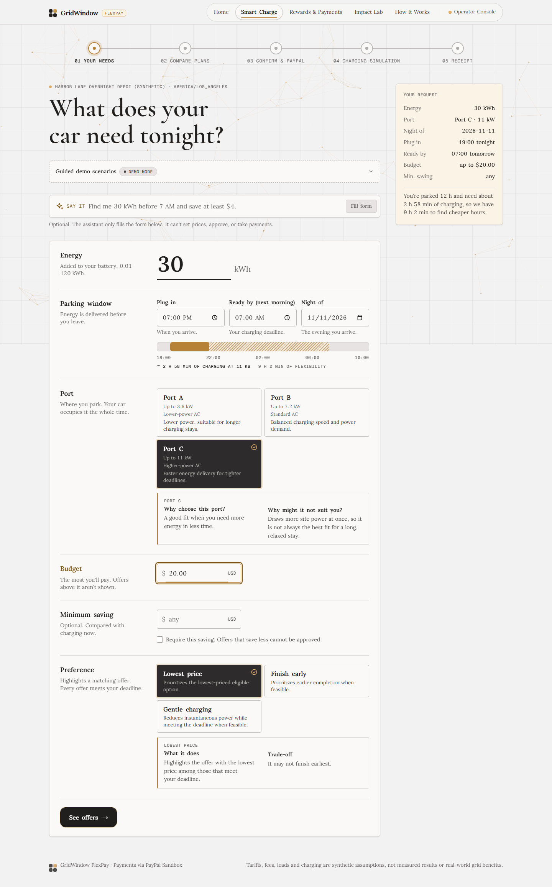
</a>

<sub>Smart Charge request experience</sub>

</div>

### The scheduling constraints

The demonstration site operates under a shared **24 kW site power limit**.

| Charging resource | Maximum charging power |
| :--- | ---: |
| Port A | 3.6 kW |
| Port B | 7.2 kW |
| Port C | 11 kW |
| Shared site cap | 24 kW |

The scheduler also accounts for existing reservations, modeled building load, charging efficiency, occupancy and the available time window.

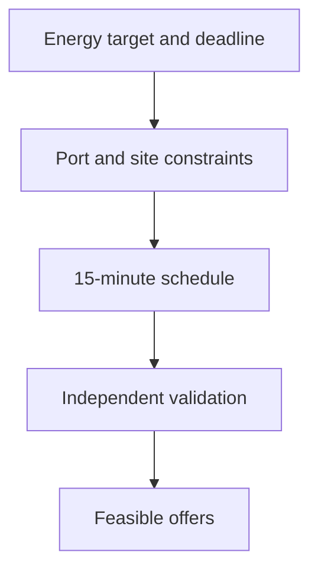

An infeasible request is not presented as a valid charging promise.

---

## 02 / Compare charging offers

GridWindow compares immediate charging with validated flexible windows.

Each offer gives the driver a specific charging window, modeled cost and savings estimate. The deal agent can recommend an option based on the driver's requirements, but cannot silently relax a minimum savings goal or invent a better price.

<div align="center">

<table>
<tr>
<td width="50%" align="center" valign="top">
<strong>Validated charging offers</strong>
<p><a href="docs/evidence/final-release-2026-11-11/01-product/05-validated-charging-offers.png">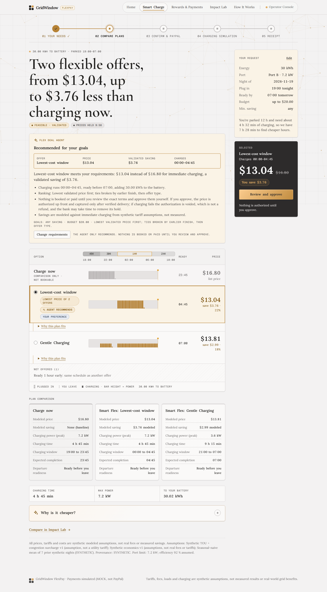</a></p>
<sub>Server-priced offers with a bounded recommendation</sub>
</td>
<td width="50%" align="center" valign="top">
<strong>Mobile charging experience</strong>
<p><a href="docs/evidence/final-release-2026-11-11/08-responsive/02-mobile-smart-charge.png">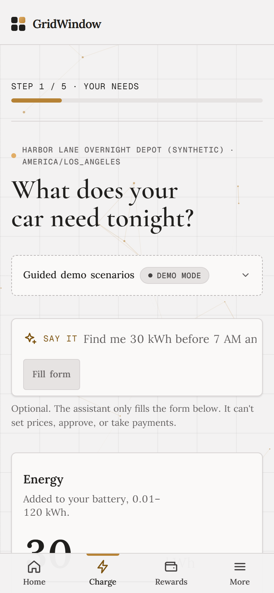</a></p>
<sub>Responsive driver interface</sub>
</td>
</tr>
</table>

</div>

The illustrated offers use synthetic charging assumptions. The recommendation shown in the captured example uses the labeled deterministic fallback.

### What makes an offer eligible?

- The requested energy must fit the available charging window.
- Every time slot must respect port capacity and the shared site cap.
- The modeled economics must satisfy the offer's driver and operator constraints.
- The final terms must be approved before payment authorization.

The driver can compare convenience, price and flexibility without needing to understand the scheduling algorithm.

---

## 03 / Approve the exact agreement

Once an offer is selected, the driver reviews the merchant, amount, charging window and approval terms.

GridWindow creates an authorization through PayPal Sandbox only after the required approval.

**An authorization is a hold. It is not a completed charge or escrow.**

The amount and terms are verified on the server. An AI agent cannot approve on the buyer's behalf, and an altered terms hash is rejected.

### From approval to settlement

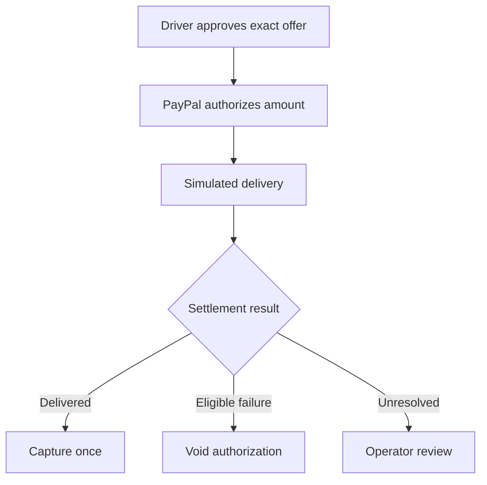

### Two outcomes, both exercised with PayPal Sandbox

<div align="center">

<table>
<tr>
<td width="50%" align="center" valign="top">
<strong>Successful delivery</strong>
<p><a href="docs/evidence/final-release-2026-11-11/02-paypal/06-flexreceipt.png">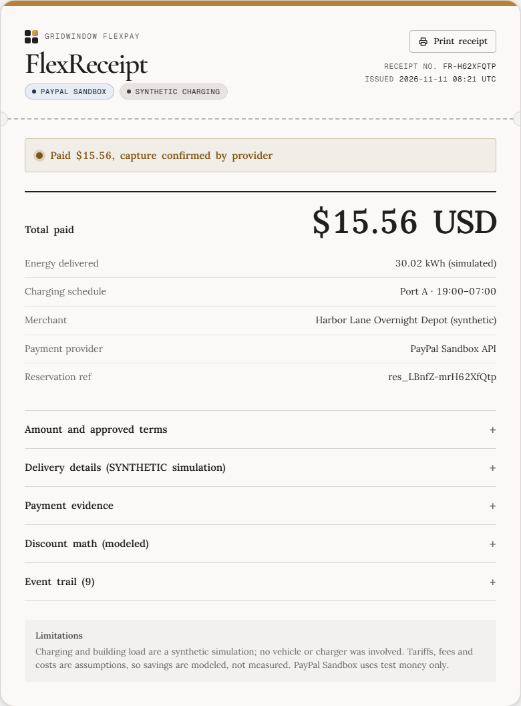</a></p>
<strong>$15.56 captured</strong>
<p><sub>30.02 kWh simulated delivery, provider-confirmed payment</sub></p>
</td>
<td width="50%" align="center" valign="top">
<strong>Charging failure</strong>
<p><a href="docs/evidence/final-release-2026-11-11/02-paypal/08-zero-charge-receipt.png">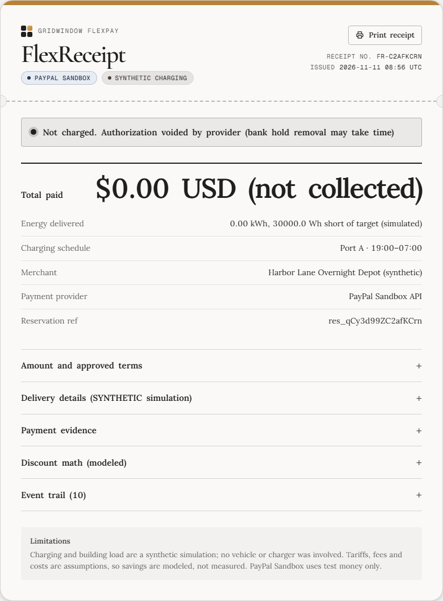</a></p>
<strong>$0.00 collected</strong>
<p><sub>Operator-attributed failure, provider-confirmed void</sub></p>
</td>
</tr>
</table>

</div>

These are real **PayPal Sandbox API outcomes using test money**, while energy delivery and charger faults are synthetic.

### Payment integrity

GridWindow uses:

| Protection | Purpose |
| :--- | :--- |
| Immutable approved terms | Prevent an offer from being silently repriced |
| PayPal authorization | Separate approval and payment capture |
| Idempotency keys | Guard against repeated payment operations |
| Signed webhook verification | Authenticate incoming provider events |
| Provider read-back | Confirm the actual payment outcome |
| Reconciliation | Resolve pending or uncertain states |
| FlexReceipt | Explain consent, simulated energy and settlement |

The live release includes both ordinary capture and void scenarios and **recovery-triggered settlement**.

---

## 04 / Manage the charging site

The operator console provides a central view of station load, reservations and charging sessions.

It combines operational monitoring with payment-state visibility, so an operator can distinguish a charging problem from an authorization or settlement problem.

<div align="center">

<a href="docs/evidence/final-release-2026-11-11/03-operator-ag-grid/01-operator-dashboard.png">
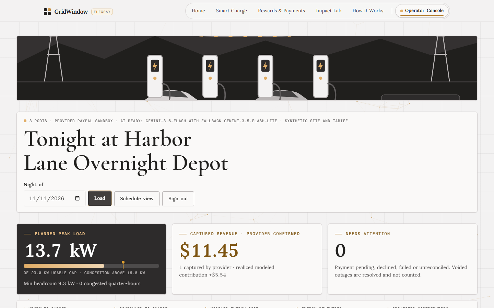
</a>

<sub>Live operator dashboard</sub>

</div>

### The AG Grid operator console

The reservations table supports inspection of payment and service status, sorting, filtering, details and CSV export.

<div align="center">

<a href="docs/evidence/final-release-2026-11-11/03-operator-ag-grid/02-ag-grid-reservations.png">
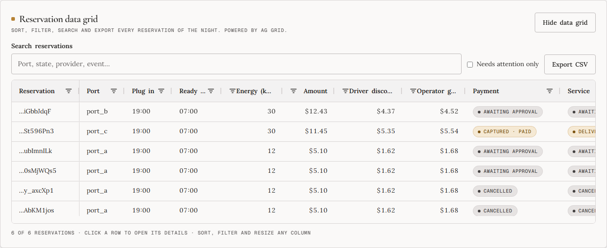
</a>

<sub>Reservation and payment data with operator controls</sub>

</div>

The console also provides access to the date-specific scheduler, recorded disturbances, recovery workflow and reconciliation states.

### Operator capabilities

| Capability | What it provides |
| :--- | :--- |
| Site overview | Shared capacity, reservations and modeled charging activity |
| AG Grid operations | Reservation table, attention filter, sorting and CSV export |
| Payment monitoring | Authorization, capture, void and reconciliation states |
| Fault controls | Synthetic outage, port power and site-cap disturbances |
| Recovery engine | Candidate analysis, consent state, trace and outcome |
| Scheduler | Original and recovered plans for a selected night |
| Financial checklist | Completed only when the required payment outcome is confirmed |

---

## 05 / Recover when charging conditions change

A scheduling system is useful when everything goes according to plan.

GridWindow's recovery engine addresses the harder situation: **something changes after the driver has already approved a charging agreement.**

The system can respond to a reduced charger power limit, site-cap change, early departure or charging failure.

### How autonomous recovery works

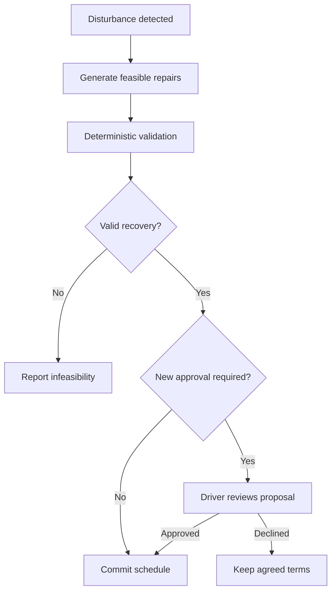

The recovery engine operates on remaining energy. It does not rewrite delivery history or other drivers' reservations.

### The Bryntum timeline

Bryntum Scheduler makes the changes visible as versions of an actual charging plan.

<div align="center">

<table>
<tr>
<td width="50%" align="center" valign="top">
<strong>Original charging plan</strong>
<p><a href="docs/evidence/final-release-2026-11-11/04-bryntum-recovery/01-original-schedule.png">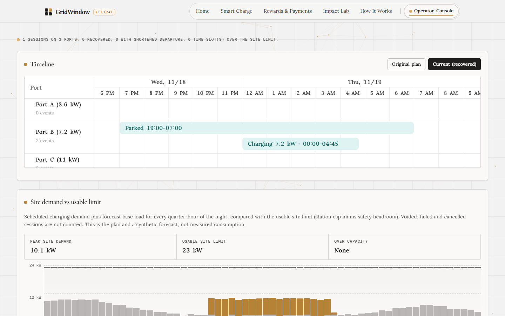</a></p>
<sub>Committed plan before the disturbance</sub>
</td>
<td width="50%" align="center" valign="top">
<strong>Recovered charging plan</strong>
<p><a href="docs/evidence/final-release-2026-11-11/04-bryntum-recovery/07-updated-bryntum-schedule.png">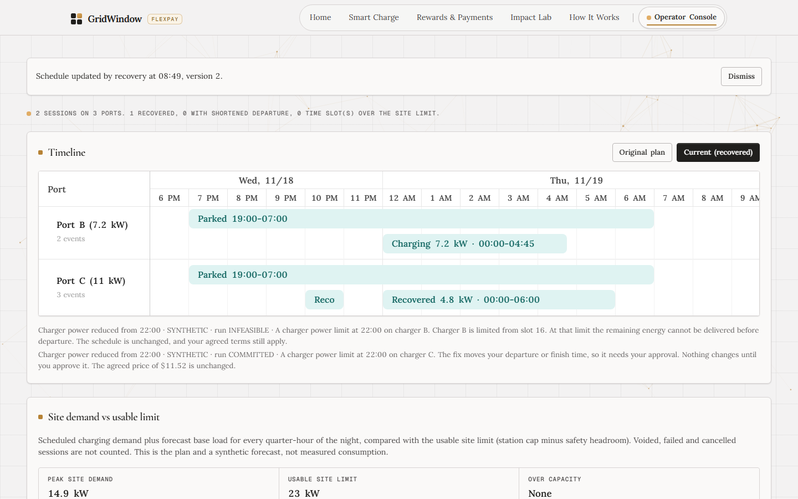</a></p>
<sub>Persisted schedule version after approval</sub>
</td>
</tr>
</table>

</div>

A proposed schedule is shown separately from the committed plan. If a change requires driver consent, the proposal remains pending until the exact version is approved.

The operator can select a night with the date picker, and that selected night is preserved in the scheduler URL.

### Recovery safeguards

| Guarantee | Enforcement |
| :--- | :--- |
| **No rewritten history** | Previously delivered energy and past slots stay unchanged |
| **No impact on other reservations** | Recovery is limited to permitted changes |
| **No silent commercial changes** | Material term changes require the relevant approval |
| **No stale consent** | Only the active proposal version can be approved |
| **No duplicate commits** | Lease and fencing checks protect schedule updates |
| **AI remains bounded** | Model selections are checked against deterministic candidates |

### Recovery followed by real Sandbox settlement

The November 11 release evidence contains two end-to-end scenarios on the hosted system:

**Driver-approved recovery:** a disturbance led to a proposal, the driver approved the new plan, the schedule advanced to version 2, simulated delivery completed, and PayPal Sandbox confirmed capture.

**Unrecoverable disturbance:** a disturbance had no feasible repair, the operator was attributed responsibility, and PayPal Sandbox confirmed that the authorization was voided.

The operator's seven-step workflow separates recovery decisions from financial settlement. A financial outcome is not marked complete merely because the recovery plan was committed.

---

## 06 / AI assistance with human-controlled payment

GridWindow uses AI for tasks where natural language and explanation improve the experience, while keeping physical constraints, pricing and payment authorization in deterministic application code.

### Google Gemini and OpenRouter

The assistant can interpret a charging request, explain a validated offer, recommend an eligible deal and help select among server-approved recovery candidates.

Gemini is the primary provider, with configured model fallbacks and an OpenRouter backup route. When a model cannot respond, GridWindow continues using a labeled deterministic fallback.

| AI can do | AI cannot do |
| :--- | :--- |
| Fill charging preferences from natural language | Invent a price or merchant |
| Explain why an offer qualifies | Change approved terms |
| Recommend among validated options | Approve a purchase for the driver |
| Select a validated recovery candidate | Override the physical validator |
| Explain a recovery result | Capture or void money directly |

**The model is an assistant, not the source of truth.**

### Agentic commerce through MCP

GridWindow exposes seven Model Context Protocol tools so a compatible AI client can work through the charging-discovery and checkout-preparation process.

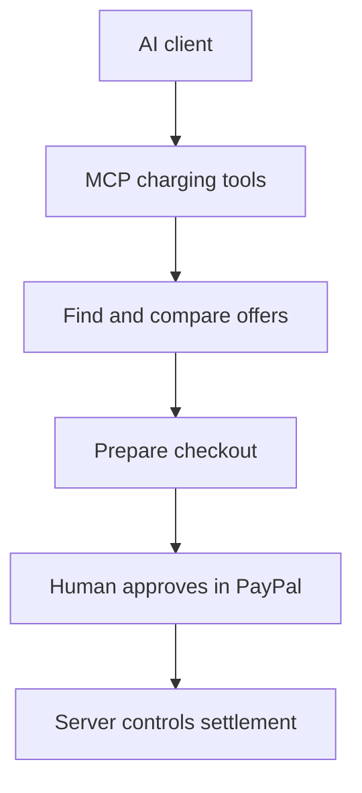

An AI agent can prepare the transaction, but the buyer must complete PayPal approval. MCP tools do not expose arbitrary payment operations or allow the agent to set its own price.

The same interface can search compatible EV accessories through Channel3.

---

## 07 / A complete developer and commerce ecosystem

GridWindow integrates external services where each one contributes to the end-to-end experience.

| Integration | Role in the product | Experience |
| :--- | :--- | :--- |
| [PayPal](https://developer.paypal.com/) | Authorization, capture, void, webhooks and reconciliation | Delivery-linked settlement |
| [Google Gemini](https://ai.google.dev/) | Charging assistant and bounded reasoning | Natural-language interaction |
| [OpenRouter](https://openrouter.ai/) | Additional model fallback route | Resilience to provider limits |
| [Bryntum](https://bryntum.com/products/scheduler/) | Charging timeline and recovery proposals | Visual scheduling |
| [AG Grid](https://www.ag-grid.com/) | Reservations, filtering and operational tables | Operator controls |
| [Channel3](https://trychannel3.com/) | EV accessory discovery from merchants | Connected commerce |
| [APIMatic](https://www.apimatic.io/) | OpenAPI developer portal and TypeScript SDK | Developer access |
| [MCP](https://modelcontextprotocol.io/) | AI-agent-compatible charging tools | Agentic commerce |
| [Render](https://render.com/) | Hosted app and API developer portal | Public deployment |

### Channel3 and APIMatic in action

<div align="center">

<table>
<tr>
<td width="50%" align="center" valign="top">
<strong>Channel3 in Rewards</strong>
<p><a href="docs/evidence/final-release-2026-11-11/06-channel3/02-channel3-product-cards.png">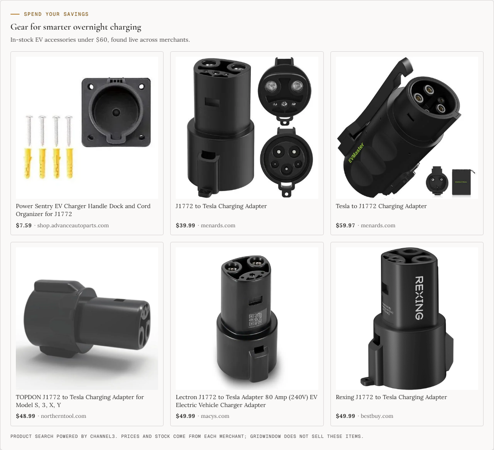</a></p>
<sub>Live merchant product discovery</sub>
</td>
<td width="50%" align="center" valign="top">
<strong>APIMatic developer portal</strong>
<p><a href="docs/evidence/final-release-2026-11-11/07-apimatic/03-accept-offer-api-reference.png">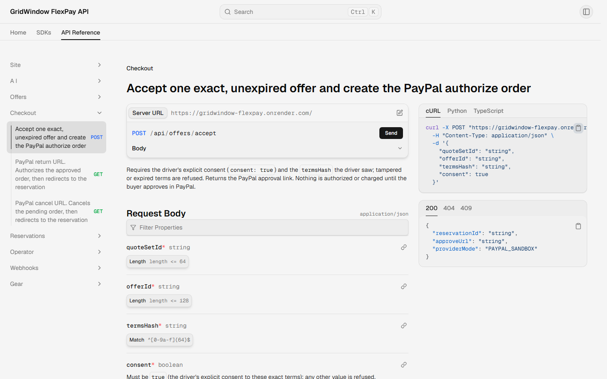</a></p>
<sub>API reference, contract and generated SDK</sub>
</td>
</tr>
</table>

</div>

**[Explore Rewards](https://gridwindow-flexpay.onrender.com/rewards)** · **[Open Developer Portal](https://gridwindow-flexpay-developers.onrender.com/)** · **[View OpenAPI Contract](docs/openapi.yaml)** · **[Explore SDK](apimatic/sdk/typescript/)**

---

## 08 / The numbers behind the scheduler

A useful charging optimizer should demonstrate improvements under clearly defined conditions, not simply show an attractive price.

GridWindow was benchmarked across **500 seeded synthetic nights and 1,500 charging requests**, comparing four scheduling policies under the same modeled site, load and tariff assumptions.

<div align="center">


</div>

### What changed against immediate charging?

<table>
<tr>
<td width="33%" align="center">
<h3>48.7% lower</h3>
<strong>Modeled energy cost</strong>
<p><sub>$10.61 to $5.44 per served session</sub></p>
</td>
<td width="33%" align="center">
<h3>20.4% lower</h3>
<strong>Average site peak</strong>
<p><sub>22.1 kW to 17.6 kW</sub></p>
</td>
<td width="33%" align="center">
<h3>1,254 served</h3>
<strong>Charging requests</strong>
<p><sub>8 more than immediate charging</sub></p>
</td>
</tr>
</table>

### Benchmark comparison

| Scheduling policy | Requests served | Mean modeled cost / served session | Mean site peak |
| :--- | ---: | ---: | ---: |
| Immediate charging | 1,246 | $10.61 | 22.1 kW |
| Static off-peak | 1,024 | $6.01 | 20.2 kW |
| Greedy cheapest tariff | 1,243 | $6.86 | 21.9 kW |
| **GridWindow optimized** | **1,254** | **$5.44** | **17.6 kW** |

### Cost comparison at a glance

```text
Mean modeled energy cost per served session
Lower is better

Immediate      $10.61  ████████████████████
Greedy          $6.86  █████████████
Static off-peak $6.01  ███████████
GridWindow      $5.44  ██████████
```

The optimization is not cheaper for every individual request. There were **125 unfavorable pairwise comparisons**, and **246 requests were physically infeasible** even for the optimized scheduler.

The results are synthetic benchmark findings, not measured field savings or a prediction of actual utility bills.

### Why it matters

The benchmark shows that a site-aware scheduler can improve modeled cost and peak demand while preserving physical feasibility. The larger served-request gain is against static off-peak charging, while the cost and peak improvements above are against immediate charging.

---

## 09 / Architecture and technical implementation

GridWindow separates the user interface, deterministic domain logic, AI assistance, payments and persistence. The boundaries are intentional: an AI response cannot bypass the same checks used for a manually selected offer.

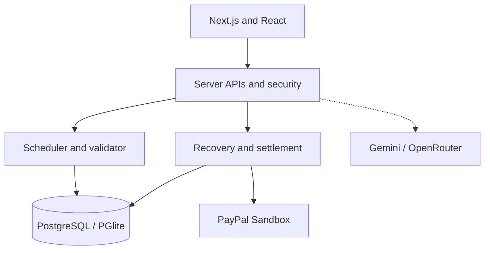

### Technology stack

| Layer | Technology | Responsibility |
| :--- | :--- | :--- |
| Frontend | Next.js 16, React 19, TypeScript | Driver experience and operator console |
| Scheduling | Deterministic domain engine | Feasible 15-minute allocations |
| Validation | Independent constraint checks | Physics, eligibility and terms verification |
| Recovery | Durable server orchestration | Candidate evaluation, approval and versioning |
| Payments | PayPal Sandbox APIs | Authorization, capture, void and reconciliation |
| AI | Gemini, OpenRouter and deterministic fallback | Natural-language assistance and constrained selection |
| Database | PostgreSQL / embedded PGlite | Reservations, events, schedules and payment evidence |
| Scheduling UI | Bryntum Scheduler | Visual timeline and persisted recovery versions |
| Operator tables | AG Grid | Reservation monitoring and export |
| Developer access | OpenAPI, APIMatic and MCP | External applications and compatible agents |
| Hosting | Render | Public application and developer portal |

### Engineering decisions

**Integer-based calculations.** Commercial and physical quantities use integer cents, watts and watt-hours where appropriate.

**Independent validation.** Candidate schedules are checked before they can be offered or committed.

**Immutable financial terms.** The server verifies the approved offer rather than trusting a browser-submitted amount.

**Durable recovery history.** Recovery runs, decisions and schedule versions remain inspectable after a reload.

**Provider-confirmed settlement.** A local state transition does not substitute for verification of PayPal's actual capture or void outcome.

**Defense in depth.** Session and origin checks, schema validation, idempotency and payment reconciliation protect sensitive operations.

---

## 10 / Verification and release readiness

The latest [v1.0.2 release](https://github.com/piyusha-sayal/gridwindow-flexpay/releases/tag/v1.0.2) was published on November 11, 2026. The release records report clean builds, passing automated suites and a live deployment verification.

<div align="center">


</div>

### Automated verification

| Gate | Reported result |
| :--- | :--- |
| Vitest unit and integration tests | **1,023 passed**, 12 skipped, 0 failed |
| Playwright browser tests | **131 passed**, 6 skipped, 0 failed |
| TypeScript and ESLint | Passed |
| Production build | Passed |
| Release secret scan | Passed |
| Generated TypeScript SDK | Passed |
| GitHub Actions CI | Passed |
| Hosted application and developer portal | Live |

### Tested areas

| Area | What was covered |
| :--- | :--- |
| PayPal payments | Checkout, authorization, capture, void, webhooks, reconciliation and settlement |
| Gemini and OpenRouter | Request parsing, assistance, fallback routing and deal-agent behavior |
| Autonomous recovery | Disturbances, validation, consent, schedule versions and financial state |
| Bryntum | Original and recovered plans, proposal display and date navigation |
| AG Grid | Reservation display, attention filtering, sorting and export |
| Channel3 | Gear discovery and product listing integration |
| APIMatic | OpenAPI contracts, generated SDK and public portal |
| MCP | Charging discovery, offer preparation and human approval boundary |
| Pricing and physics | Feasibility, capacity checks, offer terms and cost calculations |
| Security and platform | Input validation, sessions, origins and state protections |
| UI and accessibility | Desktop, tablet, mobile and browser interaction checks |
| Render | Deployment, startup and live-service checks |

### Evidence worth examining

The hosted operator console contains real PayPal Sandbox records from the release tests.

| Date | Evidence |
| :--- | :--- |
| **November 10, 2026** | Operator reservation table containing labeled Sandbox and MOCK test sessions |
| **November 12, 2026** | Recovery cases with PayPal Sandbox settlement, including capture and void |
| **November 14, 2026** | Recovery within preapproved bounds, with financial state still awaiting settlement |

These are recorded demo reservations. The operator passphrase is provided separately through the Devpost testing instructions.

**[Open Judge Guide](docs/JUDGES.md)** · **[View GitHub CI](https://github.com/piyusha-sayal/gridwindow-flexpay/actions)** · **[Latest Release](https://github.com/piyusha-sayal/gridwindow-flexpay/releases/tag/v1.0.2)**

---

## 11 / Run GridWindow locally

You can explore the product without PayPal credentials, AI keys or a hosted database.

The default local demonstration uses embedded PGlite, synthetic charging and the built-in MOCK payment provider.

**Prerequisites:** [Node.js 22+](https://nodejs.org/) and Git.

<details open>
<summary><strong>macOS / Linux / Git Bash</strong></summary>

```bash
git clone https://github.com/piyusha-sayal/gridwindow-flexpay.git
cd gridwindow-flexpay

npm ci
npm run build

PAYMENT_MODE=mock PAYPAL_ENV=sandbox DEMO_TOOLS=true \
APP_BASE_URL=http://localhost:3000 \
SESSION_SECRET=local-demo-session-secret-change-me-0123456789 \
OPERATOR_PASSPHRASE=local-demo-operator \
npm start
```

</details>

<details>
<summary><strong>Windows PowerShell</strong></summary>

```powershell
git clone https://github.com/piyusha-sayal/gridwindow-flexpay.git
cd gridwindow-flexpay

npm ci
npm run build

$env:PAYMENT_MODE="mock"
$env:PAYPAL_ENV="sandbox"
$env:DEMO_TOOLS="true"
$env:APP_BASE_URL="http://localhost:3000"
$env:SESSION_SECRET="local-demo-session-secret-change-me-0123456789"
$env:OPERATOR_PASSPHRASE="local-demo-operator"

npm start
```

</details>

Open `http://localhost:3000` in your browser.

These are local demonstration credentials. Use strong private values in any persistent environment.

### Run the main test suites

```bash
npm run typecheck
npm run lint
npm test
npm run build

npx playwright install chromium
npm run test:e2e

npm run benchmark
npm run benchmark:recovery
npm run release:scan
```

<details>
<summary><strong>Additional configuration and development information</strong></summary>

Copy `.env.example` to `.env.local` for a persistent local configuration.

| Setting | Purpose |
| :--- | :--- |
| `PAYMENT_MODE` | Select MOCK or PayPal Sandbox mode |
| `PAYPAL_ENV` | Must be `sandbox` |
| `APP_BASE_URL` | Exact application origin |
| `SESSION_SECRET` | Session signing secret |
| `OPERATOR_PASSPHRASE` | Operator-console access |
| `DEMO_TOOLS` | Local demonstration controls |
| `DATABASE_URL` | Optional external PostgreSQL |
| `PAYPAL_CLIENT_ID` | Sandbox REST app identifier |
| `PAYPAL_CLIENT_SECRET` | Sandbox REST app secret |
| `PAYPAL_WEBHOOK_ID` | PayPal webhook verification |
| `GEMINI_API_KEY` | Optional primary AI provider |
| `OPENROUTER_API_KEY` | Optional backup AI provider |
| `CHANNEL3_API_KEY` | Connected gear discovery |

External database migrations require explicit confirmation. Test isolation prevents automated suites from using hosted databases, model keys or real provider calls.

Never commit secrets or use production PayPal credentials for the demonstration.

</details>

---

## 12 / What the prototype proves

GridWindow FlexPay is a working software prototype with a publicly accessible application, tested charging workflows, PayPal Sandbox integration, an operator console and developer-facing integrations.

It is important to distinguish demonstrated behavior from future real-world deployment.

| Demonstrated | Outside the current prototype |
| :--- | :--- |
| Deterministic charging schedules under modeled constraints | Physical charger and vehicle control |
| PayPal Sandbox authorization, capture and void | Production financial transactions |
| Recovery proposals, driver consent and committed schedule versions | Guaranteed recovery from every physical failure |
| Server-validated AI assistance and deterministic fallback | A guaranteed live model-selected final recovery decision |
| Synthetic benchmark cost and peak comparisons | Measured utility savings in a real charging network |
| Hosted operator console, MCP tools and API portal | Production-scale customer identity and operations |

The charging system, tariffs, building loads and disturbances are synthetic. PayPal Sandbox uses the actual provider APIs with test funds. The model can help select or explain decisions, but it does not own the physical or financial rules.

That separation is deliberate.

---

## Meet the creators

<div align="center">

<table>
<tr>
<td align="center" width="50%" valign="top">
<a href="https://github.com/piyusha-sayal">

</a>
<h3>Piyusha Sayal</h3>
<sub>Co-creator of GridWindow FlexPay</sub>
<p><a href="https://github.com/piyusha-sayal"><strong>GitHub Profile</strong></a></p>
</td>
<td align="center" width="50%" valign="top">
<a href="https://github.com/satyamamarpandey">

</a>
<h3>Satyam Pandey</h3>
<sub>Co-creator of GridWindow FlexPay</sub>
<p><a href="https://github.com/satyamamarpandey"><strong>GitHub</strong></a> · <a href="https://pandeysatyam.com/#satyam-pandey"><strong>Website</strong></a></p>
</td>
</tr>
</table>

</div>

---

## License and attribution

GridWindow FlexPay is released under the [MIT License](LICENSE).

Copyright © 2026 Piyusha Sayal and Satyam Pandey.

The application uses open-source and third-party technologies, including the Geist font family and Bryntum Scheduler Community. Product images, screenshots and synthetic datasets are used for demonstration and are not measurements from physical charging infrastructure.

<div align="center">

### Flexible charging. Verified delivery. Accountable payment.

**[Live Application](https://gridwindow-flexpay.onrender.com/)** · **[Demo Video](https://youtu.be/eGmMA1O4EXU)** · **[Judge Guide](docs/JUDGES.md)** · **[Back to Top](#gridwindow-flexpay)**

<sub>GridWindow FlexPay | Built for a more trustworthy EV charging experience</sub>

</div>
