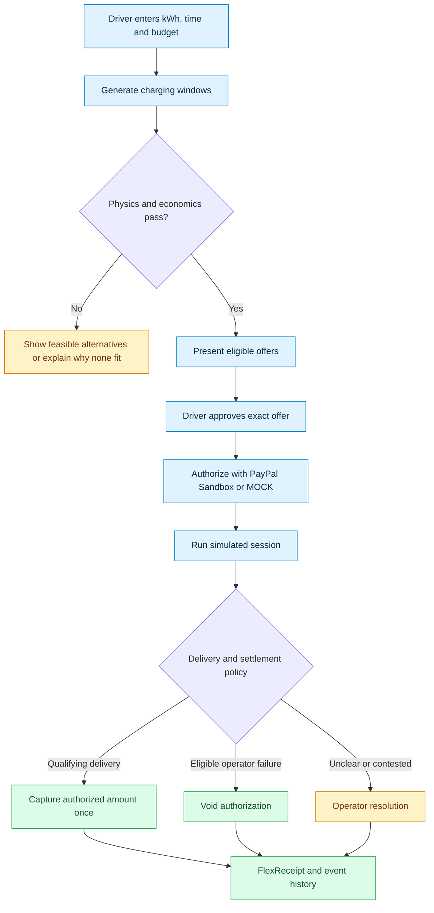
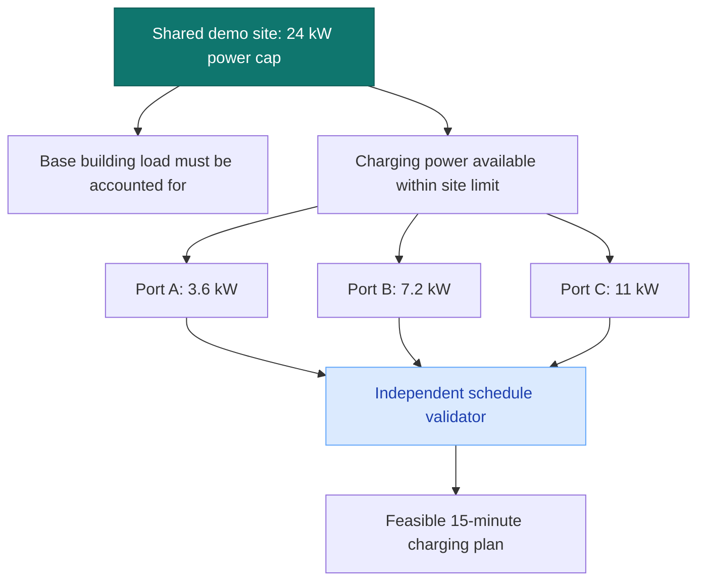
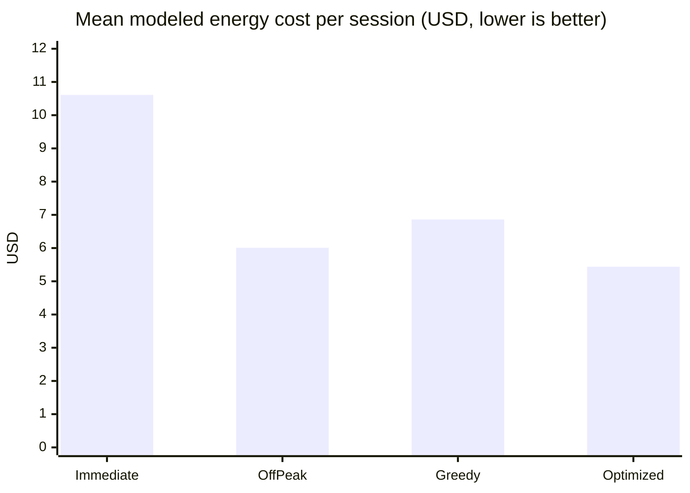
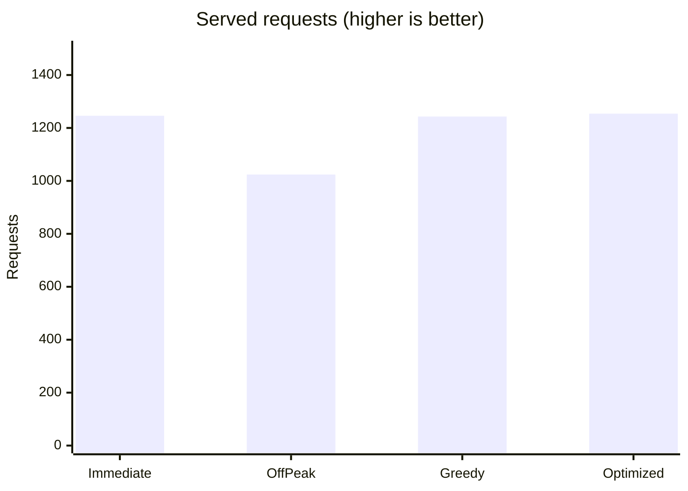
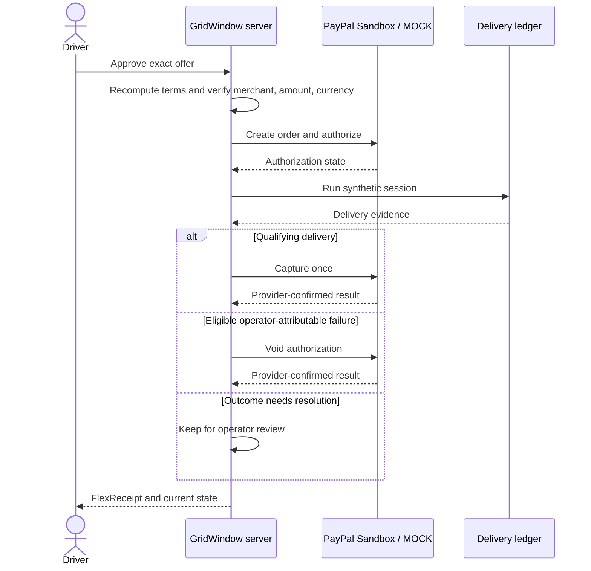
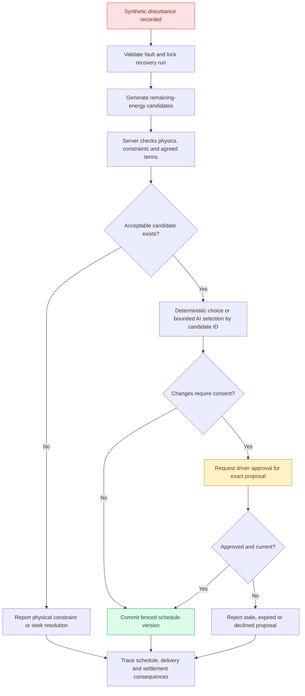
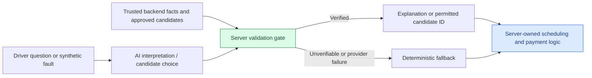
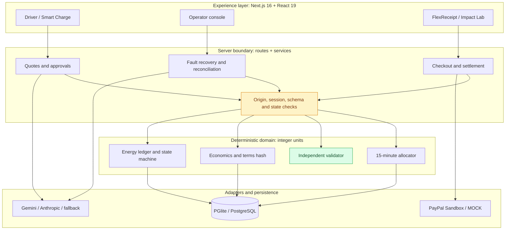

<!--
  GridWindow FlexPay
  GitHub-native README: Markdown, HTML, Mermaid, and live SVG badges.
  No JavaScript, custom CSS, or unsupported embeds required.
-->

<div align="center">

<a href="https://github.com/piyusha-sayal/gridwindow-flexpay">
  
</a>

# GridWindow FlexPay

### Your car charges when it makes sense. Your payment waits until delivery.

**Intelligent EV charging windows · Explainable offers · Delivery-linked payments · Constraint-aware recovery**

<a href="https://github.com/piyusha-sayal/gridwindow-flexpay">
  
</a>


[](https://nextjs.org/)
[](https://react.dev/)
[](https://www.typescriptlang.org/)
[](https://www.postgresql.org/)
[](docs/EVIDENCE.md)
[](LICENSE)

<br />

[**Explore the product**](#the-product-in-pictures) · [**Try the demo**](#run-it-in-minutes) · [**See the results**](#the-numbers-behind-the-scheduler) · [**Inspect the architecture**](#architecture-at-a-glance) · [**Judge walkthrough**](docs/JUDGES.md)

<br />

<a href="docs/screenshots/driver-offers.png">
  
</a>

<sub>Illustrated concept above. The product screens below were captured from a working MOCK-mode application.</sub>

</div>

---

## One simple idea, four important promises

> **A parked car does not need electricity every minute. It needs enough energy before its driver leaves.**

GridWindow FlexPay uses that flexibility to coordinate charging at a shared site. Drivers choose their energy target, departure time, and budget. The scheduler finds feasible windows, checks the economics for both sides, and lets the driver approve one exact offer. Payment is authorized first, but capture waits for the simulated energy-delivery record to satisfy the settlement policy.

| | The promise | How we approach it |
| :---: | :--- | :--- |
| 🔌 | **Ready when you leave** | Schedule in 15-minute slots around energy needs, port limits, occupancy, and departure times. |
| 📉 | **Savings with real constraints** | Show a flexible offer only when it improves the modeled outcome for both driver and operator. |
| 💳 | **No automatic pay-now capture** | Authorize an agreed amount, then capture after qualifying delivery or void after an eligible failure. |
| 🛡️ | **AI without payment authority** | Let AI explain or select prevalidated recovery options, never change prices, grant consent, or move money. |

> [!IMPORTANT]
> **Prototype, not a live charging network.** Vehicles, building load, energy delivery, forecasts, tariffs, disturbances, and savings are simulated. Payments use MOCK mode or PayPal Sandbox funds. No real vehicle is charged and no real customer money moves. [Read the limits](#what-this-prototype-does-and-does-not-prove).

---

## Pick your path

<table>
<tr>
<td width="33%" align="center">
<h3>🚗 I'm a driver</h3>
<p>See what a flexible charging offer looks like and follow a session through settlement.</p>
<a href="docs/screenshots/driver-offers.png"><strong>See Smart Charge</strong></a><br />
<a href="#what-the-app-actually-gives-you">Explore the driver flow</a>
</td>
<td width="33%" align="center">
<h3>🧑‍💻 I'm an operator</h3>
<p>Inspect site power, schedule versions, synthetic faults, and payment outcomes.</p>
<a href="docs/screenshots/operator-console.png"><strong>See the console</strong></a><br />
<a href="#what-the-app-actually-gives-you">Explore operator controls</a>
</td>
<td width="33%" align="center">
<h3>🏆 I'm a judge</h3>
<p>Find the three-minute demo, evidence, tests, and known limitations in one place.</p>
<a href="docs/JUDGES.md"><strong>Open judge guide</strong></a><br />
<a href="docs/DEMO_SCRIPT.md">Follow the demo script</a>
</td>
</tr>
</table>

---

## The product in pictures

<div align="center">

### 01 / Find a plan that fits the driver

<a href="docs/screenshots/driver-offers.png">
  
</a>

<sub>Tap the image for the full screenshot. Each qualifying offer shows timing, modeled cost, and assumptions before approval.</sub>

<br /><br />

<table>
<tr>
<td width="50%" align="center">
<h3>02 / Run the site</h3>
<a href="docs/screenshots/operator-console.png">

</a>
<sub>Site capacity, reservations, session controls, and payment states.</sub>
</td>
<td width="50%" align="center">
<h3>03 / Verify the outcome</h3>
<a href="docs/screenshots/flexreceipt.png">

</a>
<sub>FlexReceipt connects what was approved, what was delivered, and what was settled.</sub>
</td>
</tr>
</table>

</div>

<sub>All three product screenshots use seeded synthetic data and MOCK payments. They are not proof of real charging or live transactions.</sub>

---

## From plug-in to proof

A charging reservation has two separate jobs: **deliver the agreed energy** and **settle the payment correctly**. The second job is not allowed to skip ahead of the first.



**The important distinction:** an authorization is a temporary hold, not escrow and not a completed payment. The system does not capture merely because a clock or deadline has passed. [Explore the payment evidence](docs/EVIDENCE.md).

---

## Why a shared station needs a smarter window

Imagine three drivers plugging in after work. All three need energy by morning, but they do not all need the same charging start time. Charging every car immediately can increase the site's peak and push consumption into higher-cost intervals. Moving everyone to a single cheap hour can create a new bottleneck.

GridWindow handles the trade-off in **15-minute planning intervals**, with an independent validator checking the proposed schedules.

### The demo site's physical budget



| Constraint | Why it matters |
| :--- | :--- |
| **24 kW site cap** | Combined modeled site load must stay inside the configured limit. |
| **3.6 / 7.2 / 11 kW ports** | A reservation cannot draw more than its assigned port allows. |
| **Plug-in and ready-by times** | The available charging window is finite. |
| **Charging efficiency** | Energy drawn from the site is not identical to energy delivered to the battery. |
| **Shared occupancy** | Two vehicles cannot use the same port at the same time. |
| **15-minute time steps** | Every schedule is checked slot by slot, not only by an overall energy total. |

If the requested energy cannot physically be delivered, the system does not create an attractive-looking but impossible offer. [See the detailed economics and physics](docs/08_ECONOMICS.md).

---

## What the app actually gives you

<table>
<tr>
<td width="50%" valign="top">
<h3 id="driver-experience">🚗 Driver experience</h3>
<ul>
<li>Enter energy, arrival, departure, and budget by form or plain language.</li>
<li>Compare immediate charging against qualifying flexible windows.</li>
<li>Inspect assumptions, modeled savings, and final terms.</li>
<li>Approve one immutable offer with merchant, amount, currency, and expiry.</li>
<li>Track authorization, synthetic charging, and settlement.</li>
<li>Use the savings-goal helper without giving it approval authority.</li>
<li>Print a FlexReceipt connecting consent, delivery, and payment.</li>
</ul>
<a href="docs/screenshots/driver-offers.png">View driver screenshot</a>
</td>
<td width="50%" valign="top">
<h3 id="operator-experience">🖥️ Operator experience</h3>
<ul>
<li>Open a passphrase-protected control center.</li>
<li>Inspect reservations, site load, and port occupancy separately.</li>
<li>Run synthetic sessions and reconcile payment state.</li>
<li>Inject a labeled synthetic outage or capacity disturbance.</li>
<li>Review recovery traces and pending driver consent.</li>
<li>Inspect persisted schedule versions on a read-only timeline.</li>
<li>See a per-reservation event and payment history.</li>
</ul>
<a href="docs/screenshots/operator-console.png">View operator screenshot</a>
</td>
</tr>
</table>

### Explore the pages

| Experience | Route after local startup | What to try |
| :--- | :--- | :--- |
| Home | [`/`](http://localhost:3000/) | Interactive pricing scheduler and product overview |
| Smart Charge | [`/drive`](http://localhost:3000/drive) | Compare offers, approve one, and start checkout |
| Reservation | `/reservations/<id>` | Inspect session and payment state, then print FlexReceipt |
| Operator console | [`/operator`](http://localhost:3000/operator) | Monitor reservations and run synthetic scenarios |
| Operator schedule | [`/operator/schedule`](http://localhost:3000/operator/schedule) | View versions and proposals in Bryntum plus an accessible table |
| Rewards & Payments | [`/rewards`](http://localhost:3000/rewards) | Review commitments and provider-confirmed settlement state |
| Impact Lab | [`/impact-lab`](http://localhost:3000/impact-lab) | Explore Charge Now vs Smart Flex and modeled benchmarks |
| How it works | [`/how-it-works`](http://localhost:3000/how-it-works) | Walk through the product with a FAQ |

<sub>The route links above work when you run the application at `http://localhost:3000`. They are not a public hosted demo.</sub>

---

## The numbers behind the scheduler

The benchmark replays **500 seeded synthetic nights** containing **1,500 charging requests**. It compares four policies under the same modeled station, tariff, and load assumptions. A separate validator checks each proposed plan.

<div align="center">


</div>

### Modeled energy cost per served session



### Requests served out of 1,500



| Policy | Served | Mean modeled energy cost / served session | Mean site peak |
| :--- | ---: | ---: | ---: |
| Immediate charging | 1,246 | $10.61 | 22.1 kW |
| Static off-peak | 1,024 | $6.01 | 20.2 kW |
| Greedy cheapest tariff | 1,243 | $6.86 | 21.9 kW |
| **GridWindow optimized** | **1,254** | **$5.44** | **17.6 kW** |

### The results we do not hide

The optimizer was **not** the cheapest option for every comparable request. There were **125 unfavorable pairwise comparisons**: 62 against immediate charging, 49 against static off-peak, and 14 against greedy tariff. Also, **246 requests were physically infeasible even for the optimizer**. Those requests were excluded from the pairwise cost comparisons.

This is a controlled simulation, not a field study or a utility-bill prediction. The totals summarize the documented benchmark and must not be interpreted as universal real-world savings.

**Explore the evidence:** [Benchmark summary JSON](artifacts/benchmark/summary.json) · [Economics assumptions](docs/08_ECONOMICS.md) · [Impact Lab](#explore-the-pages) · [Recovery benchmark](docs/RECOVERY_BENCHMARK.md)

---

## Payments that follow delivery

An attractive offer is only useful if both sides can trust the settlement logic. GridWindow separates the **driver's consent**, the **provider's authorization**, the **synthetic delivery ledger**, and the **final payment operation**.



### Two PayPal Sandbox paths were exercised

<table>
<tr>
<td width="50%" valign="top">
<h3>✅ Delivery succeeds</h3>
<strong>November 6, 2026</strong>
<p>Authorized <strong>$14.82</strong> for a 30 kWh target. The simulator recorded <strong>30.015 kWh</strong>, followed by one capture. The provider reported completed capture and verified webhooks were processed.</p>
<a href="docs/EVIDENCE.md">Inspect successful scenario</a>
</td>
<td width="50%" valign="top">
<h3>🛑 Charging fails</h3>
<strong>November 7, 2026</strong>
<p>Authorized <strong>$14.19</strong>, then injected an outage with <strong>0 kWh</strong> delivered. The provider reported a void, no capture, and <strong>$0.00 collected</strong>.</p>
<a href="docs/EVIDENCE.md">Inspect failure scenario</a>
</td>
</tr>
</table>

Both examples used **Sandbox money and simulated energy**, not real charges. Four webhook event types were verified with PayPal signature checks over the raw body. An initial webhook URL configuration mistake was corrected and the missed events were resent once. [Read the exact evidence and caveats](docs/EVIDENCE.md).

<details>
<summary><strong>How duplicate charges, stale operations, and altered terms are addressed</strong></summary>

The server uses immutable approved terms and recalculates amounts itself. It verifies the payee, amount, and currency before authorizing. Compare-and-set transitions, settlement constraints, idempotency keys (`PayPal-Request-Id`), signed raw-body webhook verification, event deduplication, and provider-side reconciliation guard against duplicate or inconsistent payment operations.

The provider's state is read back rather than accepted from the browser. The application also rejects any `PAYPAL_ENV` other than `sandbox`.

See [Architecture](docs/ARCHITECTURE.md) and [PayPal certification](docs/PAYPAL_CERTIFICATION.md).

</details>

---

## Recovery without rewriting the agreement

Real charging conditions can change. A port may fail, a site cap may fall, or a driver may leave early. The recovery engine works on **remaining energy only**. It does not rewrite energy already delivered or silently modify other reservations.



| The recovery guarantee | What the server enforces |
| :--- | :--- |
| **History stays history** | Delivered energy and earlier slots do not change. |
| **Other drivers stay protected** | The recovery cannot rewrite other sessions. |
| **No silent price increase** | Changed commercial terms require approval. |
| **No silent departure change** | Changes to agreed timing require the relevant consent. |
| **No stale approval** | Approval only applies to the exact active proposal version. |
| **No duplicate commit** | Lease and fencing checks protect schedule commits and traces. |
| **Model cannot improvise** | It can select only server-validated candidate IDs, with deterministic fallback. |

**Important current limits:** recovery uses forecast base load while replay uses realized base load, so replanning does not guarantee that all remaining energy will ultimately be delivered. A recovery may raise the operator's modeled energy cost while preserving its 1-cent minimum contribution margin. One live Gemini recovery attempt fell back after HTTP 504, and a live model-selected recovery has not been demonstrated. Recovery-specific PayPal Sandbox settlement has not been exercised. The operator's **Inject outage** button still uses the older outage simulator, while guided Scenario C uses the newer recovery path.

[Recovery benchmark](docs/RECOVERY_BENCHMARK.md) · [Detailed findings](docs/RECOVERY_BENCHMARK_FINDINGS.md) · [Operator timeline notes](docs/BRYNTUM_NOTES.md)

---

## AI helps explain. The server makes the decisions.

GridWindow can use [Google Gemini](https://ai.google.dev/gemini-api/docs) through the [Google Gen AI SDK](https://github.com/googleapis/js-genai), with an Anthropic provider option. When no key is configured or a provider fails, the app uses a **labeled deterministic parser and explainer**. The main workflow still works.

| AI may do | AI may not do |
| :--- | :--- |
| Interpret a driver's plain-language charging request | Invent or directly change a price |
| Explain offers using verified backend facts | Approve an offer for the driver |
| Answer reservation questions | Authorize, capture, or void funds |
| Recommend among offers that already qualify | Override the independent scheduler validator |
| Select a server-approved recovery candidate by ID | Make arbitrary tool calls or modify past energy delivery |



**A model response is not the source of truth.** Facts are checked against server data, and unverifiable numerical claims are replaced with deterministic wording. Avoid entering personal information into demo AI prompts, especially when using provider free tiers.

---

## Architecture at a glance



| Layer | Source | Owns |
| :--- | :--- | :--- |
| **Web experience** | [`src/app/`](src/app/) | Next.js pages and API routes |
| **Deterministic core** | [`src/domain/`](src/domain/) | Scheduling, validation, economics, terms, simulator, state machine, benchmarks |
| **Payment adapters** | [`src/payments/`](src/payments/) | `PaymentGateway`, PayPal Sandbox and MOCK implementations |
| **Server orchestration** | [`src/server/`](src/server/) | Repositories, migrations, checkout, settlement, recovery, reconciliation, webhooks and security |
| **Persistence** | [PGlite](https://pglite.dev/) / [PostgreSQL](https://www.postgresql.org/) | Local embedded storage by default, external PostgreSQL when configured |
| **Validation and testing** | [Zod](https://zod.dev/), [Vitest](https://vitest.dev/), [Playwright](https://playwright.dev/) | Input contracts, logic tests, integration checks and browser journeys |
| **Schedule visualization** | [Bryntum Scheduler](https://bryntum.com/products/scheduler/) | Read-only operator timeline, with a separate accessible table |

Domain arithmetic uses integer cents, watts, and watt-hours to avoid avoidable floating-point decisions in commercial and power constraints. Event and energy records are append-only. [Read the full design](docs/ARCHITECTURE.md).

---

## What has actually been tested

These are the results recorded in the supplied project evidence, not live CI results or a claim that every environment has been certified.

| Test or check | Reported result | Where to inspect |
| :--- | :--- | :--- |
| Strict TypeScript and ESLint | **0 errors / 0 problems** | [Architecture and evidence](docs/AWARD_EVIDENCE.md) |
| Vitest with embedded database | **968 passed, 12 skipped** | [QA closure](docs/QA_CLOSURE.md) |
| Real PostgreSQL 18 checks, separate disposable run | **46 passed, 1 skipped; restart run 12 passed** | [QA closure](docs/QA_CLOSURE.md) |
| Playwright, desktop, mobile and tablet | **126 passed, 0 failed, 6 skipped by design** | [QA closure](docs/QA_CLOSURE.md) |
| Production build | **PASS** | [Award evidence](docs/AWARD_EVIDENCE.md) |
| Client-bundle secret/config scan | **PASS** | [License and secrets checklist](docs/LICENSE_AND_SECRETS_CHECKLIST.md) |
| Production dependency audit | **0 reported vulnerabilities** | [Award evidence](docs/AWARD_EVIDENCE.md) |
| Recovery benchmark repeat | **Two deterministic runs matched** | [Recovery benchmark](docs/RECOVERY_BENCHMARK.md) |
| PayPal Sandbox happy and failure paths | **Both exercised, with documented caveats** | [Sandbox evidence](docs/EVIDENCE.md) |

Some tests intentionally require a disposable external PostgreSQL instance or an explicit restart command. Browser keyboard journeys also have documented skips on certain responsive projects. [See the complete inventory](docs/SKIPPED_TESTS.md).

<details>
<summary><strong>Run the full local verification suite</strong></summary>

Install dependencies first with `npm ci`, then run:

```bash
npm run typecheck
npm run lint
npm test
npm run build
npx playwright install chromium
npm run test:e2e
npm run benchmark
npm run benchmark:recovery
npm run release:scan
npm audit --omit=dev
```

The test runners set `GW_ISOLATED_DB=true` and refuse hosted databases, model keys, and non-MOCK payments. Use `TEST_DATABASE_URL` only with a disposable local PostgreSQL database. See [migration safety](docs/MIGRATIONS.md).

</details>

---

## Run it in minutes

**You do not need a PayPal account, Gemini key, hosted database, or webhook tunnel to explore the product.** MOCK mode and the embedded database are enough.

**Prerequisites:** [Node.js 22+](https://nodejs.org/), Git, and internet access for the first build's Geist font download.

<details open>
<summary><strong>macOS / Linux / Git Bash</strong></summary>

```bash
git clone https://github.com/piyusha-sayal/gridwindow-flexpay.git
cd gridwindow-flexpay
npm ci
npm run build

PAYMENT_MODE=mock PAYPAL_ENV=sandbox DEMO_TOOLS=true \
APP_BASE_URL=http://localhost:3000 \
SESSION_SECRET=local-demo-session-secret-change-me-0123456789 \
OPERATOR_PASSPHRASE=local-demo-operator \
npm start
```

</details>

<details>
<summary><strong>Windows PowerShell</strong></summary>

```powershell
git clone https://github.com/piyusha-sayal/gridwindow-flexpay.git
cd gridwindow-flexpay
npm ci
npm run build

$env:PAYMENT_MODE="mock"
$env:PAYPAL_ENV="sandbox"
$env:DEMO_TOOLS="true"
$env:APP_BASE_URL="http://localhost:3000"
$env:SESSION_SECRET="local-demo-session-secret-change-me-0123456789"
$env:OPERATOR_PASSPHRASE="local-demo-operator"
npm start
```

</details>

<div align="center">

### Open [http://localhost:3000](http://localhost:3000)

[](http://localhost:3000/drive)
[](http://localhost:3000/operator)
[](http://localhost:3000/impact-lab)

</div>

The sample values above are **local-only placeholders**, not production secrets. `SESSION_SECRET` must contain at least 32 characters, and `OPERATOR_PASSPHRASE` at least 12. For an enduring local setup, copy [`.env.example`](.env.example) to `.env.local`. The embedded database is stored under `.data/`. Stop the app before deleting that folder to reset locally.

<details>
<summary><strong>Environment reference</strong></summary>

| Setting | Purpose |
| :--- | :--- |
| `PAYMENT_MODE` | `mock` or `paypal_sandbox` |
| `PAYPAL_ENV` | Must be `sandbox`; startup rejects other values |
| `APP_BASE_URL` | Exact app origin for return URLs, cookies, and origin validation |
| `ALLOWED_ORIGINS` | Optional explicit additional origins, no wildcard or path |
| `SESSION_SECRET` | Session-cookie signing secret, at least 32 characters |
| `OPERATOR_PASSPHRASE` | Operator console password, at least 12 characters |
| `DEMO_TOOLS` | Local MOCK-only seed and reset controls without `DATABASE_URL` |
| `DATABASE_URL` | Optional external PostgreSQL; otherwise embedded PGlite |
| `MIGRATION_DATABASE_URL` | Optional direct connection for migration tasks |
| `GW_AUTO_MIGRATE` | Automatic startup migrations only for disposable local databases |
| `PAYPAL_CLIENT_ID` / `PAYPAL_CLIENT_SECRET` | Server-only Sandbox credentials |
| `PAYPAL_EXPECTED_MERCHANT_ID` | Required expected payee for Sandbox checkout |
| `PAYPAL_WEBHOOK_ID` | Registered Sandbox webhook ID for signature verification |
| `TRUST_PROXY` | Enable only behind a trusted proxy or tunnel |
| `GEMINI_API_KEY` / `GEMINI_MODEL` | Optional Gemini provider config |
| `ANTHROPIC_API_KEY` / `AI_PROVIDER` / `AI_MODEL` | Optional alternative model configuration |
| `FAILED_SERVICE_REMEDY_CENTS` | Modeled operator remedy cost, default 200 cents; not a PayPal fee |
| `GW_ISOLATED_DB` | Test isolation guard, set by test runners |

For local development use `npm run dev`. For Sandbox setup and external integrations, see [External integration guide](docs/EXTERNAL_INTEGRATION.md).

</details>

<details>
<summary><strong>PayPal Sandbox: reproduce payment flows with your own credentials</strong></summary>

1. Create a Sandbox REST app and a Sandbox buyer account in the [PayPal Developer Dashboard](https://developer.paypal.com/dashboard/).
2. Configure `PAYMENT_MODE=paypal_sandbox`, `PAYPAL_ENV=sandbox`, `PAYPAL_CLIENT_ID`, `PAYPAL_CLIENT_SECRET`, `PAYPAL_EXPECTED_MERCHANT_ID`, and `APP_BASE_URL` in `.env.local`.
3. Run `npm run paypal:smoke` to preview the test plan without a network call.
4. Only when ready, run `npm run paypal:smoke -- --approve-sandbox-orders` to exercise one authorize/capture and one authorize/void of **$1.23 Sandbox** each.
5. For webhooks, expose a public HTTPS endpoint ending in `/api/webhooks/paypal`, configure `PAYPAL_WEBHOOK_ID`, and follow [PayPal certification](docs/PAYPAL_CERTIFICATION.md).

Credentials must never be committed. A PayPal Sandbox account is different from a real-money production checkout.

</details>

<details>
<summary><strong>Database and migration safety</strong></summary>

Embedded PGlite migrations run automatically. An external PostgreSQL database is **not** migrated at startup; the app refuses schema mismatches. Review migrations before applying them:

```bash
npm run db:migrate -- --status
npm run db:migrate -- --plan
# Follow the printed fingerprint instructions before applying.
npm run db:migrate -- --apply --confirm-database <fingerprint>
```

Never enable `GW_AUTO_MIGRATE=true` for a persistent database. Read [docs/MIGRATIONS.md](docs/MIGRATIONS.md).

</details>

<details>
<summary><strong>Troubleshooting quick fixes</strong></summary>

| Symptom | Check |
| :--- | :--- |
| Old npm fails | Use Node 22+ with npm 10+ |
| Build cannot download fonts | Allow network access for the initial Geist download |
| Operator console unavailable | Set a valid `OPERATOR_PASSPHRASE` |
| `SERVER_MISCONFIGURED` | Check required environment variables and server logs |
| Port 3000 occupied | Choose another port, such as `3200`, and use the matching `APP_BASE_URL` |
| Request origin rejected | Browse the exact `APP_BASE_URL`, or configure a permitted exact origin |
| Sandbox checkout does not return | Match cookie origin and browser origin exactly |
| Webhooks do not arrive | Verify HTTPS endpoint `/api/webhooks/paypal`, webhook ID, and trusted-proxy settings |
| Tests refuse to start | Remove hosted services, model keys, and non-MOCK payment settings from isolated test configuration |

See [External preflight](docs/EXTERNAL_PREFLIGHT.md).

</details>

---

## An honest look at the boundaries

| Already demonstrated | Not demonstrated or not production-ready |
| :--- | :--- |
| Deterministic scheduling with independent validation in synthetic benchmarks | Performance against real vehicles, chargers, meter readings, and utility tariffs |
| Exact-offer consent and payment state controls | Production customer authentication and live commercial payment processing |
| PayPal Sandbox authorization/capture and authorization/void scenarios | Recovery-specific PayPal Sandbox settlement |
| Fault recovery with server-validated candidate selection and deterministic fallback | A successful live Gemini-selected recovery decision |
| Read-only Bryntum timeline and adjacent accessible table | Fully accessible third-party Bryntum grid; vendor DOM has known axe findings |
| Repeatable synthetic benchmarks and documented negative cases | Proven real-world savings, grid impact, or general economic superiority |

The recovery benchmark may show unfavorable or infeasible results. The settlement sweep runs every five minutes without a UI button. The demo uses pseudonymous sessions instead of production-grade identity management. Bryntum package licensing remains subject to the documented third-party review. These are meaningful limitations, not things a README should gloss over.

[Detailed limitations](docs/AWARD_EVIDENCE.md) · [Bryntum notes](docs/BRYNTUM_NOTES.md) · [Third-party license notes](docs/THIRD_PARTY.md) · [Secrets checklist](docs/LICENSE_AND_SECRETS_CHECKLIST.md)

---

## Documentation you can actually navigate

<details open>
<summary><strong>🏆 Demo and judging</strong></summary>

| Document | Best for |
| :--- | :--- |
| [Judge walkthrough](docs/JUDGES.md) | Where to click, what works without credentials, and what requires setup |
| [Three-minute demo script](docs/DEMO_SCRIPT.md) | A short, reproducible presentation path |
| [Hackathon submission draft](docs/DEVPOST.md) | Project summary and submission context |
| [Award evidence](docs/AWARD_EVIDENCE.md) | Claimed results and PASS / FAIL / BLOCKED / NOT TESTED distinctions |

</details>

<details>
<summary><strong>🧠 Engineering and scheduling</strong></summary>

| Document | Best for |
| :--- | :--- |
| [Architecture](docs/ARCHITECTURE.md) | Trust boundaries, domain layers, payment states, and evidence mapping |
| [Economics](docs/08_ECONOMICS.md) | Tariff assumptions, offer eligibility, physics, and worked examples |
| [Recovery benchmark](docs/RECOVERY_BENCHMARK.md) | 200-seed comparison and infeasible cases |
| [Recovery findings](docs/RECOVERY_BENCHMARK_FINDINGS.md) | Forecast versus realized-load shortfalls and margin effects |
| [Bryntum notes](docs/BRYNTUM_NOTES.md) | Scheduler UI, time zones, accessibility, and licensing |

</details>

<details>
<summary><strong>💳 Integrations, safety, and operations</strong></summary>

| Document | Best for |
| :--- | :--- |
| [Integration evidence](docs/EVIDENCE.md) | Sanitized PayPal Sandbox and Gemini run records |
| [PayPal certification](docs/PAYPAL_CERTIFICATION.md) | Payment and webhook certification steps |
| [External integration](docs/EXTERNAL_INTEGRATION.md) | Sandbox, webhook, and model smoke-test runbooks |
| [External preflight](docs/EXTERNAL_PREFLIGHT.md) | Required approvals before live integration exercises |
| [Migration guide](docs/MIGRATIONS.md) | Database schema safety and migration confirmation |
| [Skipped tests](docs/SKIPPED_TESTS.md) | What was deliberately gated and why |
| [Third-party packages](docs/THIRD_PARTY.md) | Dependency licensing |
| [License and secrets checklist](docs/LICENSE_AND_SECRETS_CHECKLIST.md) | Known license status and client-bundle checks |

</details>

---

## Built by people who care about the full charging experience

<div align="center">

<table>
<tr>
<td align="center" width="50%">
<a href="https://github.com/piyusha-sayal">
<br />
<strong>Piyusha Sayal</strong>
</a><br />
<sub>Project creator</sub><br />
<a href="https://github.com/piyusha-sayal">GitHub profile</a>
</td>
<td align="center" width="50%">
<a href="https://github.com/piyusha-sayal/gridwindow-flexpay/graphs/contributors">
<br />
<strong>Satyam Pandey</strong>
</a><br />
<sub>Project creator</sub><br />
<a href="https://github.com/piyusha-sayal/gridwindow-flexpay/graphs/contributors">Repository contributions</a>
</td>
</tr>
</table>

[](https://github.com/piyusha-sayal/gridwindow-flexpay/graphs/contributors)
[](https://github.com/piyusha-sayal/gridwindow-flexpay/commits)

[**View contributors**](https://github.com/piyusha-sayal/gridwindow-flexpay/graphs/contributors) · [**Browse source**](https://github.com/piyusha-sayal/gridwindow-flexpay) · [**Report an issue**](https://github.com/piyusha-sayal/gridwindow-flexpay/issues) · [**See commits**](https://github.com/piyusha-sayal/gridwindow-flexpay/commits)

</div>

---

## License and attribution

GridWindow FlexPay is released under the [MIT License](LICENSE). Copyright © 2026 Piyusha Sayal and Satyam Pandey.

The application uses the Geist font family under the SIL Open Font License, loaded from Google Fonts during build. No third-party images or datasets are included in the project according to the supplied repository documentation. Third-party code and the Bryntum integration are documented separately in [Third-party notices](docs/THIRD_PARTY.md) and [Bryntum notes](docs/BRYNTUM_NOTES.md).

<div align="center">

### Flexible charging. Verified delivery. Accountable payment.

**[Back to top](#gridwindow-flexpay)** · **[Run the demo](#run-it-in-minutes)** · **[Read the evidence](docs/EVIDENCE.md)**

<sub>Built as a working hackathon prototype, with simulations and external integrations labeled for what they actually prove.</sub>

</div>
