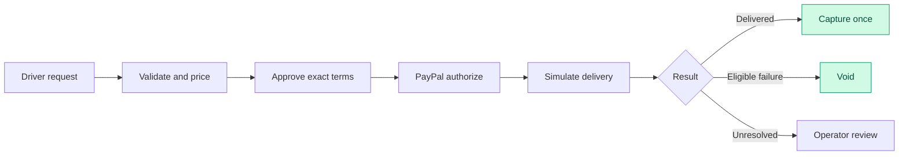
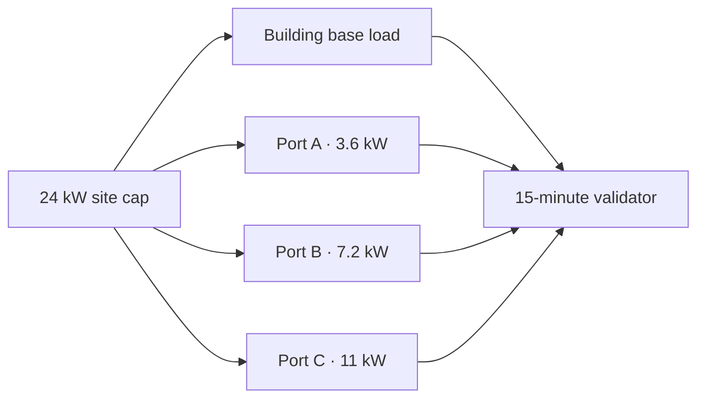
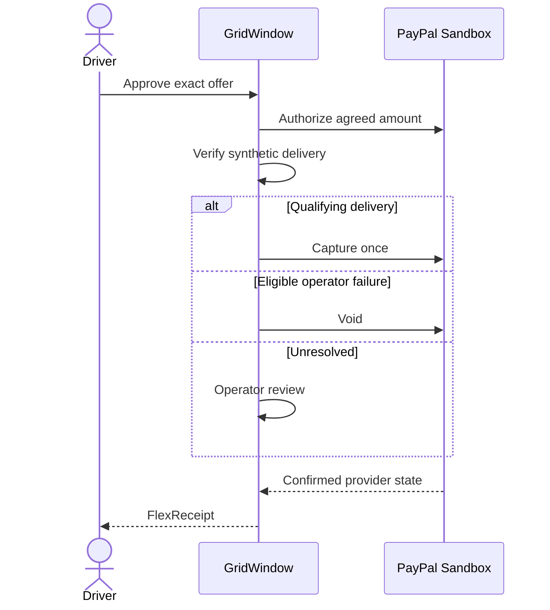
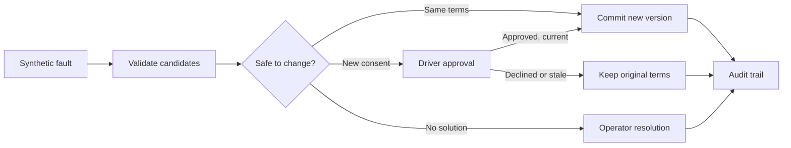
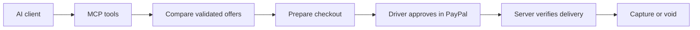
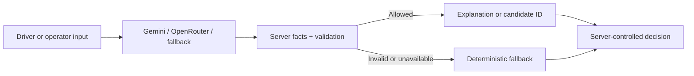
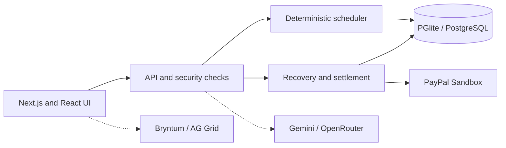

<div align="center">

# GridWindow FlexPay

**Your car charges when it makes sense. Your payment waits until delivery.**

Smart EV scheduling · Verified delivery before payment · Human-approved recovery · Developer-ready integrations

[](https://nextjs.org/)
[](https://react.dev/)
[](https://www.typescriptlang.org/)
[](https://pglite.dev/)
[](https://developer.paypal.com/)
[](LICENSE)
[](https://github.com/piyusha-sayal/gridwindow-flexpay/actions/workflows/ci.yml)

**[Try the live app](https://gridwindow-flexpay.onrender.com)** · **[Judge guide](docs/JUDGES.md)** · [API developer portal](https://gridwindow-flexpay-developers.onrender.com) · [Connect an AI agent through MCP](docs/MCP.md)

<sub>Hosted on Render · Payments are PayPal Sandbox test funds · Vehicle charging and site load are simulated</sub>


</div>

---

## One simple idea, four promises

> **A parked car does not need electricity every minute. It needs enough energy before its driver leaves.**

GridWindow FlexPay uses that flexibility to coordinate charging at a shared site. Drivers choose their energy target, departure time and budget. The scheduler finds feasible windows, checks the economics for both sides, and lets the driver approve one exact offer. That exact amount is authorized first. Capture follows only when the synthetic delivery ledger and the settlement rules allow it. If an eligible operator failure prevents delivery, the authorization is voided instead.

| The promise | How we approach it |
|---|---|
| Ready when you leave | Schedule in 15-minute slots around energy needs, port limits, occupancy and departure times. |
| Savings with real constraints | Show a flexible offer only when it improves the modeled outcome for both the driver and the operator. |
| No pay-now capture | Authorize the agreed amount, then capture after qualifying delivery or void after an eligible failure. |
| AI without payment authority | AI can explain and can pick among prevalidated recovery options. It never changes prices, grants consent or moves money. |

> [!IMPORTANT]
> **This is a prototype, not a live charging network.** Vehicles, building load, energy delivery, forecasts, tariffs, disturbances and savings are simulated. Payments use PayPal Sandbox funds (or a MOCK provider when you run it locally). No real vehicle is charged and no real customer money moves. [Read the limits](#what-is-and-isnt-demonstrated).

---

## Pick your path

<table>
<tr>
<td width="33%" align="center" valign="top">
<h3>I'm a driver</h3>
<p>Ask for a charge in plain words, compare offers, and follow one session through PayPal Sandbox to a receipt.</p>
<a href="https://gridwindow-flexpay.onrender.com/drive"><strong>Open Smart Charge</strong></a><br />
<a href="#what-the-app-gives-you">See the driver flow</a>
</td>
<td width="33%" align="center" valign="top">
<h3>I'm an operator</h3>
<p>Inspect site power, reservations, schedule versions, synthetic faults and payment outcomes.</p>
<a href="docs/screenshots/operator-console.png"><strong>See the console</strong></a><br />
<a href="#what-the-app-gives-you">See the operator tools</a>
</td>
<td width="33%" align="center" valign="top">
<h3>I'm a judge</h3>
<p>Start with the hosted app. The guide covers what to try, what needs access, and which evidence is real Sandbox.</p>
<a href="docs/JUDGES.md"><strong>Open the judge guide</strong></a><br />
<a href="docs/DEMO_SCRIPT.md">Follow the demo script</a>
</td>
</tr>
</table>

---

## The product in pictures

<div align="center">
<table>
<tr>
<td align="center" width="50%" valign="top">
<h3>01. Find a plan that fits the driver</h3>
<a href="docs/screenshots/driver-offers.png"></a>
<p><sub>Smart Charge compares qualified offers and shows the assumptions behind each one.</sub></p>
</td>
<td align="center" width="50%" valign="top">
<h3>02. Run the site</h3>
<a href="docs/screenshots/operator-console.png"></a>
<p><sub>Monitor site capacity, reservations, simulated charging and payment states.</sub></p>
</td>
</tr>
</table>
<h3>03. Verify the outcome</h3>
<a href="docs/screenshots/flexreceipt.png"></a>
<p><sub>The FlexReceipt puts the approved terms, delivered energy and settlement outcome in one printable record.</sub></p>
</div>

<sub>These screenshots use seeded synthetic data and the MOCK provider. Live PayPal Sandbox screenshots are in the <a href="docs/evidence/final-release-2026-11-11/SCREENSHOT_INDEX.md">release screenshot index</a>.</sub>

---

## From plug-in to proof

A charging reservation has two jobs: deliver the agreed energy, and settle the payment correctly. The second job can't skip ahead of the first.



An authorization is a temporary hold. It isn't escrow and it isn't a completed payment. The app never captures just because a clock or a deadline ran out. [See the payment evidence](docs/EVIDENCE.md).

---

## Why a shared station needs a smarter window

Picture three drivers plugging in after work. All of them need energy by morning, but they don't all need to start at the same time. Charging every car right away raises the site's peak and pushes energy into expensive hours. Moving everyone into one cheap hour just creates a new bottleneck.

GridWindow plans in 15-minute intervals, and an independent validator checks every proposed schedule. The demo site has a 24 kW shared cap and ports rated 3.6, 7.2 and 11 kW.



| Constraint | Why it matters |
|---|---|
| 24 kW site cap | The combined modeled site load must stay inside the limit. |
| 3.6 / 7.2 / 11 kW ports | A reservation can't draw more than its port allows. |
| Plug-in and ready-by times | The charging window is finite. |
| Charging efficiency | Energy drawn from the site isn't the same as energy that reaches the battery. |
| Shared occupancy | Two vehicles can't use the same port at the same time. |
| 15-minute time steps | Every schedule is checked slot by slot, and its energy total is checked too. |

If the requested energy physically can't be delivered, the app says so instead of showing an attractive offer it can't keep. [See the economics and physics](docs/08_ECONOMICS.md).

---

## What the app gives you

<table>
<tr>
<td width="50%" valign="top">
<h3 id="driver-experience">Driver experience</h3>
<ul>
<li>Enter energy, arrival, departure and budget in a form or in plain words.</li>
<li>Compare immediate charging with qualifying flexible windows.</li>
<li>Read the assumptions, the modeled savings and the final terms.</li>
<li>Approve one fixed offer with merchant, amount, currency and expiry.</li>
<li>Follow the authorization, the synthetic charging and the settlement.</li>
<li>Try Gentle Charging at reduced port power, and ask the savings-goal helper to recommend a qualifying offer.</li>
<li>Print a FlexReceipt that ties consent, delivery and payment together.</li>
</ul>
</td>
<td width="50%" valign="top">
<h3 id="operator-experience">Operator experience</h3>
<ul>
<li>Sign in to a passphrase-protected console.</li>
<li>Inspect reservations, site load and charging status in AG Grid tables.</li>
<li>Run synthetic sessions and reconcile payment state.</li>
<li>Inject a labeled synthetic outage or capacity disturbance.</li>
<li>Read the recovery steps, fault attribution, candidate checks and pending driver consent.</li>
<li>Pick any night on the Bryntum schedule, with stored versions and pending proposals.</li>
<li>See each reservation's event and payment history.</li>
</ul>
</td>
</tr>
</table>

| Page | Live link | What to try |
|---|---|---|
| Home | [/](https://gridwindow-flexpay.onrender.com) | Interactive pricing scheduler and product overview |
| Smart Charge | [/drive](https://gridwindow-flexpay.onrender.com/drive) | Compare offers and gentle charging, approve terms, start Sandbox checkout |
| Reservation | `/reservations/<id>` | Session and payment state, then print the FlexReceipt |
| Operator console | [/operator](https://gridwindow-flexpay.onrender.com/operator) | AG Grid reservations, synthetic events and reconciliation (passphrase required) |
| Operator schedule | [/operator/schedule](https://gridwindow-flexpay.onrender.com/operator/schedule) | Bryntum timeline for any night, stored versions, proposals and an accessible table (operator access) |
| Rewards & Payments | [/rewards](https://gridwindow-flexpay.onrender.com/rewards) | Provider-confirmed payment states and Channel3 EV gear |
| Impact Lab | [/impact-lab](https://gridwindow-flexpay.onrender.com/impact-lab) | Charging scenarios and the synthetic benchmark |
| How it works | [/how-it-works](https://gridwindow-flexpay.onrender.com/how-it-works) | Four-step walkthrough, gentle charging and FAQ |

<sub>Each reservation gets its own generated ID. Judges get the operator passphrase in the Devpost testing instructions. Locally, the same routes run on `http://localhost:3000`.</sub>

---

## The numbers behind the scheduler

The benchmark replays 500 seeded synthetic nights with 1,500 charging requests and compares four policies under the same station, tariff and load assumptions. A separate validator checks every plan.

<div align="center">


</div>

<table>
<tr>
<td width="50%" align="center" valign="top">
<h3>Modeled energy cost per served session</h3>

<p><sub>USD per served session. Lower is better.</sub></p>
</td>
<td width="50%" align="center" valign="top">
<h3>Requests served out of 1,500</h3>

<p><sub>Requests scheduled. Higher is better.</sub></p>
</td>
</tr>
</table>

<sub>The charts are images of the recorded synthetic benchmark. They don't update with live data.</sub>

| Policy | Served | Mean modeled energy cost per served session | Mean site peak |
|---|---|---|---|
| Immediate charging | 1,246 | $10.61 | 22.1 kW |
| Static off-peak | 1,024 | $6.01 | 20.2 kW |
| Greedy cheapest tariff | 1,243 | $6.86 | 21.9 kW |
| GridWindow optimized | 1,254 | $5.44 | 17.6 kW |

**Where it loses.** The optimizer wasn't the cheapest choice for every request. Out of the pairwise comparisons, it was worse 125 times: 62 against immediate charging, 49 against static off-peak and 14 against the greedy tariff. Another 246 requests were physically infeasible even for the optimizer, and those are left out of the cost comparisons.

This is a controlled simulation, not a field study or a prediction of anyone's utility bill. [Benchmark summary JSON](artifacts/benchmark/summary.json) · [Economics assumptions](docs/08_ECONOMICS.md) · [Impact summary](docs/IMPACT_SUMMARY.md) · [Recovery benchmark](docs/RECOVERY_BENCHMARK.md)

---

## Payments that follow delivery

An attractive offer only helps if both sides can trust the settlement. GridWindow keeps four things separate: the driver's consent, PayPal's authorization, the synthetic delivery ledger, and the final payment operation.



### What has run in PayPal Sandbox

| Date | Path | Result |
|---|---|---|
| 2026-11-06 | Authorize $14.82, deliver 30.015 kWh against a 30 kWh target, capture | Capture completed, verified webhooks processed |
| 2026-11-07 | Authorize $14.19, inject an outage, 0 kWh delivered | Authorization voided, no capture, $0.00 collected |
| 2026-11-11 | On the deployed site: one capture and one void of $15.56 | Both read back from the PayPal API, with signature-verified webhooks |
| 2026-11-11 | On the deployed site, after a recorded disturbance: a driver-approved recovery then a capture, and an operator-caused failure with no feasible fix then a void | Both read back from the PayPal API, with verified webhooks |

All of these used Sandbox money and simulated energy. Four webhook event types were verified with PayPal's signature check over the raw body. Early on, the webhook URL was registered without its path; we fixed it and resent the two missed events once. [Read the evidence and its caveats](docs/EVIDENCE.md).

<details>
<summary><strong>How duplicate charges, stale operations and altered terms are handled</strong></summary>

The server stores the approved terms and recalculates the amount itself. Before authorizing, it checks the payee, amount and currency against those terms. Compare-and-set state transitions, settlement constraints, idempotency keys (`PayPal-Request-Id`), signed raw-body webhook verification, event deduplication and provider reconciliation all guard against duplicate or inconsistent payment operations.

Payment state is read back from PayPal, never taken from the browser. The app also refuses to start with any `PAYPAL_ENV` other than `sandbox`.

More in [Architecture](docs/ARCHITECTURE.md) and [PayPal certification](docs/PAYPAL_CERTIFICATION.md).

</details>

---

## Recovery without rewriting the agreement

Charging conditions change. A port fails, the site cap drops, or a driver leaves early. The recovery engine only works on the energy that hasn't been delivered yet. It doesn't rewrite what already happened, and it doesn't quietly change other people's reservations.



| The recovery guarantee | What the server enforces |
|---|---|
| History stays history | Delivered energy and earlier slots don't change. |
| Other drivers stay protected | A recovery can't rewrite other sessions. |
| No silent price increase | Changed commercial terms need approval. |
| No silent departure change | Changes to agreed timing need the matching consent. |
| No stale approval | Approval applies only to the exact active proposal version. |
| No duplicate commit | Lease and fencing checks protect schedule commits and traces. |
| The model can't improvise | It can only pick server-validated candidate IDs, with a deterministic fallback. |

The operator sees each recovery as seven steps, read straight from the stored run: disturbance, agent run, validation, schedule, consent, financial outcome and FlexReceipt. The financial step says Done only after PayPal confirms the capture or void.

What we haven't shown: recovery plans use forecast base load while the replay uses realized load, so a recovered plan doesn't guarantee every remaining kWh arrives. A recovery can raise the operator's modeled energy cost while keeping its 1-cent minimum margin. And Gemini has driven recovery tool steps live, but in those runs the provider hit capacity errors and the deterministic path made the final decision. [Recovery benchmark](docs/RECOVERY_BENCHMARK.md) · [Findings](docs/RECOVERY_BENCHMARK_FINDINGS.md) · [Timeline notes](docs/BRYNTUM_NOTES.md)

---

## Connected tools

Each integration does a specific job in the charging, payment, operator or developer experience.

| Integration | Where it shows up | What it does |
|---|---|---|
| PayPal Sandbox | Checkout, authorization, capture, void, webhooks and reconciliation | Holds the approved amount first and captures only after qualifying synthetic delivery. |
| Google Gemini and OpenRouter | Driver assistant, deal agent and constrained recovery selection | Interprets and explains, but can't set prices, approve terms or move money. OpenRouter is a backup route. |
| Bryntum Scheduler | Operator schedule | A timeline for any night, with stored schedule versions and pending proposals shown apart. |
| AG Grid | Operator console | Sortable, filterable reservation tables with CSV export. |
| Channel3 | Rewards & Payments and the MCP `find_ev_gear` tool | Live EV accessory search with merchant links, kept apart from modeled energy savings. |
| APIMatic | [Developer portal](https://gridwindow-flexpay-developers.onrender.com), [OpenAPI spec](docs/openapi.yaml), generated TypeScript SDK | A documented, typed API for outside developers. [How we used it](docs/APIMATIC.md) |
| Model Context Protocol | [MCP server guide](docs/MCP.md) | Lets AI clients search and compare charging options while the driver keeps the checkout approval. |
| Render | Hosted app and developer portal | Public deployments for the demo and for developers. |

### An AI agent can help book a charge

The MCP server lets clients such as Claude and Cursor read station information, interpret a charging request, compare offers, ask for a deal recommendation and prepare checkout. The agent stops at the PayPal approval link. Only the driver can approve, and settlement stays under server control.



Run `npm run mcp:smoke` to check the whole agent flow locally. [MCP setup and consent model](docs/MCP.md) · [APIMatic guide](docs/APIMATIC.md) · [API reference](https://gridwindow-flexpay-developers.onrender.com) · [TypeScript SDK](apimatic/sdk/typescript)

---

## AI explains. The server decides.

GridWindow uses Google Gemini through the Google Gen AI SDK, with OpenRouter as a backup. When no model key is configured or a provider fails, the app uses a deterministic parser and explainer, and everything keeps working. The operator's recovery view always says whether a model or the deterministic path made each decision.

| AI may | AI may not |
|---|---|
| Interpret a driver's plain-language request | Invent or change a price |
| Explain offers using verified backend facts | Approve an offer for the driver |
| Answer questions about a reservation | Authorize, capture or void funds |
| Recommend among offers that already qualify | Override the scheduler's validator |
| Pick a server-approved recovery candidate by ID | Make arbitrary tool calls or change past energy delivery |



A model's answer is never the source of truth. Facts are checked against server data, and any number the server can't confirm is replaced with deterministic wording. Please don't type personal information into the demo assistant: providers may use free-tier traffic to improve their products.

---

## Architecture at a glance



| Layer | Source | Owns |
|---|---|---|
| Web experience | [`src/app/`](src/app/) | Next.js pages and API routes |
| Deterministic core | [`src/domain/`](src/domain/) | Scheduling, validation, economics, terms, simulator, state machine, benchmarks |
| Payment adapters | [`src/payments/`](src/payments/) | `PaymentGateway`, with PayPal Sandbox and MOCK implementations |
| Server orchestration | [`src/server/`](src/server/) | Repositories, migrations, checkout, settlement, recovery, reconciliation, webhooks and security |
| Persistence | PGlite / PostgreSQL | Embedded storage by default, external PostgreSQL when configured |
| Validation and testing | Zod, Vitest, Playwright | Input contracts, logic tests, integration checks and browser journeys |
| Schedule view | Bryntum Scheduler | Read-only timeline for any night, with an accessible table beside it |

Domain arithmetic uses integer cents, watts and watt-hours, so price and power decisions never depend on floating-point rounding. Event and energy records are append-only. [Read the full design](docs/ARCHITECTURE.md).

---

## Verification

On the submitted code, the automated suites and the live checks recorded 1,247 passing checks across payments, AI, scheduling, recovery, developer integrations, security and the live service. No automated test failed. The live PayPal checks include a real Sandbox capture and void on the hosted site, confirmed by reading the provider state back from PayPal.

<div align="center">


</div>

| Area | Passed | What was checked |
|---|---|---|
| PayPal payment lifecycle | 229 | Checkout, authorization, capture and void, webhooks, reconciliation and settlement |
| AI assistance and deal agent | 238 | Gemini, the OpenRouter backup, the assistant and the deal agent (4 live OpenRouter verdicts did not pass, see [the evidence](docs/AGENTIC_COMMERCE_EVIDENCE.md)) |
| Autonomous recovery | 282 | Safe replanning, consent rules, schedule versions and the recovery checklist |
| Bryntum scheduler | 130 | Stored schedules, timeline behavior and night navigation |
| AG Grid operator console | 4 | Browser and live checks of the reservation grid |
| Channel3 gear discovery | 7 | Gear search and the gear cards |
| APIMatic API platform | 20 | OpenAPI contract, typed SDK and developer portal |
| MCP server | 16 | Agent tools and the approval boundary |
| Pricing and charging physics | 94 | Feasibility, offer qualification and numeric constraints |
| Security and platform | 157 | Origin checks, rate limits, sessions, migrations and secret scanning |
| UI, accessibility and visual checks | 64 | Browser, keyboard, axe and layout checks |
| Render deployment and health | 6 | Hosted service and health checks |
| **Total** | **1,247** | |

<sub>The full inventory has 1,269 checks: 1,247 passed, 18 were skipped by design (a PostgreSQL-only suite and desktop-only keyboard journeys), and 4 live OpenRouter verdicts did not pass. Details: [release verification](docs/FINAL_RELEASE_VERIFICATION_2026-11-11.md), [award evidence](docs/AWARD_EVIDENCE.md), [skipped tests](docs/SKIPPED_TESTS.md).</sub>

<details>
<summary><strong>Run the checks yourself</strong></summary>

```bash
npm run typecheck
npm run lint
npm test
npm run build
npx playwright install chromium
npm run test:e2e
npm run benchmark
npm run benchmark:recovery
npm run release:scan
npm audit --omit=dev
```

The tests refuse to run against hosted databases, real payment providers or model keys. The PostgreSQL-specific tests need a disposable database. See [Migration safety](docs/MIGRATIONS.md) and [Skipped tests](docs/SKIPPED_TESTS.md).

</details>

---

## Run it in minutes

You don't need a PayPal account, a Gemini key, a hosted database or a webhook tunnel. MOCK mode and the embedded database are enough. You need Node.js 22 or newer, git, and internet access for the first build's font download.

<details open>
<summary><strong>macOS / Linux / Git Bash</strong></summary>

```bash
git clone https://github.com/piyusha-sayal/gridwindow-flexpay.git
cd gridwindow-flexpay
npm ci
npm run build

PAYMENT_MODE=mock PAYPAL_ENV=sandbox DEMO_TOOLS=true \
APP_BASE_URL=http://localhost:3000 \
SESSION_SECRET=local-demo-session-secret-change-me-0123456789 \
OPERATOR_PASSPHRASE=local-demo-operator \
npm start
```

</details>

<details>
<summary><strong>Windows PowerShell</strong></summary>

```powershell
git clone https://github.com/piyusha-sayal/gridwindow-flexpay.git
cd gridwindow-flexpay
npm ci
npm run build

$env:PAYMENT_MODE="mock"
$env:PAYPAL_ENV="sandbox"
$env:DEMO_TOOLS="true"
$env:APP_BASE_URL="http://localhost:3000"
$env:SESSION_SECRET="local-demo-session-secret-change-me-0123456789"
$env:OPERATOR_PASSPHRASE="local-demo-operator"
npm start
```

</details>

The sample values above are local placeholders, not production secrets. `SESSION_SECRET` needs at least 32 characters and `OPERATOR_PASSPHRASE` at least 12. For a setup you keep, copy `.env.example` to `.env.local`. The embedded database lives in `.data/`; stop the app before deleting that folder to reset it.

<details>
<summary><strong>Environment reference</strong></summary>

| Setting | Purpose |
|---|---|
| `PAYMENT_MODE` | `mock` or `paypal_sandbox` |
| `PAYPAL_ENV` | Must be `sandbox`; startup rejects anything else |
| `APP_BASE_URL` | Exact app origin for return URLs, cookies and origin checks |
| `ALLOWED_ORIGINS` | Optional extra origins, exact values only, no wildcard or path |
| `SESSION_SECRET` | Session cookie signing secret, at least 32 characters |
| `OPERATOR_PASSPHRASE` | Operator console password, at least 12 characters |
| `DEMO_TOOLS` | Local seed and reset controls, MOCK mode only and without `DATABASE_URL` |
| `DATABASE_URL` | Optional external PostgreSQL; otherwise embedded PGlite |
| `MIGRATION_DATABASE_URL` | Optional direct connection for migrations |
| `GW_AUTO_MIGRATE` | Automatic startup migrations, only for disposable local databases |
| `PAYPAL_CLIENT_ID` / `PAYPAL_CLIENT_SECRET` | Server-only Sandbox credentials |
| `PAYPAL_EXPECTED_MERCHANT_ID` | Expected payee for Sandbox checkout |
| `PAYPAL_WEBHOOK_ID` | Registered Sandbox webhook ID for signature verification |
| `TRUST_PROXY` | Enable only behind a trusted proxy or tunnel |
| `GEMINI_API_KEY` / `GEMINI_MODEL` / `GEMINI_FALLBACK_MODEL` | Optional Gemini configuration, with a second Gemini model as the first backup |
| `AI_FALLBACK_PROVIDER` / `OPENROUTER_API_KEY` / `OPENROUTER_MODEL` | Optional OpenRouter backup |
| `ANTHROPIC_API_KEY` / `AI_PROVIDER` / `AI_MODEL` | Optional alternative model configuration |
| `CHANNEL3_API_KEY` | Optional Channel3 product search for the gear cards |
| `FAILED_SERVICE_REMEDY_CENTS` | Modeled operator remedy cost, default 200 cents (not a PayPal fee) |
| `GW_ISOLATED_DB` | Test isolation guard, set by the test runners |

For development, use `npm run dev`. For Sandbox setup and external integrations, see the [external integration guide](docs/EXTERNAL_INTEGRATION.md).

</details>

<details>
<summary><strong>PayPal Sandbox with your own credentials</strong></summary>

1. Create a Sandbox REST app and a Sandbox buyer account in the [PayPal Developer Dashboard](https://developer.paypal.com/dashboard/).
2. Set `PAYMENT_MODE=paypal_sandbox`, `PAYPAL_ENV=sandbox`, `PAYPAL_CLIENT_ID`, `PAYPAL_CLIENT_SECRET`, `PAYPAL_EXPECTED_MERCHANT_ID` and `APP_BASE_URL` in `.env.local`.
3. Run `npm run paypal:smoke` to preview the test plan without any network call.
4. When you're ready, `npm run paypal:smoke -- --approve-sandbox-orders` runs one authorize and capture, and one authorize and void, of $1.23 Sandbox each.
5. For webhooks, expose a public HTTPS endpoint ending in `/api/webhooks/paypal`, set `PAYPAL_WEBHOOK_ID`, and follow [PayPal certification](docs/PAYPAL_CERTIFICATION.md).

Never commit credentials. A PayPal Sandbox account is separate from real-money checkout.

</details>

<details>
<summary><strong>Database and migration safety</strong></summary>

Embedded PGlite migrations run automatically. An external PostgreSQL database is never migrated at startup, and the app refuses to run on a schema it doesn't expect. Review migrations before applying them:

```bash
npm run db:migrate -- --status
npm run db:migrate -- --plan
# Follow the printed fingerprint instructions before applying.
npm run db:migrate -- --apply --confirm-database <fingerprint>
```

Never set `GW_AUTO_MIGRATE=true` for a database you keep. See [docs/MIGRATIONS.md](docs/MIGRATIONS.md).

</details>

<details>
<summary><strong>Troubleshooting</strong></summary>

| Symptom | Check |
|---|---|
| Old npm fails | Use Node 22+ with npm 10+ |
| Build can't download fonts | Allow network access for the first Geist download |
| Operator console unavailable | Set a valid `OPERATOR_PASSPHRASE` |
| `SERVER_MISCONFIGURED` | Check the required environment variables and the server log |
| Port 3000 is taken | Pick another port, such as `3200`, and set the matching `APP_BASE_URL` |
| Request origin rejected | Browse the exact `APP_BASE_URL`, or allow that exact origin |
| Sandbox checkout doesn't return | Make the cookie origin and browser origin match exactly |
| Webhooks don't arrive | Check the HTTPS endpoint `/api/webhooks/paypal`, the webhook ID and the trusted-proxy setting |
| Tests refuse to start | Remove hosted services, model keys and non-MOCK payment settings from the test environment |

</details>

---

## What is and isn't demonstrated

| Demonstrated | Not demonstrated, or not production-ready |
|---|---|
| Deterministic scheduling with independent validation in synthetic benchmarks | Performance with real vehicles, chargers, meter readings and utility tariffs |
| Exact-offer consent and payment state controls | Production customer authentication and real-money payment processing |
| PayPal Sandbox authorize and capture, and authorize and void, including settlement after a recovery run | Duplicate webhook delivery and provider timeouts against the live provider (tested with fakes only) |
| Fault recovery with server-validated candidates and a deterministic fallback | A live model making the final recovery decision |
| Bryntum schedule for any night, with an accessible table | A fully accessible Bryntum grid; the vendor markup has known axe findings |
| Repeatable synthetic benchmarks, with the cases where we lose | Proven real-world savings, grid impact or economic superiority |

The recovery benchmark includes unfavorable and infeasible results. The settlement sweep runs in the background and has no button. The demo uses pseudonymous sessions, not production identity management. [Limits in detail](docs/AWARD_EVIDENCE.md#known-limits-all-three-tracks) · [Bryntum notes](docs/BRYNTUM_NOTES.md) · [Third-party licenses](docs/THIRD_PARTY.md) · [License and secrets checklist](docs/LICENSE_AND_SECRETS_CHECKLIST.md)

---

## Documentation

<details open>
<summary><strong>Demo and judging</strong></summary>

| Document | Best for |
|---|---|
| [Judge guide](docs/JUDGES.md) | Where to click, what works without access, and real Sandbox evidence versus MOCK tests |
| [Demo script](docs/DEMO_SCRIPT.md) | The three-minute route through the live site |
| [Live app](https://gridwindow-flexpay.onrender.com) | Trying the product |
| [Award evidence](docs/AWARD_EVIDENCE.md) | Every claim with PASS, PARTIAL, FAIL, NOT TESTED or NOT CLAIMED |
| [Release verification](docs/FINAL_RELEASE_VERIFICATION_2026-11-11.md) | The 2026-11-11 release checks, live smoke test and screenshots |

</details>

<details>
<summary><strong>Engineering and scheduling</strong></summary>

| Document | Best for |
|---|---|
| [Architecture](docs/ARCHITECTURE.md) | Trust boundaries, domain layers, payment states and evidence mapping |
| [Economics](docs/08_ECONOMICS.md) | Tariff assumptions, offer eligibility, physics and worked examples |
| [Impact summary](docs/IMPACT_SUMMARY.md) | What the benchmark figures mean and what they don't |
| [Recovery benchmark](docs/RECOVERY_BENCHMARK.md) | 200-seed comparison, including infeasible cases |
| [Recovery findings](docs/RECOVERY_BENCHMARK_FINDINGS.md) | Forecast versus realized load, shortfalls and margin effects |
| [Bryntum notes](docs/BRYNTUM_NOTES.md) and [evidence](docs/BRYNTUM_EVIDENCE.md) | Scheduler UI, time zones, accessibility and licensing |
| [API contract](docs/openapi.yaml) | Machine-readable OpenAPI specification |
| [APIMatic guide](docs/APIMATIC.md) | Generated SDK and developer portal |
| [MCP setup](docs/MCP.md) | Agent tools, the approval boundary and the smoke check |

</details>

<details>
<summary><strong>Integrations, safety and operations</strong></summary>

| Document | Best for |
|---|---|
| [Integration evidence](docs/EVIDENCE.md) | Sanitized PayPal Sandbox and Gemini run records |
| [PayPal + AI evidence](docs/PAYPAL_AI_EVIDENCE.md) | What was verified locally and what was verified live |
| [Agentic Commerce evidence](docs/AGENTIC_COMMERCE_EVIDENCE.md) | Recovery agent runs, decision labels and live model runs |
| [PayPal certification](docs/PAYPAL_CERTIFICATION.md) | Payment and webhook certification steps |
| [External integration](docs/EXTERNAL_INTEGRATION.md) | Sandbox, webhook and model smoke-test runbooks |
| [Deployment](docs/DEPLOYMENT_RUNBOOK.md) | Render setup and environment |
| [Migrations](docs/MIGRATIONS.md) | Schema safety and migration confirmation |
| [Skipped tests](docs/SKIPPED_TESTS.md) | What is gated and why |
| [Third-party packages](docs/THIRD_PARTY.md) and [notices](THIRD_PARTY_NOTICES.md) | Dependency licensing |
| [License and secrets checklist](docs/LICENSE_AND_SECRETS_CHECKLIST.md) | License status and client-bundle checks |

</details>

---

## The team

<div align="center">
<table>
<tr>
<td align="center" width="50%" valign="top">
<a href="https://github.com/piyusha-sayal"></a>
<h3>Piyusha Sayal</h3>
<sub>Co-creator of GridWindow FlexPay</sub>
<p><a href="https://github.com/piyusha-sayal"><strong>GitHub</strong></a></p>
</td>
<td align="center" width="50%" valign="top">
<a href="https://github.com/satyamamarpandey"></a>
<h3>Satyam Pandey</h3>
<sub>Co-creator of GridWindow FlexPay</sub>
<p><a href="https://github.com/satyamamarpandey"><strong>GitHub</strong></a> · <a href="https://pandeysatyam.com/#satyam-pandey"><strong>Website</strong></a></p>
</td>
</tr>
</table>
</div>

---

## License

GridWindow FlexPay is released under the [MIT License](LICENSE). Copyright © 2026 Piyusha Sayal and Satyam Pandey.

The app uses the Geist font family under the SIL Open Font License, loaded from Google Fonts at build time. The illustrations and synthetic datasets are demo assets, not real-world charging measurements. Third-party code and the Bryntum integration are covered in [Third-party notices](THIRD_PARTY_NOTICES.md) and the [Bryntum notes](docs/BRYNTUM_NOTES.md).

<div align="center">

**Flexible charging. Verified delivery. Accountable payment.**

[Back to top](#gridwindow-flexpay) · [Try the live app](https://gridwindow-flexpay.onrender.com) · [Read the evidence](docs/EVIDENCE.md)

</div>
