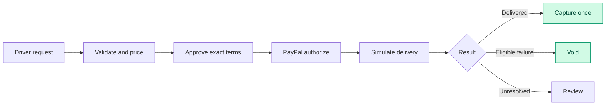
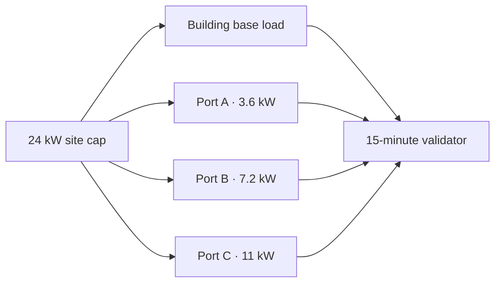
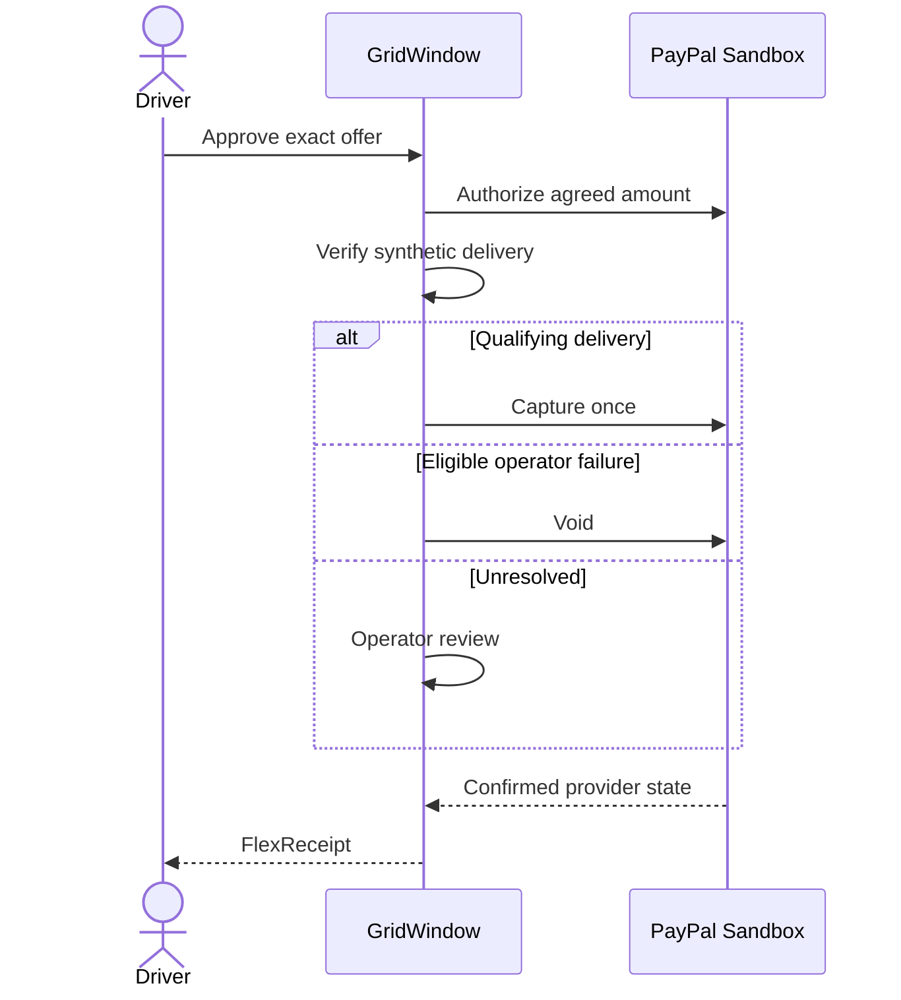
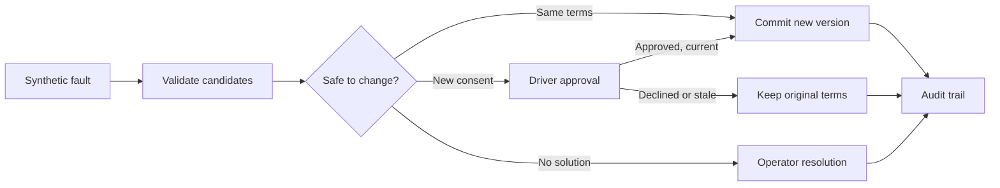
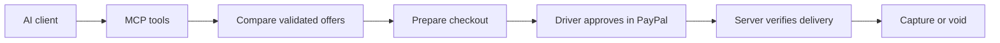
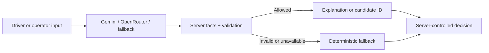
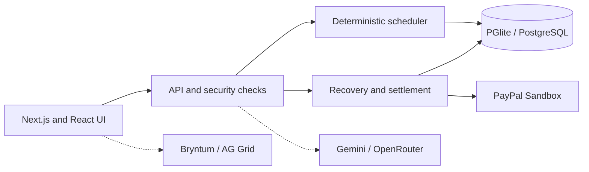

<!--
  GridWindow FlexPay
  GitHub-native README: Markdown, HTML, compact Mermaid, and image-based charts.
  No JavaScript, custom CSS, or unsupported embeds required.
<div align="center">

GridWindow FlexPay
Your car charges when it makes sense. Your payment waits until delivery.
Smart EV scheduling · Verified delivery before payment · Human-approved recovery · Developer-ready integrations


▶ Explore the live demo · Open the API developer portal · Connect an AI agent through MCP
<sub>Hosted on Render · Payments are PayPal Sandbox test funds · Vehicle charging and site load are simulated</sub>
<br />

</div>
---
One simple idea, four important promises
> **A parked car does not need electricity every minute. It needs enough energy before its driver leaves.**
GridWindow FlexPay uses that flexibility to coordinate charging at a shared site. Drivers choose their energy target, departure time, and budget. The scheduler finds feasible windows, checks the economics for both sides, and lets the driver approve one exact offer. The exact approved amount is authorized first. Capture follows only when the synthetic delivery ledger and settlement rules allow it. If an eligible operator failure prevents delivery, the authorization is voided instead.
	The promise	How we approach it
🔌	Ready when you leave	Schedule in 15-minute slots around energy needs, port limits, occupancy, and departure times.
📉	Savings with real constraints	Show a flexible offer only when it improves the modeled outcome for both driver and operator.
💳	No automatic pay-now capture	Authorize an agreed amount, then capture after qualifying delivery or void after an eligible failure.
🛡️	AI without payment authority	Let AI explain or select prevalidated recovery options, never change prices, grant consent, or move money.
> [!IMPORTANT]
> **Prototype, not a live charging network.** Vehicles, building load, energy delivery, forecasts, tariffs, disturbances, and savings are simulated. Payments use MOCK mode or PayPal Sandbox funds. No real vehicle is charged and no real customer money moves. [Read the limits](#an-honest-look-at-the-boundaries).
---
Pick your path
<table>
<tr>
<td width="33%" align="center">
<h3>🚗 I'm a driver</h3>
<p>See what a flexible charging offer looks like and follow a session through settlement.</p>
<a href="docs/screenshots/driver-offers.png"><strong>See Smart Charge</strong></a><br />
<a href="#what-the-app-actually-gives-you">Explore the driver flow</a>
</td>
<td width="33%" align="center">
<h3>🧑‍💻 I'm an operator</h3>
<p>Inspect site power, schedule versions, synthetic faults, and payment outcomes.</p>
<a href="docs/screenshots/operator-console.png"><strong>See the console</strong></a><br />
<a href="#what-the-app-actually-gives-you">Explore operator controls</a>
</td>
<td width="33%" align="center">
<h3>🏆 I'm a judge</h3>
<p>Find the three-minute demo, evidence, tests, and known limitations in one place.</p>
<a href="docs/JUDGES.md"><strong>Open judge guide</strong></a><br />
<a href="docs/DEMO_SCRIPT.md">Follow the demo script</a>
</td>
</tr>
</table>
---
The product in pictures
<div align="center">
<table>
<tr>
<td align="center" width="50%" valign="top">
<h3>01 / Find a plan that fits the driver</h3>
<a href="docs/screenshots/driver-offers.png"></a>
<p><sub>Smart Charge compares qualified offers and displays the assumptions behind each one.</sub></p>
</td>
<td align="center" width="50%" valign="top">
<h3>02 / Run the site</h3>
<a href="docs/screenshots/operator-console.png"></a>
<p><sub>Monitor site capacity, reservations, simulated charging and payment states.</sub></p>
</td>
</tr>
</table>
<h3>03 / Verify the outcome</h3>
<a href="docs/screenshots/flexreceipt.png"></a>
<sub>FlexReceipt joins the approved terms, delivered energy and settlement outcome in one printable record.</sub>
</div>
<sub>Product screenshots use seeded synthetic data and MOCK payments. They do not represent real charging or live payments.</sub>
---
From plug-in to proof
A charging reservation has two separate jobs: deliver the agreed energy and settle the payment correctly. The second job is not allowed to skip ahead of the first.

The important distinction: an authorization is a temporary hold, not escrow and not a completed payment. The system does not capture merely because a clock or deadline has passed. Explore the payment evidence.
---
Why a shared station needs a smarter window
Imagine three drivers plugging in after work. All three need energy by morning, but they do not all need the same charging start time. Charging every car immediately can increase the site's peak and push consumption into higher-cost intervals. Moving everyone to a single cheap hour can create a new bottleneck.
GridWindow handles the trade-off in 15-minute planning intervals, with an independent validator checking each proposed schedule. The demo site has a 24 kW shared cap and ports rated 3.6, 7.2 and 11 kW.
The demo site's physical budget

Constraint	Why it matters
24 kW site cap	Combined modeled site load must stay inside the configured limit.
3.6 / 7.2 / 11 kW ports	A reservation cannot draw more than its assigned port allows.
Plug-in and ready-by times	The available charging window is finite.
Charging efficiency	Energy drawn from the site is not identical to energy delivered to the battery.
Shared occupancy	Two vehicles cannot use the same port at the same time.
15-minute time steps	Every schedule is checked slot by slot, not only by an overall energy total.
If the requested energy cannot physically be delivered, the system does not create an attractive-looking but impossible offer. See the detailed economics and physics.
---
What the app actually gives you
<table>
<tr>
<td width="50%" valign="top">
<h3 id="driver-experience">🚗 Driver experience</h3>
<ul>
<li>Enter energy, arrival, departure, and budget by form or plain language.</li>
<li>Compare immediate charging against qualifying flexible windows.</li>
<li>Inspect assumptions, modeled savings, and final terms.</li>
<li>Approve one immutable offer with merchant, amount, currency, and expiry.</li>
<li>Track authorization, synthetic charging, and settlement.</li>
<li>Compare Gentle Charging at reduced port power when feasible and ask the savings-goal helper to recommend a qualifying offer.</li>
<li>Print a FlexReceipt connecting consent, delivery, and payment.</li>
</ul>
<a href="docs/screenshots/driver-offers.png">View driver screenshot</a>
</td>
<td width="50%" valign="top">
<h3 id="operator-experience">🖥️ Operator experience</h3>
<ul>
<li>Open a passphrase-protected control center.</li>
<li>Use AG Grid-powered operator tables to inspect reservations, site load and charging status.</li>
<li>Run synthetic sessions and reconcile payment state.</li>
<li>Inject a labeled synthetic outage or capacity disturbance.</li>
<li>Review ordered recovery steps, fault attribution, candidate checks and pending driver consent.</li>
<li>Navigate the selected date in the Bryntum schedule, with persisted versions and pending proposals.</li>
<li>See a per-reservation event and payment history.</li>
</ul>
<a href="docs/screenshots/operator-console.png">View operator screenshot</a>
</td>
</tr>
</table>
Explore the pages
Experience	Route after local startup	What to try
Home	Live home	Interactive pricing scheduler and product overview
Smart Charge	Live Smart Charge	Compare offers, gentle charging, approve terms and start Sandbox checkout
Reservation	`/reservations/<id>`	Inspect session and payment state, then print FlexReceipt
Operator console	Live operator console	AG Grid operations view, reservations, synthetic events and reconciliation; passphrase required
Operator schedule	Live scheduler	Date-specific Bryntum timeline, persisted versions, proposals and accessible table; operator access required
Rewards & Payments	Live Rewards	Provider-confirmed payment states and Channel3 EV gear recommendations
Impact Lab	Live Impact Lab	Explore charging scenarios and synthetic benchmark results
How it works	Live walkthrough	Four-step product walkthrough, gentle charging and FAQ
<sub>The reservation route uses a generated session-specific ID. Operator pages require authorized access. Local equivalents use `http://localhost:3000` after setup.</sub>
---
The numbers behind the scheduler
The benchmark replays 500 seeded synthetic nights containing 1,500 charging requests. It compares four policies under the same modeled station, tariff, and load assumptions. A separate validator checks each proposed plan.
<div align="center">


</div>
<table>
<tr>
<td width="50%" align="center" valign="top">
<h3>Modeled energy cost per served session</h3>

<p><sub>USD per served session. Lower is better.</sub></p>
</td>
<td width="50%" align="center" valign="top">
<h3>Requests served out of 1,500</h3>

<p><sub>Requests successfully scheduled. Higher is better.</sub></p>
</td>
</tr>
</table>
<sub>Charts are rendered as image previews from the recorded synthetic benchmark results. They do not update with live charging data.</sub>
Policy	Served	Mean modeled energy cost / served session	Mean site peak
Immediate charging	1,246	$10.61	22.1 kW
Static off-peak	1,024	$6.01	20.2 kW
Greedy cheapest tariff	1,243	$6.86	21.9 kW
GridWindow optimized	1,254	$5.44	17.6 kW
The results we do not hide
The optimizer was not the cheapest option for every comparable request. There were 125 unfavorable pairwise comparisons: 62 against immediate charging, 49 against static off-peak, and 14 against greedy tariff. Also, 246 requests were physically infeasible even for the optimizer. Those requests were excluded from the pairwise cost comparisons.
This is a controlled simulation, not a field study or a utility-bill prediction. The totals summarize the documented benchmark and must not be interpreted as universal real-world savings.
Explore the evidence: Benchmark summary JSON · Economics assumptions · Impact Lab · Recovery benchmark
---
Payments that follow delivery
An attractive offer is only useful if both sides can trust the settlement logic. GridWindow separates the driver's consent, the provider's authorization, the synthetic delivery ledger, and the final payment operation.

Two PayPal Sandbox paths were exercised
<table>
<tr>
<td width="50%" valign="top">
<h3>✅ Delivery succeeds</h3>
<strong>November 6, 2026</strong>
<p>Authorized <strong>$14.82</strong> for a 30 kWh target. The simulator recorded <strong>30.015 kWh</strong>, followed by one capture. The provider reported completed capture and verified webhooks were processed.</p>
<a href="docs/EVIDENCE.md">Inspect successful scenario</a>
</td>
<td width="50%" valign="top">
<h3>🛑 Charging fails</h3>
<strong>November 7, 2026</strong>
<p>Authorized <strong>$14.19</strong>, then injected an outage with <strong>0 kWh</strong> delivered. The provider reported a void, no capture, and <strong>$0.00 collected</strong>.</p>
<a href="docs/EVIDENCE.md">Inspect failure scenario</a>
</td>
</tr>
</table>
Both examples used Sandbox money and simulated energy, not real charges. Four webhook event types were verified with PayPal signature checks over the raw body. An initial webhook URL configuration mistake was corrected and the missed events were resent once. Read the exact evidence and caveats.
<details>
<summary><strong>How duplicate charges, stale operations, and altered terms are addressed</strong></summary>
The server uses immutable approved terms and recalculates amounts itself. It verifies the payee, amount, and currency before authorizing. Compare-and-set transitions, settlement constraints, idempotency keys (`PayPal-Request-Id`), signed raw-body webhook verification, event deduplication, and provider-side reconciliation guard against duplicate or inconsistent payment operations.
The provider's state is read back rather than accepted from the browser. The application also rejects any `PAYPAL_ENV` other than `sandbox`.
See Architecture and PayPal certification.
</details>
---
Recovery without rewriting the agreement
Real charging conditions can change. A port may fail, a site cap may fall, or a driver may leave early. The recovery engine works on remaining energy only. It does not rewrite energy already delivered or silently modify other reservations.

The recovery guarantee	What the server enforces
History stays history	Delivered energy and earlier slots do not change.
Other drivers stay protected	The recovery cannot rewrite other sessions.
No silent price increase	Changed commercial terms require approval.
No silent departure change	Changes to agreed timing require the relevant consent.
No stale approval	Approval only applies to the exact active proposal version.
No duplicate commit	Lease and fencing checks protect schedule commits and traces.
Model cannot improvise	It can select only server-validated candidate IDs, with deterministic fallback.
Important current limits: recovery uses forecast base load while replay uses realized base load, so replanning does not guarantee that all remaining energy will ultimately be delivered. A recovery may raise the operator's modeled energy cost while preserving its 1-cent minimum contribution margin. One earlier Gemini recovery attempt returned HTTP 504 and used deterministic fallback. The release checks cover Gemini and OpenRouter integration, but do not establish that every recovery in the live service is model-selected. The supplied verification report confirms live Sandbox capture and void, but does not separately establish a full recovery-triggered Sandbox settlement. The dedicated recovery workflow traces its steps in sequence and supports a version-specific approval gate. Its synthetic fault path is distinct from the older single-click outage simulator.
Recovery benchmark · Detailed findings · Operator timeline notes
---
Connected tools that make the product work
These integrations are part of the application, not a list of logos. Each has a specific job in the charging, payment, operator, or developer experience.
Integration	Where it shows up	Why it matters
PayPal Sandbox	Checkout, authorization, capture, void, webhooks and provider reconciliation	The approved amount can be held first and captured only after qualifying synthetic delivery.
Google Gemini and OpenRouter	Driver assistance, deal agent and constrained recovery selection	AI can interpret and explain but cannot set prices, approve terms or move money. OpenRouter provides an optional backup route.
Bryntum Scheduler	Operator schedule	Date-driven timeline with persisted schedule versions and separately shown pending proposals.
AG Grid	Operator console	Structured operational tables and faster inspection of reservation and session data.
Channel3	Rewards & Payments and MCP `find_ev_gear`	Live EV accessory discovery and merchant links, distinct from modeled energy savings.
APIMatic	Developer portal, OpenAPI spec, generated TypeScript SDK	A documented and typed surface for external developers rather than undocumented endpoints.
Model Context Protocol	MCP server guide	Allows compatible AI clients to search and compare charging options while preserving the driver's checkout approval.
Render	Hosted application and developer portal	Publicly accessible deployments for demonstrations and developer exploration.
A charging flow an AI agent can assist with
The MCP server enables compatible agents such as Claude and Cursor to read station information, interpret a charging request, compare offers, request a deal recommendation, and prepare checkout. The agent stops at the PayPal approval link. The driver must approve the transaction, and settlement stays under server control.

Run `npm run mcp:smoke` for the dedicated integration check. MCP setup and consent model · APIMatic developer guide · API reference · TypeScript SDK files.
---
AI helps explain. The server makes the decisions.
GridWindow can use Google Gemini through the Google Gen AI SDK, with OpenRouter available as a backup model route. When no supported model key is configured or a provider fails, the app uses a labeled deterministic parser and explainer. The main workflow still works.
AI may do	AI may not do
Interpret a driver's plain-language charging request	Invent or directly change a price
Explain offers using verified backend facts	Approve an offer for the driver
Answer reservation questions	Authorize, capture, or void funds
Recommend among offers that already qualify	Override the independent scheduler validator
Select a server-approved recovery candidate by ID	Make arbitrary tool calls or modify past energy delivery

A model response is not the source of truth. Facts are checked against server data, and unverifiable numerical claims are replaced with deterministic wording. Avoid entering personal information into demo AI prompts, especially when using provider free tiers.
---
Architecture at a glance

Layer	Source	Owns
Web experience	`src/app/`	Next.js pages and API routes
Deterministic core	`src/domain/`	Scheduling, validation, economics, terms, simulator, state machine, benchmarks
Payment adapters	`src/payments/`	`PaymentGateway`, PayPal Sandbox and MOCK implementations
Server orchestration	`src/server/`	Repositories, migrations, checkout, settlement, recovery, reconciliation, webhooks and security
Persistence	PGlite / PostgreSQL	Local embedded storage by default, external PostgreSQL when configured
Validation and testing	Zod, Vitest, Playwright	Input contracts, logic tests, integration checks and browser journeys
Schedule visualization	Bryntum Scheduler	Date-aware, read-only timeline with an adjacent accessible table
AG Grid adds operator data tables, the MCP server exposes bounded charging workflows, and APIMatic publishes the API contract and TypeScript client. Domain arithmetic uses integer cents, watts, and watt-hours to avoid avoidable floating-point decisions in commercial and power constraints. Event and energy records are append-only. Read the full design.
---
Release verification: November 11, 2026
The release records supplied for deployed revision `3edf59d` report 1,247 successful checks across payments, AI, scheduling, recovery, developer integrations, security and the live service. The automated Vitest and Playwright suites recorded zero failures. The live PayPal checks include an actual Sandbox capture and void on the hosted site, confirmed by reading the resulting provider states back from PayPal.
<div align="center">


</div>
Verification by capability
Area	Successful checks	What was verified
PayPal payment lifecycle	229	Checkout, authorizations, capture and void, webhooks, reconciliation and settlement.
AI assistance and deal agent	238	Gemini, OpenRouter backup, assistant and deal-agent behavior. Four additional live or contract checks were not recorded as passed.
Autonomous recovery	282	Safe replanning, consent requirements, schedule versions and recovery step-order fix.
Bryntum scheduler	130	Persisted schedules, timeline behavior and selected-date navigation fix.
AG Grid operator console	4	Browser and integration checks for operator data presentation.
Channel3 gear discovery	7	EV gear search and integration behavior.
APIMatic API platform	20	OpenAPI contract, typed SDK and developer portal checks.
MCP server	16	Agent tools, contract and workflow checks.
Pricing and charging physics	94	Feasibility, offer qualification and numerical constraints.
Security and platform	157	Completed security and platform validations.
UI, accessibility and visual checks	64	Completed browser, accessibility and visual validations.
Render deployment and health	6	Hosted service and health checks.
Total successful	1,247	Successful checks recorded against the release.
<sub>The full release inventory contains 1,269 recorded checks: 1,247 passed, 18 were intentionally skipped, and 4 AI live/contract checks did not pass. The table above focuses on successful coverage rather than counting skipped checks as executed tests. No automated test failed. These figures come from the supplied release record, not a new independent test execution.</sub>
Live outcomes worth demonstrating
<table>
<tr>
<td width="33%" valign="top"><strong>PayPal authorization to capture</strong><p>Sandbox buyer approval, energy delivery simulation, one capture and a provider-confirmed final state.</p></td>
<td width="33%" valign="top"><strong>PayPal authorization to void</strong><p>Synthetic charging failure, authorization void and provider-confirmed no-capture outcome.</p></td>
<td width="33%" valign="top"><strong>Recovery with approval</strong><p>Change a charging constraint, inspect candidate validation, require driver approval when agreed terms change, then apply only the current proposal version.</p></td>
</tr>
</table>
The two important operator fixes, date-specific scheduler navigation and correct recovery step ordering, are part of the recorded final checks. For a demo, use the judge walkthrough, test and award evidence, and integration evidence.
<details>
<summary><strong>Re-run the automated checks locally</strong></summary>
```bash
npm run typecheck
npm run lint
npm test
npm run build
npx playwright install chromium
npm run test:e2e
npm run benchmark
npm run benchmark:recovery
npm run release:scan
npm audit --omit=dev
```
Test isolation refuses hosted databases, production-like payment providers and model keys. PostgreSQL-specific tests require a disposable database. Migration safety · Test inventory.
</details>
---
Run it in minutes
You do not need a PayPal account, Gemini key, hosted database, or webhook tunnel to explore the product. MOCK mode and the embedded database are enough.
Prerequisites: Node.js 22+, Git, and internet access for the first build's Geist font download.
<details open>
<summary><strong>macOS / Linux / Git Bash</strong></summary>
```bash
git clone https://github.com/piyusha-sayal/gridwindow-flexpay.git
cd gridwindow-flexpay
npm ci
npm run build

PAYMENT_MODE=mock PAYPAL_ENV=sandbox DEMO_TOOLS=true \
APP_BASE_URL=http://localhost:3000 \
SESSION_SECRET=local-demo-session-secret-change-me-0123456789 \
OPERATOR_PASSPHRASE=local-demo-operator \
npm start
```
</details>
<details>
<summary><strong>Windows PowerShell</strong></summary>
```powershell
git clone https://github.com/piyusha-sayal/gridwindow-flexpay.git
cd gridwindow-flexpay
npm ci
npm run build

$env:PAYMENT_MODE="mock"
$env:PAYPAL_ENV="sandbox"
$env:DEMO_TOOLS="true"
$env:APP_BASE_URL="http://localhost:3000"
$env:SESSION_SECRET="local-demo-session-secret-change-me-0123456789"
$env:OPERATOR_PASSPHRASE="local-demo-operator"
npm start
```
</details>
The sample values above are local-only placeholders, not production secrets. `SESSION_SECRET` must contain at least 32 characters, and `OPERATOR_PASSPHRASE` at least 12. For an enduring local setup, copy `.env.example` to `.env.local`. The embedded database is stored under `.data/`. Stop the app before deleting that folder to reset locally.
<details>
<summary><strong>Environment reference</strong></summary>
Setting	Purpose
`PAYMENT_MODE`	`mock` or `paypal_sandbox`
`PAYPAL_ENV`	Must be `sandbox`; startup rejects other values
`APP_BASE_URL`	Exact app origin for return URLs, cookies, and origin validation
`ALLOWED_ORIGINS`	Optional explicit additional origins, no wildcard or path
`SESSION_SECRET`	Session-cookie signing secret, at least 32 characters
`OPERATOR_PASSPHRASE`	Operator console password, at least 12 characters
`DEMO_TOOLS`	Local MOCK-only seed and reset controls without `DATABASE_URL`
`DATABASE_URL`	Optional external PostgreSQL; otherwise embedded PGlite
`MIGRATION_DATABASE_URL`	Optional direct connection for migration tasks
`GW_AUTO_MIGRATE`	Automatic startup migrations only for disposable local databases
`PAYPAL_CLIENT_ID` / `PAYPAL_CLIENT_SECRET`	Server-only Sandbox credentials
`PAYPAL_EXPECTED_MERCHANT_ID`	Required expected payee for Sandbox checkout
`PAYPAL_WEBHOOK_ID`	Registered Sandbox webhook ID for signature verification
`TRUST_PROXY`	Enable only behind a trusted proxy or tunnel
`GEMINI_API_KEY` / `GEMINI_MODEL`	Optional Gemini provider config
`ANTHROPIC_API_KEY` / `AI_PROVIDER` / `AI_MODEL`	Optional alternative model configuration
`FAILED_SERVICE_REMEDY_CENTS`	Modeled operator remedy cost, default 200 cents; not a PayPal fee
`GW_ISOLATED_DB`	Test isolation guard, set by test runners
For local development use `npm run dev`. For Sandbox setup and external integrations, see External integration guide.
</details>
<details>
<summary><strong>PayPal Sandbox: reproduce payment flows with your own credentials</strong></summary>
Create a Sandbox REST app and a Sandbox buyer account in the PayPal Developer Dashboard.
Configure `PAYMENT_MODE=paypal_sandbox`, `PAYPAL_ENV=sandbox`, `PAYPAL_CLIENT_ID`, `PAYPAL_CLIENT_SECRET`, `PAYPAL_EXPECTED_MERCHANT_ID`, and `APP_BASE_URL` in `.env.local`.
Run `npm run paypal:smoke` to preview the test plan without a network call.
Only when ready, run `npm run paypal:smoke -- --approve-sandbox-orders` to exercise one authorize/capture and one authorize/void of $1.23 Sandbox each.
For webhooks, expose a public HTTPS endpoint ending in `/api/webhooks/paypal`, configure `PAYPAL_WEBHOOK_ID`, and follow PayPal certification.
Credentials must never be committed. A PayPal Sandbox account is different from a real-money production checkout.
</details>
<details>
<summary><strong>Database and migration safety</strong></summary>
Embedded PGlite migrations run automatically. An external PostgreSQL database is not migrated at startup; the app refuses schema mismatches. Review migrations before applying them:
```bash
npm run db:migrate -- --status
npm run db:migrate -- --plan
# Follow the printed fingerprint instructions before applying.
npm run db:migrate -- --apply --confirm-database <fingerprint>
```
Never enable `GW_AUTO_MIGRATE=true` for a persistent database. Read docs/MIGRATIONS.md.
</details>
<details>
<summary><strong>Troubleshooting quick fixes</strong></summary>
Symptom	Check
Old npm fails	Use Node 22+ with npm 10+
Build cannot download fonts	Allow network access for the initial Geist download
Operator console unavailable	Set a valid `OPERATOR_PASSPHRASE`
`SERVER_MISCONFIGURED`	Check required environment variables and server logs
Port 3000 occupied	Choose another port, such as `3200`, and use the matching `APP_BASE_URL`
Request origin rejected	Browse the exact `APP_BASE_URL`, or configure a permitted exact origin
Sandbox checkout does not return	Match cookie origin and browser origin exactly
Webhooks do not arrive	Verify HTTPS endpoint `/api/webhooks/paypal`, webhook ID, and trusted-proxy settings
Tests refuse to start	Remove hosted services, model keys, and non-MOCK payment settings from isolated test configuration
See External preflight.
</details>
---
An honest look at the boundaries
Already demonstrated	Not demonstrated or not production-ready
Deterministic scheduling with independent validation in synthetic benchmarks	Performance against real vehicles, chargers, meter readings, and utility tariffs
Exact-offer consent and payment state controls	Production customer authentication and live commercial payment processing
PayPal Sandbox authorization/capture and authorization/void scenarios	A complete live Sandbox settlement triggered specifically by the newer recovery path
Fault recovery with server-validated candidate selection and deterministic fallback	Guaranteed model-selected recovery under all provider conditions
Bryntum schedule with operator-selected date and an accessible table	Fully accessible third-party Bryntum grid; vendor DOM has known axe findings
Repeatable synthetic benchmarks and documented negative cases	Proven real-world savings, grid impact, or general economic superiority
The recovery benchmark may show unfavorable or infeasible results. The settlement sweep runs periodically in the background and is not a manual UI action. The demo uses pseudonymous sessions instead of production-grade identity management. Bryntum package licensing remains subject to the documented third-party review. These are meaningful limitations, not things a README should gloss over.
Detailed limitations · Bryntum notes · Third-party license notes · Secrets checklist
---
Documentation you can actually navigate
<details open>
<summary><strong>🏆 Demo and judging</strong></summary>
Document	Best for
Judge walkthrough	Where to click, what works without credentials, and what requires setup
Three-minute demo script	A short, reproducible presentation path
Hackathon submission draft	Project summary and submission context
Live application	Browser-based product walkthrough
Award evidence	Claimed results and PASS / FAIL / BLOCKED / NOT TESTED distinctions
</details>
<details>
<summary><strong>🧠 Engineering and scheduling</strong></summary>
Document	Best for
Architecture	Trust boundaries, domain layers, payment states, and evidence mapping
Economics	Tariff assumptions, offer eligibility, physics, and worked examples
Recovery benchmark	200-seed comparison and infeasible cases
Recovery findings	Forecast versus realized-load shortfalls and margin effects
Bryntum notes	Scheduler UI, time zones, accessibility, and licensing
API contract	Machine-readable OpenAPI specification
APIMatic guide	Generated SDK and developer portal
MCP setup	Agent tools, approval boundary and smoke check
</details>
<details>
<summary><strong>💳 Integrations, safety, and operations</strong></summary>
Document	Best for
Integration evidence	Sanitized PayPal Sandbox and Gemini run records
PayPal certification	Payment and webhook certification steps
External integration	Sandbox, webhook, and model smoke-test runbooks
External preflight	Required approvals before live integration exercises
Migration guide	Database schema safety and migration confirmation
Skipped tests	What was deliberately gated and why
Third-party packages	Dependency licensing
License and secrets checklist	Known license status and client-bundle checks
</details>
---
Meet the creators
<div align="center">
<table>
<tr>
<td align="center" width="50%" valign="top">
<a href="https://github.com/piyusha-sayal"></a>
<h3>Piyusha Sayal</h3>
<sub>Co-creator of GridWindow FlexPay</sub>
<p><a href="https://github.com/piyusha-sayal"><strong>GitHub profile</strong></a></p>
</td>
<td align="center" width="50%" valign="top">
<a href="https://github.com/satyamamarpandey"></a>
<h3>Satyam Pandey</h3>
<sub>Co-creator of GridWindow FlexPay</sub>
<p><a href="https://github.com/satyamamarpandey"><strong>GitHub</strong></a> · <a href="https://pandeysatyam.com/#satyam-pandey"><strong>Website</strong></a></p>
</td>
</tr>
</table>
</div>
---
License and attribution
GridWindow FlexPay is released under the MIT License. Copyright © 2026 Piyusha Sayal and Satyam Pandey.
The application uses the Geist font family under the SIL Open Font License, loaded from Google Fonts during build. The illustrations and synthetic datasets are documented as demo assets rather than real-world charging measurements. Third-party code and the Bryntum integration are documented separately in Third-party notices and Bryntum notes.
<div align="center">
Flexible charging. Verified delivery. Accountable payment.
Back to top · Run the demo · Read the evidence
<sub>Built as a working hackathon prototype, with simulations and external integrations labeled for what they actually prove.</sub>
</div>
