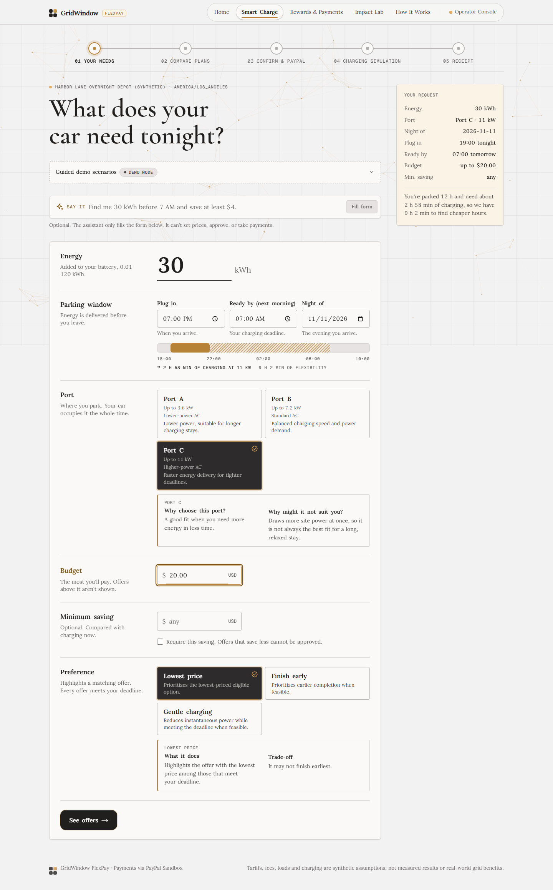
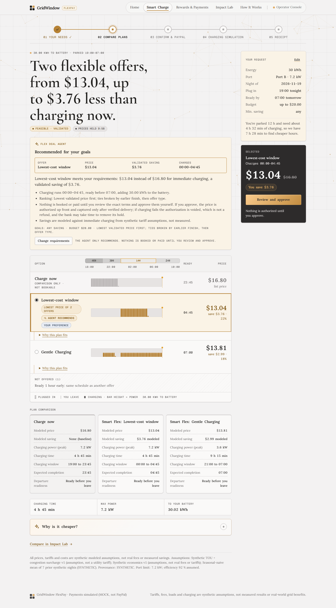
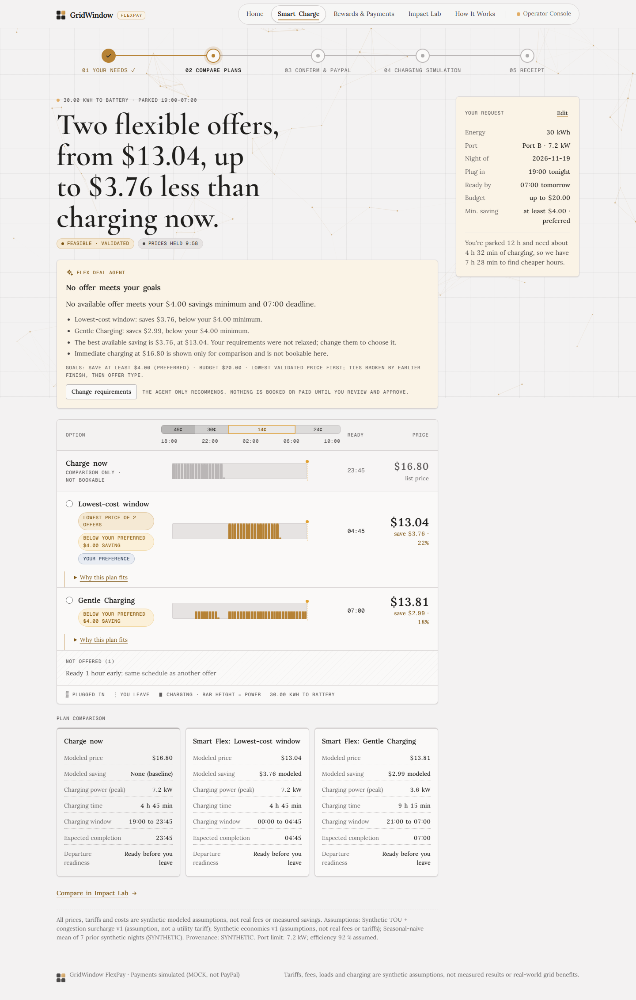
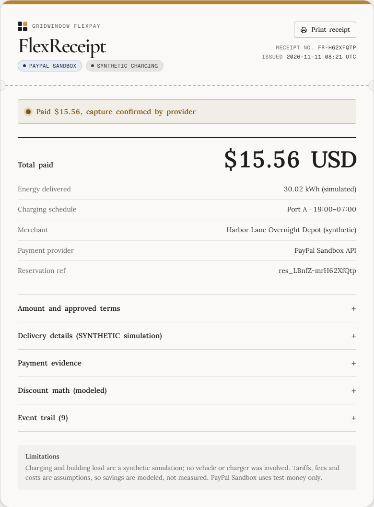
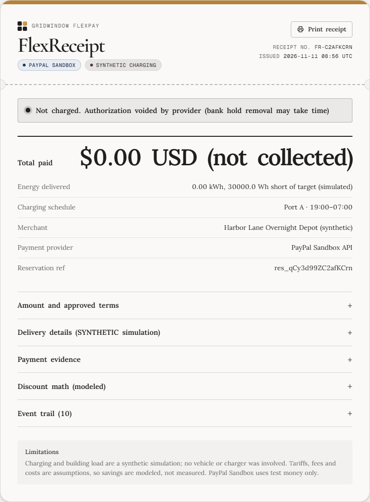
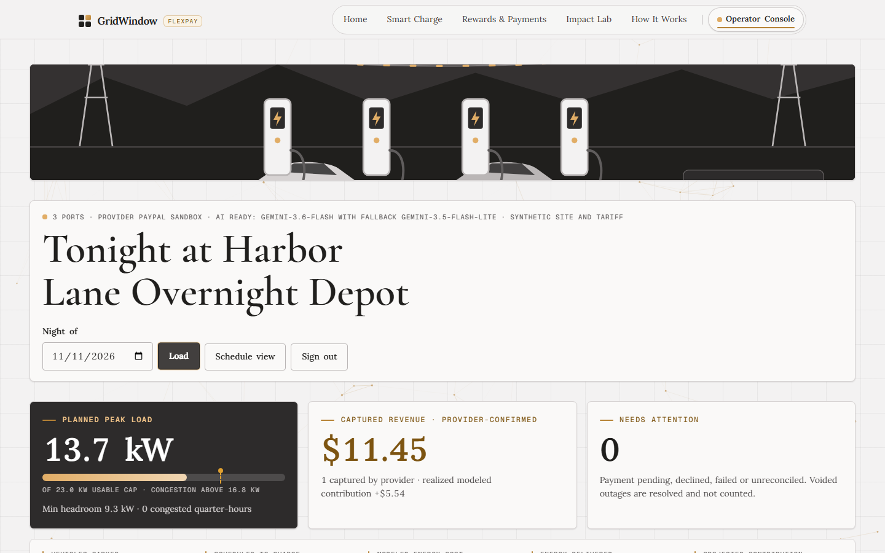
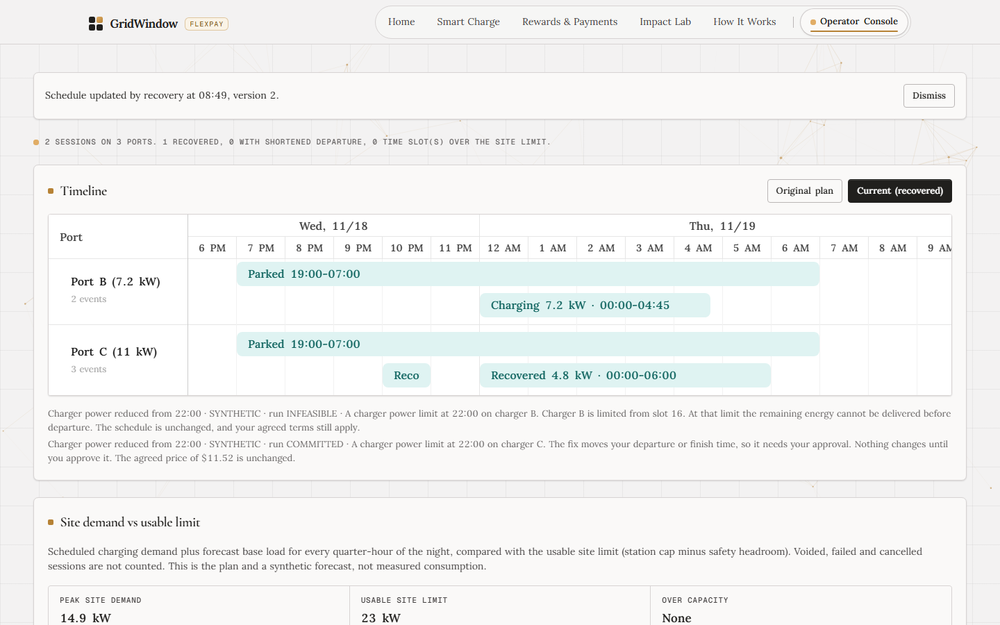

<div align="center">

# GridWindow FlexPay | Judge Guide

### Start with the live product. Follow one charging promise from offer to settlement.

**[Launch the live app](https://gridwindow-flexpay.onrender.com/)** · **[Smart Charge](https://gridwindow-flexpay.onrender.com/drive)** · **[Operator Console](https://gridwindow-flexpay.onrender.com/operator)** · **[API Developer Portal](https://gridwindow-flexpay-developers.onrender.com/)**

**Demo video:** [Watch on YouTube](https://youtu.be/eGmMA1O4EXU)

<sub>Latest release: [v1.0.2](https://github.com/piyusha-sayal/gridwindow-flexpay/releases/tag/v1.0.2) | PayPal Sandbox test funds | Synthetic charging and grid conditions</sub>

</div>

---

## Start here: three things to know

1. **No installation is required.** The [hosted application](https://gridwindow-flexpay.onrender.com/) and [API portal](https://gridwindow-flexpay-developers.onrender.com/) are public. Render's free tier may need up to a minute to wake after inactivity.
2. **The payment provider is real, the money is not.** On the hosted site, PayPal Sandbox handles authorizations, captures and voids using test funds. Charging, building load, tariffs and disturbances are labeled synthetic simulations. Local automated tests use a separate MOCK provider.
3. **AI does not control the deal.** Gemini assists with requests and explanations, with model and deterministic fallbacks. The server validates charging schedules, sets prices, enforces consent and controls settlement. The model that answered is recorded in the application response.

## 1. The three-minute evaluation route

This route works best with the operator passphrase and a PayPal Sandbox buyer account from the **private Devpost testing instructions**. The public portions need neither.

| Time | Where to go | What to demonstrate |
| :--- | :--- | :--- |
| **0:00 to 0:20** | [Home](https://gridwindow-flexpay.onrender.com/) | Drag the ready-by slider. The modeled charge price responds to timing. |
| **0:20 to 0:50** | [Smart Charge](https://gridwindow-flexpay.onrender.com/drive) | Type a charging request, press **Fill form**, then **See offers**. Compare server-validated windows and the deal agent's explanation. |
| **0:50 to 1:15** | Offer review and PayPal | Open the exact terms, check consent and proceed to Sandbox. Return to the reservation showing **Authorized, not captured**, if a buyer account is available. |
| **1:15 to 1:35** | [Operator Console](https://gridwindow-flexpay.onrender.com/operator) | Use AG Grid to inspect provider labels and payment states. Filter **Needs attention only** and export CSV. |
| **1:35 to 2:15** | **Night of November 12, 2026** | Open **Recorded disturbances**. Show a driver-approved recovery and an infeasible operator-attributed recovery, then compare schedule versions in Bryntum. Then open **November 25** to see an infeasible recovery that moved no money. |
| **2:15 to 2:40** | FlexReceipt and payment status | Show provider-confirmed capture after delivery and void after an eligible failure. Explain why Step 6 waits for confirmed settlement. |
| **2:40 to 3:00** | [Rewards](https://gridwindow-flexpay.onrender.com/rewards) and [Developer Portal](https://gridwindow-flexpay-developers.onrender.com/) | Show live Channel3 gear and APIMatic's typed API documentation. Mention the MCP agent's human approval boundary. |

**If you only have public access:** complete the Home, Smart Charge, Rewards, Impact Lab and developer portal steps in [Section 2](#2-explore-without-credentials). Use the screenshots and evidence nights below to understand the protected workflow without guessing its outcome.

---

## 2. Explore without credentials

### A. Try the driver experience

1. Open **[Smart Charge](https://gridwindow-flexpay.onrender.com/drive)**.
2. In **SAY IT**, enter: `Find me 30 kWh before 7 AM and save at least $4`.
3. Select **Fill form**, check the energy, port, times and budget, then select **See offers**.
4. Inspect the recommended offer, cost comparison and the explanation of why it qualifies.
5. If the savings target cannot be met, the deal agent should explain that rather than silently relax it. For a broader comparison, try `Find me 30 kWh before 7 AM` without the required savings minimum.
6. Open **Review and approve**. The terms identify the merchant, authorized amount, time window and expiry. You may proceed to the PayPal Sandbox login page, but **do not approve a checkout without your own Sandbox buyer account**.

The latest `v1.0.2` release adds an **MCP guidance link** when SAY IT cannot handle a requested action. An MCP-connected agent can compare offers and prepare checkout, but only the driver can approve the payment.

<div align="center">

<a href="evidence/final-release-2026-11-11/01-product/03-smart-charge-request.png"></a>

<sub>Driver inputs are checked by the server before an offer is shown.</sub>

</div>

<details>
<summary><strong>View validated offers and the unmet-savings-goal example</strong></summary>

<table>
<tr>
<td align="center" width="50%" valign="top"><strong>Validated charging offers</strong><p><a href="evidence/final-release-2026-11-11/01-product/05-validated-charging-offers.png"></a></p><sub>Local synthetic test with deterministic fallback</sub></td>
<td align="center" width="50%" valign="top"><strong>Required savings are not relaxed</strong><p><a href="evidence/final-release-2026-11-11/01-product/05b-savings-goal-not-relaxed.png"></a></p><sub>The constraint is explained instead of ignored</sub></td>
</tr>
</table>

</details>

### B. Explore public product and developer pages

| Page | What to inspect |
| :--- | :--- |
| [Home](https://gridwindow-flexpay.onrender.com/) | Ready-by slider, modeled prices and the product journey |
| [Rewards & Payments](https://gridwindow-flexpay.onrender.com/rewards) | **Spend your savings** product cards sourced from Channel3; modeled savings are not cash payouts |
| [Impact Lab](https://gridwindow-flexpay.onrender.com/impact-lab) | Synthetic benchmark of 500 seeded nights and 1,500 charging requests |
| [How It Works](https://gridwindow-flexpay.onrender.com/how-it-works) | Charging, consent and settlement walkthrough |
| [Developer Portal](https://gridwindow-flexpay-developers.onrender.com/) | APIMatic OpenAPI reference, request examples and TypeScript SDK documentation |
| [OpenAPI specification](openapi.yaml) | The API contract used by the portal and developer integrations |

---

## 3. Complete checkout with a Sandbox buyer account

A **PayPal Sandbox personal buyer account** is needed to authorize a test payment. The login may be provided in private Devpost testing instructions, or you can create your own in the [PayPal Developer Dashboard](https://developer.paypal.com/dashboard/) under Testing Tools and Sandbox Accounts.

1. Choose an eligible offer on Smart Charge and review its **exact terms**.
2. Select the consent checkbox and **Approve $X with PayPal Sandbox**.
3. Sign in as a **Sandbox buyer**, approve the test transaction, and return to the reservation.
4. Check the initial state: **Authorized, not captured**. This is a hold, not a completed charge or escrow.
5. Select **Run the synthetic overnight charge** on your own reservation.
6. When PayPal confirms the capture, open **FlexReceipt** to inspect approved terms, synthetic delivered energy and provider-confirmed settlement.

A failed synthetic service can follow the void path instead. Do not assume every disturbance is recoverable or that every session must capture.

### Two provider-confirmed outcomes

<table>
<tr>
<td align="center" width="50%" valign="top"><strong>Energy delivered, capture confirmed</strong><p><a href="evidence/final-release-2026-11-11/02-paypal/06-flexreceipt.png"></a></p><sub>30.02 kWh synthetic delivery and $15.56 Sandbox capture</sub></td>
<td align="center" width="50%" valign="top"><strong>Eligible failure, authorization voided</strong><p><a href="evidence/final-release-2026-11-11/02-paypal/08-zero-charge-receipt.png"></a></p><sub>$0.00 collected; the bank's hold release can take additional time</sub></td>
</tr>
</table>

Every payment proof identifies its source: **`PAYPAL_SANDBOX_API`** for a real Sandbox API outcome, or **`MOCK_PROVIDER`** for a local simulation. We do not count MOCK results as PayPal transactions.

---

## 4. Operator access: inspect stored evidence, not just screenshots

The operator console is **[here](https://gridwindow-flexpay.onrender.com/operator)**. The passphrase is intentionally not public; find it in the **private Devpost testing instructions**.

After signing in, use the **Night of** picker to inspect these preloaded nights. These are **reservation dates**, not necessarily the dates the tests were performed.

| Reservation night | What to open | What it demonstrates |
| :--- | :--- | :--- |
| **November 10, 2026** | AG Grid reservations and payment status | 11 reservations: 10 PayPal Sandbox and one clearly labeled MOCK. Provider-confirmed capture ending `…H62XfQtp`. Try payment sorting, **Needs attention only**, and **Export CSV**. |
| **November 12, 2026** | **Recorded disturbances** and **Schedule view** | Provider-confirmed void ending `…C2afKCrn`. Two other Sandbox reservations went through recovery: a driver-approved commit followed by capture, and an infeasible operator-attributed disturbance followed by void. |
| **November 14, 2026** | Automatic recovery and its seven-step checklist | A recovery committed within preapproved bounds. Payment remains **Authorized**, so the financial step correctly shows **Waiting** rather than Done. |
| **November 23, 2026** | **Recorded disturbances** | Driver-approved recovery and capture on reservation `res_42W3op4GUph4lqbj`: schedule version **2**, 30.015 kWh synthetic delivery, and a PayPal Sandbox **capture of $13.04** confirmed by provider read-back and a verified webhook. |
| **November 25, 2026** | **Recorded disturbances** | Infeasible recovery with unknown fault attribution on reservation `res_cg6ud43I8hjE8VfM`. The app required operator resolution and moved no money: the $13.03 authorization is held, with nothing captured or voided. |

### November 12: the two recovery cases to compare

| Scenario | Stored evidence | Financial result |
| :--- | :--- | :--- |
| **Driver approves a new plan** | Synthetic disturbance; new consent requested and granted; schedule version **2** committed; 30.015 kWh synthetic energy delivered. Reservation ending `…n-qKqgUM`. | PayPal Sandbox **capture completed**, confirmed by provider read-back and verified webhook. |
| **No feasible repair** | Operator-attributed synthetic disturbance; validator returned **INFEASIBLE**. Reservation ending `…kfgzxjBp`. | PayPal Sandbox **authorization voided**, with nothing captured. |

Both scenarios were exercised on **November 11, 2026**, using reservations for the night of November 12. The financial outcomes were read back from PayPal Sandbox.

### An infeasible recovery is not a void: November 12 versus November 25

| Scenario | Stored evidence | Financial result |
| :--- | :--- | :--- |
| **Infeasible, operator recorded as responsible** | Synthetic charger disturbance with fault attribution **OPERATOR**; the validator returned **INFEASIBLE**. Reservation ending `…kfgzxjBp` (night of November 12). | The app marked the service failed, and PayPal Sandbox **voided the authorization** nine seconds after the disturbance was recorded. Nothing captured. |
| **Infeasible, cause not recorded** | Synthetic charger disturbance with fault attribution **UNKNOWN**; the validator returned **INFEASIBLE**, and the schedule stays at version 1. Reservation `res_cg6ud43I8hjE8VfM` (night of November 25). | The app recorded **OPERATOR_RESOLUTION_REQUIRED** and moved no money: the $13.03 authorization is **held**, with **$0.00 captured** and nothing voided. Step 6 shows **Waiting**. |

The recovery result does not decide the money. The settlement policy voids automatically only for a confirmed operator failure, meaning attribution **OPERATOR** plus a conclusive recovery result. **UNKNOWN**, **DRIVER** and **EXTERNAL** never void or capture automatically; an operator has to decide. The November 25 row is the state we read back at 01:16 UTC on November 12, 2026. The older **Inject outage** action is a separate workflow (nothing is delivered, so the authorization is voided), and the server refuses it while a recorded disturbance has outdated the schedule and no valid recovery is committed. Full timelines: [EVIDENCE.md](EVIDENCE.md#two-more-recovery-runs-and-why-an-infeasible-recovery-is-not-a-void-2026-11-12-utc).

### Inspect the complete recovery trace

1. In the operator console, load **November 12, 2026**.
2. Find the matching reservation under **Recorded disturbances**.
3. Open its stored run and follow the **seven recovery steps**. Check the disturbance, validated candidates, consent decision, committed plan and financial state.
4. Select **Schedule view**. The Bryntum timeline opens the night currently loaded in the operator dashboard.
5. Switch between **Original plan** and **Current (recovered)**. Pending proposals remain distinct from committed allocations.
6. Change **Night of**, press **Load**, then refresh or use Back/Forward. The chosen night should persist without showing sessions from a different date.
7. Check Step 6 (**Financial outcome**): **Done** only after provider-confirmed capture or void; **Waiting** for authorization or pending settlement; **Stopped** for failed or cancelled payment paths.

<div align="center">

<a href="evidence/final-release-2026-11-11/03-operator-ag-grid/01-operator-dashboard.png"></a>

<sub>Operator dashboard with reservation, site and payment information</sub>

<a href="evidence/final-release-2026-11-11/04-bryntum-recovery/07-updated-bryntum-schedule.png"></a>

<sub>Recovered schedule example from an isolated synthetic scenario</sub>

</div>

**Please leave the preloaded evidence reservations unchanged.** For hands-on fault injection, create your own booking and use its **Recovery engine** panel. The older **Inject outage** action and the newer recorded-disturbance recovery flow are different workflows, and the server refuses **Inject outage** on a reservation that a recorded disturbance has outdated until a valid recovery is committed.

---

## 5. What to look for in the implementation

| Area | Evidence of implementation |
| :--- | :--- |
| **Charging constraints** | 15-minute scheduling, 24 kW shared site cap, 3.6 / 7.2 / 11 kW ports, building load, occupancy and deadline checks |
| **Commercial terms** | Server-priced offers, explicit consent, immutable approved terms and provider/payee verification |
| **PayPal** | Sandbox authorization, capture and void, signed webhooks, idempotency, reconciliation and provider read-back |
| **Autonomous recovery** | Stored disturbances, deterministic candidate validation, fault attribution, consent and versioned schedules |
| **Bryntum** | Original versus current plan, a separate proposal lane and date-driven schedule navigation |
| **AG Grid** | Payment status sorting, Needs attention filter, reservation detail and CSV export |
| **Gemini and OpenRouter** | Bounded request interpretation and explanation with provider attribution and deterministic fallback |
| **MCP** | Seven tools that can discover offers and prepare checkout but cannot authorize or settle payment |
| **Channel3** | Live EV accessory products in Rewards and an MCP gear-search tool |
| **APIMatic** | Public developer portal and TypeScript SDK generated from the OpenAPI contract |
| **Render** | Live application and developer portal, available without installing the project |

### Measured in the synthetic benchmark

The optimizer was evaluated over **500 seeded nights and 1,500 requests** under matched synthetic assumptions.

| Policy | Served | Mean modeled cost per served session | Mean site peak |
| :--- | ---: | ---: | ---: |
| Immediate charging | 1,246 | $10.61 | 22.1 kW |
| Static off-peak | 1,024 | $6.01 | 20.2 kW |
| Greedy cheapest tariff | 1,243 | $6.86 | 21.9 kW |
| **GridWindow optimized** | **1,254** | **$5.44** | **17.6 kW** |

Against immediate charging, this is **48.7% lower modeled cost per served session** and **20.4% lower mean site peak**. It serves only **eight more** requests than immediate charging. There were **125 unfavorable pairwise cost comparisons** and **246 physically infeasible requests** for the optimized policy. These are simulation results, not measured operational savings.

---

## 6. Run the application locally

Local evaluation needs **Node.js 22+** and Git, but **no PayPal, AI or hosted-database credentials**. It uses the embedded PGlite database, synthetic charging and the separate MOCK payment provider. The first build downloads fonts, so an initial internet connection is needed.

<details open>
<summary><strong>macOS, Linux or Git Bash</strong></summary>

```bash
git clone https://github.com/piyusha-sayal/gridwindow-flexpay.git
cd gridwindow-flexpay
npm ci
npm run build

PAYMENT_MODE=mock PAYPAL_ENV=sandbox DEMO_TOOLS=true \
APP_BASE_URL=http://localhost:3000 \
SESSION_SECRET=local-demo-session-secret-change-me-0123456789 \
OPERATOR_PASSPHRASE=local-demo-operator \
npm start
```

</details>

<details>
<summary><strong>Windows PowerShell</strong></summary>

```powershell
git clone https://github.com/piyusha-sayal/gridwindow-flexpay.git
cd gridwindow-flexpay
npm ci
npm run build

$env:PAYMENT_MODE="mock"
$env:PAYPAL_ENV="sandbox"
$env:DEMO_TOOLS="true"
$env:APP_BASE_URL="http://localhost:3000"
$env:SESSION_SECRET="local-demo-session-secret-change-me-0123456789"
$env:OPERATOR_PASSPHRASE="local-demo-operator"
npm start
```

</details>

### Local walkthrough

1. Open `http://localhost:3000/operator`, sign in with `local-demo-operator` and select **Seed background drivers**.
2. Open `http://localhost:3000/drive`, request a charge and approve the offer through the clearly labeled **MOCK checkout**.
3. On your reservation, select **Run the synthetic overnight charge** and inspect the FlexReceipt.
4. Back in the operator console, use **Inject outage** on an appropriate seeded reservation to inspect a void, or use the reservation's **Recovery engine** panel to record a synthetic disturbance and follow its separate recovery trace.
5. Use **Reset demo data** to start over. Alternatively, stop the application before deleting the local `.data/` directory.

The local placeholder secrets above are not appropriate for a public deployment. The application refuses any `PAYPAL_ENV` other than `sandbox`.

---

## 7. Reproduce the verification

```bash
npm run typecheck
npm run lint
npm test
npm run build
npx playwright install chromium
npm run test:e2e
npm run benchmark
npm run benchmark:recovery
npm run release:scan
```

| Release evidence | Recorded outcome |
| :--- | :--- |
| Vitest | **1,023 passed**, 12 skipped, 0 failed |
| Playwright | **114 desktop + 14 mobile + 3 tablet = 131 passed**, 6 skipped, 0 failed |
| TypeScript, ESLint and production build | Passed |
| Release secret scan and generated SDK typecheck | Passed |
| GitHub Actions | CI passed on the submitted release |
| PayPal Sandbox | Hosted capture and void, including settlement after recorded recovery |
| `v1.0.2` Smart Charge MCP guidance | 47 targeted unit tests and 8 targeted browser checks passed; live feature verified |

The main automated suites run in isolation with a MOCK provider and disposable data. They do not call PayPal or an AI provider. The 12 skipped Vitest cases require a disposable external PostgreSQL database; the six browser skips cover keyboard journeys excluded from smaller-device runs. The `v1.0.2` targeted results are **not added to the earlier full-suite total**.

[**View the latest GitHub release**](https://github.com/piyusha-sayal/gridwindow-flexpay/releases/tag/v1.0.2) · [**Inspect CI runs**](https://github.com/piyusha-sayal/gridwindow-flexpay/actions)

---

## 8. Limits and interpretation

- **Charging is simulated.** Vehicle behavior, energy delivery, base load, tariffs, forecasts and disturbances are synthetic; modeled savings are not measured utility-bill reductions.
- **Sandbox is not live money.** PayPal Sandbox uses real provider APIs with test funds. MOCK is an entirely separate local provider.
- **AI does not promise a final model decision.** Gemini has driven live recovery tool steps, but provider capacity errors caused the deterministic path to make the final decision in those recorded runs. The workflow records which path made each decision.
- **Not every recovery is feasible.** Some requests cannot be repaired under the physical limits or consent bounds; the system should report that rather than fabricate a schedule.
- **Bryntum has vendor accessibility findings.** The accessible table below the timeline presents the same scheduling data. In half-hour time zones, some timeline axis ticks follow browser-local hours.
- **Settlement reconciliation is background work.** The sweep runs every five minutes; there is no manual button for it.
- **Operator access is demonstration-grade.** A shared passphrase and pseudonymous driver sessions are not production identity management.
- **External free tiers can limit availability.** Render can sleep when idle, and Gemini may reach its quota. The deterministic fallback preserves the basic charging flow.

---

<div align="center">

### What to remember

**A driver approves one charging promise. GridWindow checks feasibility, repairs disruptions only within permitted bounds, and settles against recorded delivery rather than an AI's assertion.**

[**Launch GridWindow**](https://gridwindow-flexpay.onrender.com/) · [**Open the operator console**](https://gridwindow-flexpay.onrender.com/operator) · [**Explore the developer portal**](https://gridwindow-flexpay-developers.onrender.com/) · [**Back to top**](#gridwindow-flexpay--judge-guide)

<sub>GridWindow FlexPay | PayPal Sandbox test funds | Synthetic charging | Public GitHub repository</sub>

</div>
